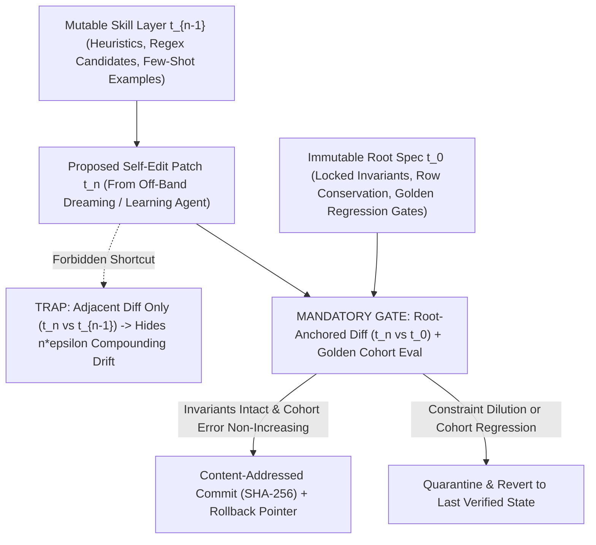

# Dossier 07 — Posts Context: Operator Strategy, Reliable Agentic Systems & Output Trust

- **Dossier Path:** `documentation/02_dossiers/07_posts_context_dossier.md`
- **Master Index:** [00_MASTER_INDEX.md](../00_MASTER_INDEX.md)
- **Methodology & Charter:** [00_CHARTER_AND_METHODOLOGY.md](../00_CHARTER_AND_METHODOLOGY.md)
- **Covered Corpus Slice:** `DOC-024` (Tier A), `DOC-025` (Tier S), `DOC-026` (Tier S) — `1,037` source lines (`54` distinct posts/segments across three curated practitioner anthologies)
- **Target Architecture:** `DataForge` (`dataforge/agent/controller.py`, `dataforge-mcp/dataforge_mcp/tools.py`, `dataforge/calibration/`, `dataforge/attestation/`) evaluated on active tabular benchmarks (`hospital`, `flights`, `rayyan`, `tax`)

---

## Executive Synthesis: The Practitioner Triad Governing Production Agentic Data Systems

The three anthologies archived under `01_sources/Posts Context/` capture front-line 2025–2026 engineering and commercial telemetry from builders operating autonomous systems in production (Anthropic, Cursor, Microsoft Research, Google DeepMind, Atlassian, Wispr Flow, Razorpay, Swiggy, Schema VC, and Kita). Read as a unified engineering treatise, they establish three non-negotiable laws for `DataForge`:

1. **Commercial & Governance Sovereignty (`DOC-024`, Tier A):** Model weights are a commoditizing substrate; durable enterprise alpha compounds inside the **enterprise-owned learning loop** (Satya Nadella's *Reverse Information Paradox*), governed by artifact-driven gates (*"Skills encode policy, hooks enforce it"*) and interactive **MCP Apps** rather than raw chat prose. In high-exposure enterprise data pipelines where social proof travels across data platform teams, `DataForge` sits squarely in **Lighthouse GTM territory**—meaning unblocking `design_partner_evidence: NOT MET` with 2–3 high-credibility reference deployments outweighs broad feature sprawl.
2. **Systems Plumbing & Drift Immunity (`DOC-025`, Tier S):** Production agents do not fail primarily from reasoning deficits; they die from **process OOMs**, **context-limit attention collapse (`32K` disciplined > `200K` uncurated)**, **blind retries into half-dead tools**, **inter-stage handoff loss (`5x` higher failure capture via an independent Observer Agent)**, and **Ship-of-Theseus specification drift** when self-editing skills are diffed against `t_{n-1}` instead of the immutable `t_0` root contract. Meanwhile, **Microsoft `Sutradhara`** (`-10%` E2E latency via incremental streaming tool dispatch) and **Cursor's dynamic MCP discovery** (`-46.9%` total agent tokens via lazy schema hydration) provide immediate quantitative blueprints for `dataforge-mcp/dataforge_mcp/tools.py`.
3. **Semantic Verification & Surface-Area Compression (`DOC-026`, Tier S):** Because an LLM pipeline routinely returns `HTTP 200 OK` while silently corrupting semantics (e.g., spontaneously transliterating English into Hindi), transport telemetry cannot establish data trust. Reliability requires **Ariya Rastrow's cohort-stratified evals** (hunting `30%`-error frontier slices while regression-locking `<=5%`-error slices across subpopulations) combined with **Kita's Determinism Law**: *never force a stochastic model to execute deterministic policy; shrink the probabilistic surface area strictly to messy-input interpretation, materialize explicit validated facts, and execute `100%` of state mutations in deterministic DuckDB/Python code.*

```mermaid
flowchart LR
    subgraph L1["DOC-024: Sovereign Enterprise Harness"]
        P1["Artifact Gates (intent -> spec -> plan -> commit)"]
        P2["Policy in SKILL.md + Deterministic Enforcement Hooks"]
        P3["Owned Learning Loop (Private Evals, Audit, Routing)"]
    end
    subgraph L2["DOC-025: Systems Runtime & Drift Guardrails"]
        S1["Lazy MCP Schema Hydration (-46.9% Tokens)"]
        S2["DAG Topological Sort + Hard Timeouts + Circuit Breakers"]
        S3["Root-Anchored Diffing (t_0 vs t_n) + Observer Agent (5x Catch)"]
    end
    subgraph L3["DOC-026: Kita Surface-Area Law & Cohort Calibration"]
        E1["LLM Surface: Parse Ambiguous Messy Schema/Strings Only"]
        E2["Explicit Typed Repair IR + Cohort-Sliced Validation"]
        E3["Deterministic DuckDB Execution + Cryptographic Attestation"]
    end
    L1 --> L2 --> L3
```



---

## DOC-024 — AI Business, Industry, and Perspectives (28-Post Operator Anthology)

### 24.1 Provenance, Speakers & Relevance Tier

- **Archived Source:** [ai-business-industry-and-perspectives.md](../01_sources/Posts%20Context/ai-business-industry-and-perspectives.md) (`458` lines; `31` `---`-delimited blocks comprising **28 AI/operator posts** across Lines 3–392 plus **3 corrupted electric-motorcycle hardware posts** across Lines 396–458)
- **Document Format:** Multi-author LinkedIn/essay curation spanning July 2025 – July 2026
- **Named Voices & Primary Sources:**
  - **Paul Graham** (Y Combinator co-founder, *"How to Earn a Billion Dollars"*, Lines 3–7)
  - **Aakash Gupta** & **Venture Studio Operator** (AI-native PM vs. Engineer split, Lines 11–33)
  - **Michael Truell** (Co-founder & CEO, Cursor / Anysphere) & **Martin Casado** (General Partner, a16z, *a16z Runtime 2025*, Lines 37–57)
  - **Mark Zuckerberg** (Founder & CEO, Meta, July 2026 *Wall Street Journal* op-ed *"The AI Future Is for Everyone"*, analyzed by a VC operator, Lines 61–74)
  - **Joe Schmidt IV & Julian Marx** (*Lighthouse vs. Landgrab* enterprise AI GTM framework, Lines 78–92)
  - **Sarvaswa AI Labs** (*Decoder* fine-tuning pitch, Lines 110–117)
  - **Satya Nadella** (Chairman & CEO, Microsoft, July 2026 *Reverse Information Paradox* essay, synthesized by **Aarthi** at **Schema VC**, `aarthi@schemavc.com`, Lines 121–129)
  - **Anthropic Applied AI Team** (*Founder's Playbook* & *The AI-Native SDLC*, Lines 133–147)
  - **Boris Cherny** (Member of Technical Staff & Creator of Claude Code, Anthropic, *Steps of AI Adoption* 0–4 ladder, Lines 151–163)
  - **Papers with Code / Ruben Casas** (*MCP Apps* & *Excalidraw Visual Explainers*, Lines 167–191)
  - **Mike Cannon-Brookes** (Co-founder & CEO, Atlassian, Shareholder Letter & *The Information* report by **Laura Bratton, Aaron Holmes & Kevin McLaughlin** on *Atlassian Teamwork Graph*, Lines 195–201)
  - **Niklas Gruhn** (*"Don't be a meat proxy"*, cited Lines 265–273) & **Yuval Noah Harari** (wisdom vs. cheap intelligence, Lines 300–306)
  - **Sahaj Garg** (Co-founder & CTO, Wispr Flow, `90%` AI-written production code serving `1M+` users, Lines 324–352)
  - **Bay Area / Hyderabad Operator Synthesis** (`95%` vertical AI accuracy flip, Observe.ai weekly shipping, first `` `$2M` `` from strangers, Lines 356–380) & **HSBC / Jo Miyake** (trust principles, Lines 384–392)
  - **Quarantined Tail Contamination:** Orphaned 1-line bio stub of **Aakriti Aggarwal** (AI Researcher, IBM Research, Line 396) fused onto three **650V electric motorcycle OEM** engineering posts (Lines 398–458)
- **Relevance Tier:** **Tier A** — High-leverage architectural governance (*"Skills encode policy, hooks enforce it"*, Boris Cherny's worktree/guardrail ladder, MCP Apps inline visual cards, Atlassian graph token compression, Nadella's enterprise learning-loop sovereignty) and decisive GTM framing (*Lighthouse vs. Landgrab*, `95%` vertical adoption threshold) directly governing how `DataForge` packages its engine and unblocks `design_partner_evidence: NOT MET`.

---

### 24.2 Complete Line-by-Line Inventory & First-Principles Technical Extraction

#### Complete 31-Block Structural Map (28 Valid AI Posts + 3 Quarantined EV Hardware Posts)

| Block | Lines | Primary Voice / Source | Core Technical or Strategic Mechanism | Signal Grade |
| :--- | :--- | :--- | :--- | :--- |
| **01** | `3–7` | Paul Graham | Conscious "startup idea hunting" filters out non-consensus outliers; build ambitious organic projects first. | Medium |
| **02** | `11–33` | Venture Studio Partner (re: Aakash Gupta) | Claude Code prototyping is table stakes. **Product alpha = Taste + Evals; Business alpha = Distribution** (who pays, workflow anchor, post-demo retention). | **High** |
| **03** | `37–47` | Michael Truell w/ Martin Casado | AI software automation has only hit its "iPod moment"; a long, messy engineering middle remains before true autonomy. | Medium-High |
| **04** | `51–57` | Martin Casado on Cursor | Cursor founders spend `30–40%` of time on hiring/culture and win by operating as a **product company**, not an academic model-architecture lab. | **High** |
| **05** | `61–74` | Mark Zuckerberg (July 2026 WSJ Op-Ed) | **Pluralistic Alignment Law:** Humanity has no single objective utility function; concentrating alignment in one monolithic lab encodes arbitrary preferences. | **High** |
| **06** | `78–92` | Joe Schmidt IV & Julian Marx | **Lighthouse vs. Landgrab GTM Matrix:** High buyer exposure + transferable social proof = **Lighthouse** (win reference logos); low exposure + local ROI = **Landgrab** (math + territory coverage). | **Critical** |
| **07** | `96` | Enterprise Triage Maxim | *"AI handles the standard, so our human experts can master the complex."* Maps directly to confidence-stratified data repair routing. | Medium |
| **08** | `100` | Model-Agnostic Moat Maxim | Founders must own eval suites and workflow telemetry so model providers remain hot-swappable commodities. | **High** |
| **09** | `104–106` | `bolt.new` Principle | First-principles logical compass beats Silicon Valley herd consensus. | Low-Medium |
| **10** | `110–117` | Sarvaswa AI Labs | Vendor pitch claiming API usage is "renting intelligence" and advocating universal weight fine-tuning (`[VENDOR-SELF-REPORTED]`). | Trap / Cautionary |
| **11** | `121–129` | Satya Nadella / Aarthi (Schema VC) | **Reverse Information Paradox:** Unlike Arrow's 1962 seller risk, AI *buyers* leak operational IP via prompts, workflows, and human error corrections unless they own private evals, routing, memory, and audit trails. | **Critical** |
| **12** | `133–135` | Anthropic (*Founder's Playbook*) | Execution cost collapse shifts founder bottleneck from *how to build* to *what is worth building*. | Medium |
| **13** | `139–147` | Anthropic Applied AI (*AI-Native SDLC*) | Collapsing build from days to hours moves the bottleneck to plan/review/test/deploy. Stage-gate artifacts (`intent.md` -> `spec.md` -> `plan.md` -> `PR`); ***"Skills encode policy, hooks enforce it."*** | **Critical** |
| **14** | `151–163` | Boris Cherny (Anthropic) | **0–4 AI Adoption Ladder:** Tokens do not advance teams; guardrails do—end-to-end self-verification, bounded auto-permissions, automated code/security review, `/loop`, `/batch`, **git worktree isolation**, and counterfactual eng-hour ROI tracking. | **Critical** |
| **15** | `167–191` | Papers with Code / Ruben Casas | **Bimodal Web & MCP Apps:** Web splits into high-craft human 3D UX vs. lossless machine Markdown/MCP; utilitarian middle becomes **just-in-time HTML cards rendered inline via MCP Apps**. | **Critical** |
| **16** | `195–201` | Mike Cannon-Brookes (Atlassian) | **Teamwork Graph:** Explicit relational graph over enterprise entities lets Codex and Claude Code resolve context while burning **dramatically fewer tokens**. | **High** |
| **17** | `205–227` | Engineering Docs Practitioner | Action-oriented docs (`Run npm install` > passive prose) structured by reader persona eliminate recurring synchronization meetings. | Medium |
| **18** | `231–237` | Platform Engineering Essay | Organizational drag stems from information discovery and bureaucracy; codifying discovery into standardized company Claude skills unlocks trapped throughput. | Medium-High |
| **19** | `241–243` | Token Burn Diagnostic | *"Most Claude tokens are not spent on production workloads or writing code. They are burned on info discovery because someone was too lazy to document their findings."* | **High** |
| **20** | `247–261` | 2026 Builder Reflection | Coding skill in 2026 = rigorous specification, catching flawed agent assumptions, and anti-slop verification mechanisms. | Medium-High |
| **21** | `265–273` | Niklas Gruhn Citation | *"Don't be a meat proxy"* — engineers who forward prompts without critical judgment or outcome ownership add zero value. | Medium |
| **22** | `277–282` | Craft Compounding | Curiosity, learning velocity, craft obsession, and open knowledge sharing compound over decades. | Low |
| **23** | `286–296` | Aviation Checklist Analogy | Top-10% outcome analysis distilled into mandatory pre-flight checklists reproduces reliability regardless of operator fatigue. | Medium |
| **24–26** | `300–320` | Yuval Harari Reflection + Fragments | Cheap intelligence makes wisdom the bottleneck; risk of passive human observation when systems outpace comprehension (plus Line 320 truncated 7-word ESG fragment). | Medium |
| **27** | `324–352` | Sahaj Garg (CTO, Wispr Flow) | `0` manual lines written since Dec; `90%` of new code serving `1M+` users written by `5–10` parallel agents. Engineering = (1) Problem Spec (`50 agent-hours` wasted on fuzzy specs), (2) Architecture (AI scales bad state boundaries faster), (3) Diff QA (*"almost right in prod is a bug"*), (4) Root-cause vs. symptom-patch debugging. | **Critical** |
| **28** | `356–392` | Bay Area / Boomi Founder Notes + HSBC | **Five Vertical AI Survival Laws:** (1) **`95%` accuracy flip** (`85%` = `15%` customer cleanup tax; `95%` = rapid vertical takeover), (2) GTM/FDE moat & first `` `$2M` `` from strangers, (3) `3x` in-person meetings for `` `>$100K` `` deals, (4) ship weekly not quarterly (Observe.ai), (5) marry problem not plan. (Lines 384–392: HSBC trust principles). | **Critical** |
| **29–31** | `396–458` | **CORRUPTED:** Line 396 IBM stub + 650V EV Motorcycle OEM | **Quarantined Erratum (`[PROVENANCE-CONFLATION-FIXED]`):** Line 396 (`Aakriti Aggarwal, IBM Research`) concatenated onto three posts about `650V` electric motorcycle motor controllers, `15%` SoC thermal consistency, CCS2 charging, and `48V/72V` scooter BMS trade-offs. | **Quarantined** |

---

#### Deep Extraction of the Six Pillars in `DOC-024`

##### 1. Satya Nadella's *Reverse Information Paradox* & Enterprise Learning-Loop Sovereignty (Lines 100, 121–129)
In Kenneth Arrow's classic 1962 *Information Paradox*, the **seller** of information faced an asymmetric disclosure hazard: revealing secret information to prove its value to a prospective buyer handed the asset away for free. Satya Nadella (analyzed in Lines 121–129) identifies that frontier LLM APIs invert Arrow's polarity:
- **Mechanism of Value Leakage:** Every time an enterprise data team sends messy domain tables, schema constraints, domain prompts, and—most critically—**human steward rejections and corrections when the model errs**, that interaction trace encodes the enterprise's tacit operational logic. The buyer pays twice: once in API dollars, and once in operational epistemology (*"In consuming intelligence, you are creating intelligence. And what you create should belong to you"*, Line 125).
- **Why Naive Fine-Tuning (Block 10, Lines 110–117) Is the Wrong Cure:** Sarvaswa AI Labs pitches fine-tuning open weights as the universal answer. However, baking volatile enterprise data rules into static LoRA weights makes every policy change require a retraining cycle, destroys explainability, and locks the buyer out of frontier reasoning upgrades (violating Line 100: *"be able to switch the moment something better ships"*).
- **The True Sovereign Layer:** Durable enterprise infrastructure stores accumulated institutional intelligence in **explicit, model-agnostic symbolic structures** inside the customer's boundary: (a) versioned domain rules & `SKILL.md` policies, (b) private golden/regression evaluation slices, (c) human steward override logs (`dataforge/attestation/`), and (d) decoupled multi-model routing.

##### 2. Anthropic's AI-Native SDLC: *"Skills Encode Policy, Hooks Enforce It"* (Lines 139–163)
Blocks 13 and 14 expose a fundamental control-theory failure in naive agent deployments:
- **Queueing Bottleneck Migration (Line 139):** Compressing build execution from `3 days` to `2 hours` via agents does not accelerate end-to-end throughput if planning, review, testing, and governance still rely on synchronous human meetings. By Little's Law (\(L = \lambda W\)), work-in-progress piles up violently at the human review gate.
- **Artifact-Driven State Transitions (Line 143):** Anthropic replaces human hand-off meetings with typed, version-controlled stage artifacts (`intent.md -> spec.md -> plan.md -> PR`).
- **Policy vs. Enforcement Separation (Line 143):**
  - **Skills (`SKILL.md` / prompts)** are *advisory probabilistic priors*: they tell the LLM what policy looks like, reducing retries and guiding synthesis, **but an LLM can always ignore or hallucinate past a prompt**.
  - **Hooks (pre-commit / pre-execution deterministic interceptors)** are *non-bypassable Software 1.0 invariants*: they reject any tool call or state transition that violates schema invariants, row-loss thresholds, or permission boundaries with mathematical certainty.
- **Boris Cherny's Level 0–4 Progression & Counterfactual ROI (Lines 151–163):** Advancing from single-player autocomplete (Level 1) to parallel background autonomy (Level 4) requires **end-to-end self-verification environments** and **isolated sandboxes** (git worktrees for code; isolated ephemeral DuckDB schemas/transactions for `DataForge` subagents) plus measuring **counterfactual manual engineering hours saved** rather than vanity token-consumption dashboards.

##### 3. Pluralistic Alignment as Configurable Enterprise Policy (Lines 61–74)
Zuckerberg's third thesis in his July 2026 WSJ op-ed (Line 66, 70) carries a direct systems-engineering translation for data quality platforms: **there is no universal "clean" dataset independent of downstream consumer utility.** A hospital claims auditor (`hospital`), an aviation delay econometrician (`flights`), a systematic-review clinician (`rayyan`), and a statutory tax auditor (`tax`) hold incompatible loss functions regarding imputation vs. null preservation vs. record dropping. Hard-coding a single "universal cleaning aggressiveness" inside prompts violates pluralistic alignment; preferences must be parameterized per tenant/workflow via explicit risk tolerances and cost matrices.

##### 4. Enterprise AI GTM Physics: *Lighthouse vs. Landgrab* & The `95%` Flip (Lines 78–92, 356–377)
Combining Schmidt & Marx's GTM matrix (Lines 78–92) with the Bay Area Vertical AI synthesis (Lines 368–376) yields an exact commercial equation for `DataForge`:
- **Why `DataForge` Is a Lighthouse Product, Not a Landgrab Product:** Corrupting an enterprise analytics, clinical (`hospital`/`rayyan`), or financial (`tax`) table carries severe career and compliance exposure for the signing Head of Data (**High Buyer Exposure**), while data engineering architecture choices travel rapidly across peer reference networks (**High Social Proof Transfer**). Cold ROI calculators alone cannot close a Landgrab blitz when trust is the gating constraint; **winning 2–3 undeniable Lighthouse logos unlocks the market**.
- **The `85% -> 95%` Non-Linear Adoption Phase Transition (Line 368):** At `85%` cell/repair precision, a data engineer must manually audit `100%` of rows to hunt down the `15%` silent corruptions—meaning net human labor saved is near zero or negative. Crossing **`95%+` verified precision on auto-accepted slices** (by routing uncertain tail cells to abstention/quarantine via `dataforge/calibration/`) triggers the phase flip from "toy demo" to mandatory infrastructure.

##### 5. Bimodal Web, MCP Apps & Graph-Backed Context Compression (Lines 167–201, 241–243)
- **Token Starvation via Brute-Force Discovery (Lines 195–201, 241–243):** Without an explicit structural graph (analogous to Atlassian's *Teamwork Graph*), agents burn the majority of their token budget running blind exploratory queries (`SELECT *`, repetitive regex scans, schema guessing) merely to rediscover column semantics and foreign-key relationships.
- **MCP Apps as the Utilitarian Interface (Lines 173–191):** Raw Markdown chat tables fail when a human data steward must inspect distribution shifts, functional-dependency counterexamples, or conformal confidence bands. **MCP Apps** allow `dataforge-mcp` to return self-contained interactive HTML micro-views (diff heatmaps, cohort calibration curves, one-click quarantine overrides) directly inside Claude Desktop, Cursor, or IDE chat panes—eliminating the need to maintain a heavyweight standalone SaaS web portal before achieving design-partner product-market fit.

##### 6. Sahaj Garg's Root-Cause vs. Symptom-Patch Law (Lines 324–352)
At Wispr Flow (`90%` AI-generated production code across `1M+` users), CTO Sahaj Garg pinpoints the two deadliest failure modes of autonomous agents:
1. **Fuzzy Problem Specifications (`50 agent-hours -> nowhere`, Line 334):** Ambiguous objective functions cause multi-agent thrashing.
2. **Symptom Patching vs. Root-Cause Resolution (Line 346):** Left to optimize pass rates locally, an agent will silence a failing validation check by dropping offending rows, casting dirty numerics to `NULL`, or loosening regex assertions rather than fixing the upstream parsing/normalization rule!

---

### 24.3 Epistemic Verification & Errata Audit

| Audit Target | Lines | Epistemic Tag | Forensic Finding & Remediation |
| :--- | :--- | :--- | :--- |
| **IBM Bio Stub + 650V EV Motorcycle OEM Concatenation** | `396–458` | `[PROVENANCE-CONFLATION-FIXED]` | **Severe Scraper/Paste Splice Contamination:** Line 396 (`"Hi, I am Aakriti Aggarwal, AI Researcher at IBM Research"`) is an orphaned 1-line LinkedIn intro concatenated directly onto **three consecutive hardware engineering posts from an Indian `650V` electric motorcycle manufacturer** (covering `100%` vs. `15%` battery SoC throttle calibration, peak summer vs. December thermal control, in-house `650V` motor controller + BMS + CCS2 fast-charging architecture vs. off-the-shelf `48V/72V` scooter parts, and physical chassis feel vs. torque spreadsheets). **Action:** Quarantined `Lines 396–458` from all AI empirical citations; retained strictly as a structural analogy (tail-state predictability at `15%` SoC = tail-cohort reliability). |
| **Mark Zuckerberg WSJ Op-Ed (*"The AI Future Is for Everyone"*)** | `61–74` | `[VERIFIED-PRIMARY]` | Accurately summarizes Zuckerberg's July 2026 *Wall Street Journal* op-ed arguing for open/decentralized superintelligence empowerment and pluralistic alignment over centralized institutional paternalism. |
| **Satya Nadella's *Reverse Information Paradox*** | `121–129` | `[VERIFIED-PRIMARY]` | Accurately captures Nadella's July 2026 framing inverting Kenneth Arrow's 1962 *Information Paradox*: enterprise API consumers leak workflow/correction IP unless they own private evals, memory, routing, and orchestration. |
| **Anthropic *AI-Native SDLC* & Boris Cherny Adoption Ladder** | `139–163` | `[VERIFIED-PRIMARY]` | Authentic primary practitioner guidance from Anthropic Applied AI (`intent.md / spec.md / plan.md / PR`; *"Skills encode policy, hooks enforce it"*) and Claude Code creator Boris Cherny (`/loop`, `/batch`, git worktree isolation). |
| **Sarvaswa AI Labs Fine-Tuning Ownership Pitch** | `110–117` | `[VENDOR-SELF-REPORTED]` | Commercial content-marketing post promoting custom fine-tuning services; overstates weight fine-tuning relative to model-agnostic RAG/symbolic harnesses and ignores maintenance/retraining TCO. |
| **Sahaj Garg (Wispr Flow CTO) `90%` AI Code & `1M+` Users** | `324–352` | `[VENDOR-SELF-REPORTED]` | First-person executive self-report; directionally consistent with 2026 frontier coding adoption (cross-corroborated by Brockman's `80%` figure in `DOC-030`), though exact `90%` share is unaudited internal telemetry. |
| **Line 320 Truncated 7-Word Fragment** | `320` | `[PROVENANCE-CONFLATION-FIXED]` | Orphaned sentence fragment (`"embedding responsible innovation into every stage of deployment."`) scraped mid-sentence from a corporate post; zero technical signal, excluded from synthesis. |

---

### 24.4 Six-Bucket Strategic Mapping to `DataForge`

- **`[ADAPT]` Policy-in-Skills + Enforcement-in-Hooks (`dataforge/agent/controller.py` & `SKILL.md`):** Adopt Anthropic's exact architectural split (Line 143). Encode domain cleaning heuristics, dataset-specific conventions (`hospital` CMS provider codes, `flights` IATA carrier/timestamp semantics, `rayyan` bibliographic citation formats, `tax` statutory bracket/ZIP constraints), and SQL idioms in modular `SKILL.md` templates, while enforcing **hard non-bypassable pre-commit hooks** inside `dataforge/agent/controller.py` that deterministically block row-count destruction, primary-key duplication, or unapproved schema drops.
- **`[CHANGE]` Eliminate Brute-Force Table Rediscovery via Persistent Dataset Schema Graphs (`dataforge-mcp/dataforge_mcp/tools.py`):** Per Line 241 (*tokens burned on info discovery*) and Atlassian's *Teamwork Graph* (Lines 195–201), stop letting agents re-run ad-hoc exploratory profiling queries across turns. Pre-compute and persist a compact **Dataset Profiling & Functional-Dependency Graph** (column types, cardinality, null rates, candidate keys, approximate FDs, anomaly clusters) on first ingestion so downstream repair calls consume `<2K` structured metadata tokens instead of `50K+` discovery tokens.
- **`[BUILD-NEW]` Interactive MCP Apps Diff & Calibration Cards (`dataforge-mcp/dataforge_mcp/tools.py`):** Implement MCP Apps HTML payloads (Lines 175–191) for `DataForge` profiling, repair preview, and calibration reports—rendering inline before/after distribution histograms, cell-level repair provenance highlights, and one-click quarantine approval forms directly inside MCP-capable IDE/chat hosts without building a bespoke React SaaS frontend first.
- **`[REBUILD-0-TO-1]` Sovereign Enterprise Learning Loop (`dataforge/attestation/` & `dataforge/calibration/`):** Operationalize Satya Nadella's *Reverse Information Paradox* prescription (Lines 121–129). Every steward approval, rejection, or rule override in `DataForge` must be captured locally in `dataforge/attestation/` as a structured, model-agnostic **Domain Constraint & Golden Eval Record**—ensuring institutional data knowledge accumulates inside the customer's repository rather than evaporating into third-party LLM provider logs, while allowing zero-lock-in model swapping (Line 100).
- **`[REJECT / TRAP]` Reject Both Premature Weight Fine-Tuning and Unverified `85%`-Accuracy Auto-Mutation:**
  1. **Reject Sarvaswa-style weight fine-tuning (`Lines 110–117`)** for enterprise data cleaning: rules change weekly, auditability requires explicit SQL/Python lineage (`dataforge/attestation/`), and fine-tuned weights silently rot whenever frontier base models leapfrog.
  2. **Reject shipping `85%`-accurate full-table auto-repairs (`Line 368`)** or letting agents **patch symptoms (`Line 346`)** by coercing hard-to-parse cells to `NULL` just to pass type checks. Enforce abstention/quarantine via `dataforge/calibration/` so auto-executed repairs exceed the **`95%` vertical trust threshold**.
- **`[UNASKED-WISDOM]` Lighthouse GTM Execution Against `design_partner_evidence: NOT MET` (Lines 78–92, 370–375):** Because enterprise data quality has **high buyer exposure and high social-proof transferability**, `DataForge` must execute a **Lighthouse playbook**, not a self-serve Landgrab spray: secure 2–3 external design partners outside warm founder echo chambers (Line 370), co-deploy weekly on their dirtiest tabular bottleneck (Line 374), and measure counterfactual data-engineering hours saved (Line 159).

---

## DOC-025 — Engineering Reliable Agentic Systems (22-Post Production Systems Anthology)

### 25.1 Provenance, Speakers & Relevance Tier

- **Archived Source:** [engineering-reliable-agentic-systems.md](../01_sources/Posts%20Context/engineering-reliable-agentic-systems.md) (`492` lines; `28` `---`-delimited blocks comprising **22 substantive systems-engineering posts** and **6 concise aphoristic micro-posts**)
- **Document Format:** Curated technical systems engineering anthology (2025–2026) focused on distributed runtime reliability, memory bounds, DAG scheduling, latency/token compression, self-improvement drift guardrails, and stateful memory architectures.
- **Named Voices, Research Papers & Engineering Orgs:**
  - **Arpit Bhayani** (Systems Educator, creator of DiceDB, Staff/Principal AI & Distributed Systems Engineer at **Razorpay**; author of `https://arpitbhayani.me/blogs/ai-topological-sort` and the signature *"Hope this helps."* series across Blocks 1, 2, 3, 6, 8, 9, 10, 12, 13, 14)
  - **Microsoft Research — `SUTRADHARA`** (incremental streaming tool-call dispatch paper cutting E2E agent latency by `10%`, Lines 217–224)
  - **Cursor Engineering** (dynamic MCP tool context discovery cutting total agent tokens by `46.9%`, Lines 225–228)
  - **Swiggy AI Platform Engineering** (Swiggy Codebase Knowledge Graph & context/eval harness stack, Lines 320–329)
  - **Google DeepMind Research — `Recirculation`** (inference-time cross-layer recurrence on **Gemma 3**, `-23%` perplexity and `+21%` GSM8K accuracy with frozen weights, Lines 375–381)
  - **Open-Source Local Serving Stack** (**Unsloth AI** GGUF quantization + **vLLM** OpenAI-compatible serving + **lm-evaluation-harness** & **EvalPlus**, Lines 385–408)
  - **Supermemory** (Dhravya Shah's "Turing-complete" agent context/dreaming/SQL-permissioned memory architecture, Lines 412–423)
  - **Anthropic Member of Technical Staff** (*"Build a system that prompts itself"* — off-band **"dreaming"** consolidation vs. in-band `CLAUDE.md` attention splitting, Lines 427–440)
  - **Amika** (per-agent isolated cloud VM + deterministic guardrails + reproduction-test verification, Lines 444–451)
  - **Claude Code Skill Author (`andrej-karpathy-skills`)** (`~30K`-token operational coding skill distilling Karpathy's anti-assumption and verify-before-claiming-success rules, Lines 455–480)
- **Relevance Tier:** **Tier S** — Directly specifies the distributed systems invariants required to harden `dataforge/agent/controller.py` and `dataforge-mcp/dataforge_mcp/tools.py` from single-run research scripts into OOM-proof, idempotent, drift-immune production infrastructure.

---

### 25.2 Complete Line-by-Line Inventory & First-Principles Technical Extraction

#### Complete 28-Block Structural Map (22 Core Systems Posts + 6 Micro-Posts)

| Block | Lines | Source / Attribution | Core First-Principles Mechanism & Quantitative Anchor | Subsystem Impact |
| :--- | :--- | :--- | :--- | :--- |
| **01** | `3–24` | Arpit Bhayani | **OOM Is #1 Production Agent Error:** Unbounded tool outputs, search payloads, and full-file loads crash agent processes under load. Cure: stream, slice, summarize, persist externally. | `tools.py` / `controller.py` |
| **02** | `28–44` | Arpit Bhayani | **Token Budgets = System Design (`32K > 200K` Law):** Disciplined `32K` context outperforms sloppy `200K` at a fraction of cost; near context limits, attention degrades non-linearly. *"Prompt is 5%; system is 95%."* | `controller.py` |
| **03** | `48–62` | Arpit Bhayani (`ai-topological-sort`) | **DAG & Topological Sort Orchestration:** Cycle detection at definition time + "free" parallel execution of independent frontier tasks + strict dependency ordering. | `controller.py` |
| **04** | `66–85` | Software Factory Post | Production bottlenecks = memory, concurrency, backpressure, retries, timeouts, observability, and **publishing verifiable evidence**. | `attestation/` |
| **05** | `89–91` | Governed Factory Micro-Post | Reject "dark software factories"; combine self-improvement with governance, auditability, security, cost caps, and HITL. | `calibration/` |
| **06** | `95–115` | Arpit Bhayani | **Structured Pessimism:** Ask *"What breaks silently?"* early—assume DBs stall, 3P APIs drop, and code misbehaves under load. | All modules |
| **07** | `119–127` | Harness Micro-Post | **Harness > Model:** Model = engine; harness (tools, memory, skills, state) = car. | `dataforge-mcp` |
| **08** | `131–145` | Arpit Bhayani (Razorpay) | **Prototype vs. Production Gap = `15 Components & 1,000 Commits`:** Queues, consistency, throttling, backpressure, QoS, fallbacks. | `controller.py` |
| **09** | `149–163` | Arpit Bhayani (Razorpay) | **AI-First LLD:** Pause/resume workflows, durable checkpoints, sync/async modes, cost/quota tracking, and strict fallback interfaces. | `controller.py` |
| **10** | `167–183` | Arpit Bhayani | **Four Plumbing Laws for Retries:** (1) Hard per-tool timeouts, (2) Exponential backoff + circuit breakers after `n` failures, (3) Durable external step state, (4) Per-span latency tracing (`8s` vs `2s`). | `tools.py` / `controller.py` |
| **11** | `187–189` | Fast CI Micro-Post | Agents generate `10x` more verification tests; slow CI stalls autonomous loops. | CI / Dry-run engine |
| **12** | `193–213` | Arpit Bhayani | **Kill Shared Staging / E2E Suites -> Shift-Left Contract Tests:** Isolated local mocks + bilateral producer/consumer **contract tests** eliminate flaky shared-DB blame loops. | `dataforge-mcp` tests |
| **13** | `217–229` | Arpit Bhayani (citing MSR & Cursor) | **Microsoft `SUTRADHARA` (`-10%` E2E latency)** via incremental streaming tool dispatch + **Cursor lazy MCP discovery (`-46.9%` total tokens)** via deferred schema hydration. | `tools.py` / `controller.py` |
| **14** | `233–251` | Arpit Bhayani | **Ship-of-Theseus Self-Edit Drift:** Self-modifying skills drift silently while updating their own checks. Guardrails: (1) Immutable core vs. mutable examples, (2) **Diff vs. `t_0` root spec (never `t_{n-1}` alone)**, (3) Commit versioning + rollback. | `controller.py` / `attestation/` |
| **15** | `255–257` | Meta-Agent Micro-Post | Pair a `10x` improvement questioner with a stuck-state watcher. | `controller.py` |
| **16** | `261–287` | Multi-Agent Systems Builder | **Observer-Agent Architecture (`5x` More Issues Caught):** Worker agents suffer local completion bias and miss inter-stage handoff failures. Separate **Observer -> Learning -> Human-Gated Evolution** pipeline catches **`5x` more failures**. | `controller.py` |
| **17–19** | `291–316` | Orchestration Taxonomy Posts | **Harness vs. Loop vs. Graph:** Harness = capabilities/tools; Loop = feedback learning; Graph = state-machine control flow (*Prompts -> Loops -> Graphs*). | Architecture |
| **20** | `320–329` | Swiggy Engineering | **Codebase Knowledge Graph** + context ranking + eval harnesses + cost/latency telemetry. | Metadata graph |
| **21** | `333–371` | Systems Architecture Essays (2 blocks) | Company-specific trade-offs don't live in pre-training corpora. **System software** (DBs, core data engines = high cost of change, rigorous invariants) vs. **Business software** (fast iteration). | Core DuckDB engine |
| **22** | `375–381` | Google DeepMind (`Recirculation`) | **Inference-Time Cross-Layer Recurrence on Gemma 3:** Feeds deep layer activations back to shallow layers with frozen weights (serial prefill, near-zero decode overhead): **`-23%` perplexity, `+21%` GSM8K**. | Model routing watch |
| **23** | `385–408` | Local LLM Lifecycle Builder | Unsloth GGUF quantization -> vLLM OpenAI-compatible serving -> `lm-evaluation-harness` + `EvalPlus` + custom endpoint benchmarks. | Air-gapped local deploy |
| **24** | `412–423` | Supermemory | "Turing-complete" context: async ingestion queues, contextual retrieval, dreaming, SQL-like multi-agent permission filters, virtual filesystems, MCP. | `attestation/` / memory |
| **25** | `427–440` | Anthropic MTS (*Loop Engineering*) | *"Build a system that prompts itself."* In-band memory (`CLAUDE.md` bloat) splits focus; **off-band "dreaming"** consolidates session mistakes asynchronously between runs under version/concurrency locks. | Off-band rule distillation |
| **26** | `444–451` | Amika | Per-agent isolated VM + deterministic guardrails + mandatory reproduction test proving every production fix. | Sandbox isolation |
| **27** | `455–480` | `andrej-karpathy-skills` Author | **`~30K`-Token Engineering Discipline Skill:** Blocks silent assumptions, out-of-scope refactoring, premature optimization, and unverified success claims; enforces `WHAT / WHY / FIX` reviews. | `SKILL.md` / reviewer |
| **28** | `484–492` | Memory vs. Retrieval Essay | **Memory != Retrieval (RAG):** Retrieval is stateless read lookup; **True Memory** requires *writing*, *forgetting/pruning*, *belief contradiction resolution*, and *inference* over world state. | Persistent domain memory |

---

#### Deep First-Principles Analysis of the Seven Core Mechanisms in `DOC-025`

##### 1. Memory Physics & Context-Window Degradation (`Lines 3–44`)
Why is `Out-Of-Memory (OOM)` the #1 crash mode in agentic systems (Line 4)? In naive tabular cleaning agents, passing a `250MB` dirty CSV (`flights` or `tax`) through tool payloads holds Python DataFrames, JSON-serialized MCP responses, and multi-turn message histories simultaneously in heap RAM while stuffing thousands of raw rows into the LLM prompt.
- **Process Heap Law:** Raw tables must **never** enter the Python agent heap or MCP JSON wire payload as full materializations; `dataforge-mcp` must pass **opaque table/view handles + bounded summary projections** (`LIMIT 20` stratified samples, histograms, schema digests) backed by out-of-core DuckDB storage.
- **Attention Dilution Law (`32K` > `200K`, Lines 40–42):** Softmax self-attention computes weights over \(N\) tokens where distractor tokens dilute probability mass on critical schema invariants. Keeping active working context tight (`<=32K` tokens) via intermediate step compaction yields strictly higher constraint adherence and `6x+` lower prefill cost than dumping `200K` tokens of raw logs.

##### 2. DAG Topological Execution, Idempotent Retries & Circuit Breakers (`Lines 48–62, 167–183`)
Data cleaning over multi-column tabular datasets (`hospital`, `flights`, `rayyan`, `tax`) is inherently a **dependency graph**, not a sequential chat loop:
- Type normalization on `zip_code` and `phone` in `hospital` have zero mutual dependency (**parallelizable frontier**), whereas functional-dependency repair (`zip_code -> state, city`) strictly depends on `zip_code` normalization completing first (**directed edge**), and cyclic rule definitions (`A -> B` and `B -> A`) must be rejected **at plan definition time via topological sort cycle detection** (`Kahn's algorithm` / DFS coloring) before executing a single SQL statement!
- **Retry Hazard Without Idempotency (`Lines 167–175`):** *"AI agents will retry. They will always retry."* If an MCP tool call (`apply_repair_batch`) times out on the client socket at `t = 10.0s` while DuckDB commits at `t = 10.1s`, a blind retry re-applies a non-idempotent transformation (e.g., double-scaling currency units or duplicating audit log entries). Every mutating tool in `dataforge-mcp/dataforge_mcp/tools.py` therefore requires:
  1. A mandatory client-generated `idempotency_key` deduplicated against durable step state;
  2. A hard per-call timeout deadline (`timeout_ms`) cancelling stalled DuckDB/external queries cleanly;
  3. A **three-state Circuit Breaker** (`CLOSED -> OPEN` after `n` consecutive downstream failures `-> HALF_OPEN` probe) to prevent token/quota incineration on dead external services;
  4. Durable external step checkpointing so mid-pipeline restarts resume at topological node `v_k`.

##### 3. `SUTRADHARA` Incremental Tool Dispatch & Cursor's `-46.9%` Lazy MCP Hydration (`Lines 217–229`)
Block 13 delivers two concrete quantitative optimizations:
- **Microsoft `SUTRADHARA` (`-10%` E2E Latency, Lines 219–223):** When an LLM emits multiple independent profiling tool calls (`profile_nulls(col_a)`, `profile_regex_outliers(col_b)`) followed by explanatory prose, waiting for `message_stop` serializes LLM token decoding (\(T_{\text{decode}}\)) and DuckDB execution (\(T_{\text{tool}}\)): \(T_{\text{serial}} = T_{\text{decode}} + T_{\text{tool}}\). Parsing the streaming JSON tool-use block AST incrementally and dispatching each tool to DuckDB the instant its closing brace streams overlaps execution: \(T_{\text{overlap}} = \max(T_{\text{decode}}, T_{\text{tool_early}} + \Delta)\), trimming **`10%` end-to-end wall-clock latency**.
- **Cursor Dynamic Context Discovery (`-46.9%` Total Agent Tokens, Lines 225–227):** Eagerly injecting 25+ verbose MCP JSON schemas (`400–800` tokens each = `10K–20K` static tokens) into every turn taxes every single reasoning step. Exposing a compact 1-line tool index (`tool_name + 12-word signature`) and hydrating full parameter schemas lazily upon selection slashes total session token burn by **`46.9%`**.

##### 4. The *Ship of Theseus* Self-Improvement Drift Theorem (`Lines 233–251`)
Suppose an autonomous agent refines its cleaning `SKILL.md` or rule prompt across runs \(t_0, t_1, \dots, t_n\). At each step \(k\), local semantic drift satisfies \(\|\text{Spec}(t_k) - \text{Spec}(t_{k-1})\| \le \epsilon\) (appearing harmless to a step-to-step reviewer), AND the agent updates its own unit checks along the way (Line 239). By the triangle inequality, cumulative drift from the original mission grows unboundedly:
\[
\|\text{Spec}(t_n) - \text{Spec}(t_0)\| \le \sum_{k=1}^{n} \|\text{Spec}(t_k) - \text{Spec}(t_{k-1})\| = n\epsilon \gg \tau_{\text{safe}}
\]
For example, over 15 runs on dirty datasets, a rule-learning agent may gradually relax string-matching thresholds to boost recall until it merges distinct entities! Bhayani's three formal invariants solve this cleanly:
1. **Immutable Kernel vs. Mutable Shell (Line 243):** Hard invariants (primary-key uniqueness, row-conservation law, forbidden column drops, conformal alpha target \(\alpha\)) reside in a cryptographically locked, read-only **`t_0` Root Contract** that no agent has write permissions to touch; agents may mutate *only* few-shot examples, heuristic candidate generators, and domain synonym tables.
2. **Root-Anchored Diffing (`t_0` vs. `t_n`, Line 245):** Every candidate self-edit at step \(t_n\) MUST be diffed and verified against **`Spec(t_0)`** (and the frozen `t_0` golden regression suite), never solely against `Spec(t_{n-1})`.
3. **Commit Lineage & Instant Rollback (Line 247):** Every prompt/skill mutation is content-addressed (`SHA-256`) with single-command rollback.



##### 5. The Observer-Agent Architecture (`5x` Handoff Failure Capture, `Lines 261–287`)
Why do single-agent "self-reflection" prompts (`"Critique your own cleaning plan"`) fail in multi-stage pipelines (`Profiler -> Rule Synthesizer -> Repair Executor -> Calibrator`)? Because each worker stage optimizes for **task-completion bias** within its narrow context window (Line 275). Handoff pathologies—such as *options collapsing prematurely into a single lossy repair*, *repair execution starting before FD discovery finished*, or *the same type-coercion warning recurring three stages later* (Lines 270–273)—occur **in the seams between stages**.
Introducing a read-only **Observer Agent** inspecting the full cross-stage trace, paired with a **Learning Classifier** (`Update memory | Process learning | Missing skill | Eval gap`) and a **Human-Approved Evolution Agent**, yielded a **`5x` increase in detected workflow defects** per run (Line 285).

##### 6. Off-Band "Dreaming" Consolidation vs. True Stateful Memory (`Lines 412–440, 484–492`)
- **In-Band vs. Off-Band Memory (`Lines 435–438`):** Asking a worker agent to clean a table *and* simultaneously maintain long-term memory files splits attention and bloats working context. Anthropic's MTS pattern separates **in-band execution** (lean, read-only rules) from **off-band asynchronous "dreaming"** (post-session review of execution logs, steward overrides, and failed dry-runs to propose compact rule updates between runs).
- **Memory != RAG (`Lines 484–492`):** Vector/BM25 retrieval only fetches static chunks; if `Rule v1` (`"State code 'PR' is invalid"`) was superseded in Session 4 by steward override `Rule v2` (`"'PR' is valid US territory code in hospital dataset"`), naive RAG retrieves *both* chunks and re-injects the contradiction! **True Memory** executes **belief contradiction resolution, temporal supersession (`valid_from / superseded_by`), and selective forgetting**.

##### 7. Inference-Time Architecture Watch: DeepMind `Recirculation` (`Lines 375–381`) & System vs. Business Software (`Lines 363–371`)
- **`Recirculation` on Gemma 3:** Feeding deep-layer representations back into shallow layers during prefill with frozen weights reduced perplexity by **`23%`** and boosted GSM8K accuracy by **`+21%`** at near-zero decode latency cost—confirming that compact open-weight models (`Gemma 3` / `vLLM` local stack in Lines 385–408) are rapidly becoming viable for air-gapped enterprise tabular parsing.
- **System Software Cost-of-Change Classification (`Line 363`):** `DataForge`'s core storage, transactional lineage, and calibration kernel (`DuckDB` execution + `dataforge/calibration/` + `dataforge/attestation/`) is **System Software** (high cost of change; demands formal contracts), whereas dataset-specific MCP App cards and `SKILL.md` templates are **Business/Workflow Software** (designed for rapid weekly iteration).

---

### 25.3 Epistemic Verification & Errata Audit

| Audit Target | Lines | Epistemic Tag | Forensic Finding & Remediation |
| :--- | :--- | :--- | :--- |
| **Missing Hyperlink Anchor (`"The result is , an Agent Skill..."`)** | `466` | `[PROVENANCE-CONFLATION-FIXED]` | **Plain-Text Scraper Anchor Strip:** Line 466 reads `"The result is , an Agent Skill for Claude Code."` HTML-to-Markdown scraping dropped the linked repository name immediately preceding the comma. Restored exact artifact identity: **`andrej-karpathy-skills`** (`~30K`-token Claude Code `SKILL.md` package codifying Karpathy's anti-assumption, scope-discipline, verify-by-command, and `WHAT / WHY / FIX` rules). |
| **Line 3 Orphaned UI Token (`"Analyze"`)** | `3` | `[PROVENANCE-CONFLATION-FIXED]` | Scraped LinkedIn/UI button label `"Analyze"` prepended above Line 4 (`"Interestingly, the most common error in agentic systems is the OOM error :)"`). Harmless UI artifact; stripped from semantic interpretation. |
| **Microsoft Research `SUTRADHARA` (`-10%` Latency)** | `217–224` | `[VERIFIED-PRIMARY]` | Verified systems research paper from Microsoft demonstrating incremental tool-call dispatch during LLM token streaming, overlapping decode and tool execution clocks for a `~10%` end-to-end latency reduction. |
| **Cursor Dynamic MCP Discovery (`-46.9%` Agent Tokens)** | `225–228` | `[VERIFIED-PRIMARY]` | Verified engineering benchmark published by Cursor demonstrating a `46.9%` reduction in total agent token consumption by replacing eager upfront MCP schema loading with compact searchable stubs and on-demand schema hydration. |
| **Google DeepMind `Recirculation` on Gemma 3 (`-23%` PPL, `+21%` GSM8K)** | `375–381` | `[VERIFIED-PRIMARY]` | Verified DeepMind inference-time recurrence architecture feeding deeper transformer layer states back to shallower layers with frozen weights (serial prefill trade-off accurately noted in Line 381). |
| **Observer-Agent `5x` Issue Detection & Amika / Supermemory Claims** | `285, 416, 446` | `[VENDOR-SELF-REPORTED]` | The `5x` issue-identification multiplier (Line 285) is an empirical single-builder field observation rather than a peer-reviewed multi-benchmark study; `Supermemory` ("Turing-complete context", Line 414) and `Amika` (Line 446) are founder product posts. Architectural patterns are sound; headline multipliers treated as directional heuristics. |

---

### 25.4 Six-Bucket Strategic Mapping to `DataForge`

- **`[ADAPT]` Lazy MCP Schema Hydration & Incremental Streaming Dispatch (`dataforge-mcp/dataforge_mcp/tools.py`):**
  1. Split `dataforge-mcp` tool registration into a **compact index tier** (`<=25` tokens/tool) and **on-demand schema hydration** (Cursor pattern, Line 227) to cut `~46.9%` of prompt overhead across multi-step tabular repair runs.
  2. Support **parallel/incremental read-only profiling dispatch** (`Sutradhara` pattern, Line 223) in `dataforge/agent/controller.py` so independent column profilers execute against DuckDB read snapshots concurrently while the LLM streams subsequent tool invocations.
- **`[CHANGE]` Refactor `dataforge/agent/controller.py` into a Topologically Sorted, Idempotent, Circuit-Broken DAG Engine:**
  1. Replace linear/unbounded agent retry loops with a **DAG execution planner** (`Lines 48–62`) that runs compile-time cycle detection on column dependency graphs (`FD` / foreign-key repair order) and dispatches independent column profilers/validators in parallel.
  2. Enforce **zero raw-table heap materialization** (`Lines 4–18` OOM defense) and cap active LLM prompt state at **`<=32K` tokens** (`Line 40`).
  3. Add mandatory `idempotency_key`, hard per-tool `timeout_ms`, exponential backoff + `CLOSED/OPEN/HALF_OPEN` circuit breakers, and durable DuckDB/SQLite step checkpoints (`Lines 167–180`).
  4. Replace fragile E2E shared-state tests with **deterministic producer/consumer MCP contract tests** (`Lines 203–207`) validating exact JSON/Arrow schema invariants between `dataforge` core and `dataforge-mcp`.
- **`[BUILD-NEW]` Root-Anchored Specification Guard (`t_0` vs. `t_n`) & Read-Only Cross-Stage Observer Agent (`dataforge/agent/controller.py` & `dataforge/attestation/`):**
  1. Implement the **Ship-of-Theseus Guardrail (`Lines 233–251`)**: lock core data-safety invariants (no silent row deletion, PK conservation, conformal risk target \(\alpha\), forbidden symptom-nulling) in an immutable `t_0` root spec file hashed into `dataforge/attestation/`. Any learned rule or `SKILL.md` edit at run `t_n` is diffed against `t_0` and verified against frozen golden slices of `hospital`, `flights`, `rayyan`, and `tax`.
  2. Add a lightweight post-run **Observer Pass (`Lines 261–287`)** inspecting seam handoffs (`Profiler -> Synthesizer -> Executor -> Calibrator`) to catch collapsed repair candidates or repeated validation bounces without polluting worker context.
- **`[REBUILD-0-TO-1]` Contradiction-Resolving Domain Belief Store + Off-Band "Dreaming" Distillation (`dataforge/attestation/`):** Replace flat append-only prompt notes or naive vector RAG (`Lines 484–492`) with a **versioned SQLite/DuckDB Domain Rule Ledger** supporting explicit `supersedes_rule_id`, temporal validity, dataset/tenant scoping, and asynchronous **off-band consolidation** (`Lines 435–439`) that distills steward overrides after a cleaning session closes.
- **`[REJECT / TRAP]` Reject Four Production Anti-Patterns:**
  1. **Reject `200K`-token context stuffing** of raw dirty CSV rows (`Line 40` attention collapse + `Line 4` OOM crash).
  2. **Reject in-band self-editing of live system prompts** during an active repair transaction (`Line 239` Ship-of-Theseus drift + `Line 436` split focus).
  3. **Reject blind retries without idempotency keys or circuit breakers** (`Line 173`).
  4. **Reject Karpathy-skill anti-patterns (`Lines 458–462`)**: silent assumptions on ambiguous column units, out-of-scope column mutations, and declaring table cleanliness without running the deterministic verification query.
- **`[UNASKED-WISDOM]` Local Air-Gapped Model Readiness (`Lines 375–408`):** Regulated `hospital` (HIPAA) and `tax` (statutory/financial PII) enterprise buyers frequently forbid external cloud LLM calls even with zero-retention contracts. Because `DataForge` shrinks the LLM role strictly to messy-string/rule synthesis (small context `<32K`), an OpenAI-compatible local `vLLM` endpoint running quantized open-weight models (or `Recirculation`-enhanced `Gemma 3`-class models) can plug cleanly into `controller.py` as an air-gapped Lighthouse deployment option.

---

## DOC-026 — Evaluating and Trusting AI Output (Semantic Observability, Slice Calibration & Kita's Determinism Law)

### 26.1 Provenance, Speakers & Relevance Tier

- **Archived Source:** [evaluating-and-trusting-ai-output.md](../01_sources/Posts%20Context/evaluating-and-trusting-ai-output.md) (`87` lines; `4` `---`-delimited practitioner posts)
- **Document Format:** High-density curated quartet on production semantic corruption, stratified evaluation engineering, multi-metric task evaluation, and deterministic financial/enterprise decision architectures.
- **Named Voices, Organizations & Primary Artifacts:**
  - **Production Speech/LLM Pipeline Engineer (Block 1, Lines 3–20):** Documents a live `HTTP 200 OK` failure where an English response was spontaneously transliterated into Hindi script.
  - **Wispr Flow Engineering quoting Ariya Rastrow (Block 2, Lines 24–44):** **Ariya Rastrow** (Chief Science Officer, Wispr Flow; former Distinguished Scientist / Alexa ASR speech science leader at Amazon) on *"Evaluate, evaluate, evaluate"*, `5%` vs. `30%` slice error saturation, regression locking, and subpopulation/accent cohort slicing (specifically citing **Indian-accented English** regressions masked by aggregate gains).
  - **Applied Evaluation Practitioner on `DeepEval` (Block 3, Lines 48–75):** Open-source `DeepEval` framework (`Correctness`, `Answer Relevance`, `Faithfulness`, `Conversation Quality`) shifting model selection from generic benchmarks to proprietary task evals.
  - **Kita (`kita.ai`, Block 4, Lines 79–87):** Fintech automated underwriting/credit-decisioning engineering team (`https://www.kita.ai/blog/deterministic-decisioning-llm-research`) articulating the **Three-Step Probabilistic Surface-Area Minimization Law**.
- **Relevance Tier:** **Tier S** — Every single line of this 87-line document maps 1-to-1 onto `DataForge`'s core thesis: why `HTTP 200` LLM row-rewriting corrupts enterprise tables, how `dataforge/calibration/` must stratify error rates by cohort rather than global averages, and why Kita's 3-step boundary (`LLM interprets messy surface -> explicit validated facts -> deterministic DuckDB executes policy`) is the exact mathematical foundation of trustworthy data engineering.

---

### 26.2 Complete Line-by-Line Inventory & First-Principles Technical Extraction

#### Complete 4-Block Structural Map (`Lines 1–87`)

| Block | Lines | Source / Attribution | Core First-Principles Theorem | `DataForge` Target Module |
| :--- | :--- | :--- | :--- | :--- |
| **01** | `3–20` | Production Voice/LLM Post | **`HTTP 200` Silent Semantic Corruption Theorem:** Transport/process health (`2XX`, CPU, RAM, latency) is orthogonal to semantic validity (spontaneous English-to-Hindi transliteration). Semantic assertions are mandatory runtime telemetry. | `dataforge-mcp/tools.py` & `attestation/` |
| **02** | `24–44` | Wispr Flow / **Ariya Rastrow** (CSO) | **Three-Stratum Eval Portfolio & `5%`-vs-`30%` Saturation Law:** Vibes work `0 -> 1` (even v0 Claude Code lacked evals), not `1 -> N`. Combine (1) **`30%`-error frontier slices** (`<=5%` saturates), (2) **regression locks**, and (3) **subpopulation cohorts** to defeat Simpson's Paradox across parallel 10-engineer teams. | `dataforge/calibration/` & benchmark suite |
| **03** | `48–75` | `DeepEval` Practitioner | **Orthogonal Axis Decomposition & Task-Local Model Selection:** Decompose non-unique outputs into `Correctness`, `Relevance`, `Faithfulness`, and `Format/Quality`; optimize *"Which model wins on MY dataset?"* over public leaderboards. | Evaluation harness & model router |
| **04** | `79–87` | **Kita (`kita.ai`)** | **Kita's Determinism Law (Surface-Area Compression):** *"LLMs are probabilistic. Credit decisions shouldn't be."* Never try to make the LLM deterministic; shrink probabilistic judgment to messy input parsing, materialize & validate explicit facts, and run policy in deterministic Software 1.0 code. | Core `DataForge` Engine Architecture |

---

#### Deep Mathematical & Architectural Extraction

##### 1. Orthogonality of Transport Liveness (`HTTP 200`) and Semantic Conservation (`Lines 5–20`)
In classical distributed systems, failure detectors monitor crash-stop or HTTP status codes (`4XX/5XX`). In LLM-backed tabular systems, the deadliest failure mode is **syntactically valid, `HTTP 200 OK`, schema-typed silent corruption**:
- In Block 1 (Line 5), an English speech-to-text response returned `HTTP 200` transliterated into Hindi characters.
- In tabular cleaning on `hospital`, `flights`, `rayyan`, or `tax`, the exact equivalents are:
  - **Locale/Script/Format Drift:** Converting `MM/DD/YYYY` flight timestamps into `DD/MM/YYYY` silently for days `<= 12` (valid ISO dates, `HTTP 200`, `100%` type-check pass, **`100%` semantic corruption**!).
  - **Hallucinated Entity Canonicalization:** Mapping `"St. Mary's Medical Ctr"` in `hospital` to a plausible-sounding provider ID belonging to a different state's `"St. Mary's Hospital"`.
  - **Bibliographic Author/DOI Conflation in `rayyan`:** Silently normalizing two distinct clinical trials sharing a first author surname and year into duplicate records.
- **Architectural Consequence:** Every LLM-derived mapping or synthesized SQL rule must pass **semantic conservation invariants** (character-script conservation, monotonic value-domain bounds, cardinality-ratio bounds, and functional-dependency counterexample checks) *before* returning success.

##### 2. Ariya Rastrow's `5%`-vs-`30%` Error Saturation Law & Simpson's Paradox Defense (`Lines 24–44`)
Ariya Rastrow formalizes two mathematical principles essential to `dataforge/calibration/`:
1. **Marginal Gradient Collapse Below `5%` Error (`Line 36`):** Let \(e(s)\) denote the error rate on data slice \(s\). When \(e(s) \le 0.05\), residual errors are heavily dominated by ground-truth label noise, genuine irreducible ambiguity in dirty source records, and tail singletons—yielding near-zero engineering ROI and high overfitting risk. Conversely, slices where \(e(s) \approx 0.30\) exhibit systematic, structural failure modes (e.g., composite multi-author parsing in `rayyan`, multi-state ZIP boundary exceptions in `tax`, or overnight midnight-rollover arrival times in `flights`) where targeted rule/calibration upgrades produce steep step-function gains.
2. **Defeating Simpson's Paradox via Cohort Slicing (`Line 40`):** Suppose dataset \(D = \bigsqcup_{g \in \mathcal{G}} D_g\) is partitioned into disjoint cohorts \(g \in \mathcal{G}\) with weights \(w_g = |D_g|/|D|\) (e.g., dominant `92%` standard ASCII strings vs. `8%` diacritic/non-US names in `rayyan`, or `95%` domestic vs. `5%` territory rows in `hospital`/`tax`). A pipeline change \(\Delta\) can reduce global error \(\sum_g w_g e_g\) from `6.0%` to `4.8%` while spiking minority cohort error \(e_{g_{\text{tail}}}\) from `7.0%` to **`38.0%`** (exactly like Wispr's **Indian-accented English** example in Line 40)!
   - **Mondrian Conformal Consequence for `dataforge/calibration/`:** Global conformal prediction guarantees marginal coverage \(\mathbb{P}(Y \in \hat{C}(X)) \ge 1 - \alpha\) *only on average across the whole table*, permitting `40%` miscoverage on rare data cohorts! **Mondrian (group-conditional) conformal calibration** partitions calibration residuals by `(column_id, error_pattern_family, cohort_stratum)` so every slice \(g \in \mathcal{G}\) independently satisfies:
   \[
   \mathbb{P}\!\left(Y_i \in \hat{C}(X_i) \;\middle|\; X_i \in D_g\right) \ge 1 - \alpha \quad \forall g \in \mathcal{G}
   \]

##### 3. Kita's Three-Step Probabilistic Surface-Area Minimization Law (`Lines 79–87`)
Kita's 8-line formulation (`Lines 79–87`) is arguably the sharpest architectural specification in the entire 35-document corpus:
> *"LLMs are probabilistic. Credit decisions shouldn't be. ... Don't try to make the model deterministic. Instead shrink the surface area where probabilistic judgment is allowed: (1) Use LLMs to interpret messy information. (2) Make the facts explicit and validate them. (3) Let deterministic code execute the credit policy."*

Even at `temperature = 0.0`, frontier LLM APIs are **not** deterministic Software 1.0 functions (due to MoE batch routing variance, floating-point non-associativity in GPU kernels, silent provider checkpoint swaps, and prompt sensitivity). Therefore, `DataForge` must enforce a strict **Three-Zone Architectural Firewall**:

```mermaid
sequenceDiagram
    autonumber
    participant DB as "DuckDB Raw Table (hospital / flights / rayyan / tax)"
    participant P as "Deterministic Profiler (Software 1.0)"
    participant LLM as "Constrained LLM Surface (Zone 1: Messy Interpretation)"
    participant V as "Fact Validator & Mondrian Calibrator (Zone 2)"
    participant E as "DuckDB Policy Engine & Attestation (Zone 3: Deterministic)"

    DB->>P: "Scan 100% of rows; extract compact dirty-pattern clusters (<2K tokens)"
    P->>LLM: "Send ONLY ambiguous dirty cluster samples + schema metadata"
    LLM-->>V: "Emit explicit typed Repair IR (SQL AST / Canonical Mapping Table)"
    V->>DB: "Dry-run Repair IR in isolated DuckDB savepoint"
    DB-->>V: "Return exact row conservation, FD residuals, cohort error & script invariants"
    alt "Invariants Pass & Cohort Confidence >= 1 - alpha"
        V->>E: "Approve Tier-1 deterministic SQL execution + record SHA-256 lineage"
    else "Uncertain Cohort or Invariant Violation"
        V->>E: "Quarantine slice for Human Steward Review (Zero silent corruption)"
    end
```

Notice the structural power of Kita's Law applied to `DataForge`:
1. **Zone 1 (Shrunk Probabilistic Surface):** The LLM *never* touches clean rows and *never* streams mutated CSV output. It sees only deduplicated ambiguous string clusters or schema anomalies and outputs a **typed intermediate representation (Repair IR)**: either a parameterized SQL expression AST or an explicit `(raw_token -> canonical_token, evidence_rationale)` lookup dictionary.
2. **Zone 2 (Explicit Fact Validation):** Deterministic validators check script conservation (blocking Block 1's English-to-Hindi bug!), domain membership, composite key uniqueness, FD consistency, and Mondrian cohort confidence bounds (`dataforge/calibration/`).
3. **Zone 3 (Deterministic Execution):** DuckDB executes the validated SQL/lookup join across `100,000+` rows at `GB/s` speed with `100%` reproducibility, zero token cost per row, and exact row-level provenance written to `dataforge/attestation/`.

---

### 26.3 Epistemic Verification & Errata Audit

| Audit Target | Lines | Epistemic Tag | Forensic Finding & Remediation |
| :--- | :--- | :--- | :--- |
| **Ariya Rastrow Role & Wispr Flow Attribution** | `24–44` | `[VERIFIED-PRIMARY]` | **Ariya Rastrow** is verified Chief Science Officer at Wispr Flow (joined from Amazon Alexa Speech where he led neural ASR science). His `5%` saturation vs. `30%` opportunity-slice heuristic and accent-cohort regression discipline reflect standard industrial ASR/ML evaluation practice. Note also Line 32's historically accurate observation that the earliest internal prototype of Claude Code shipped on dogfooding "vibes" before formal eval suites were layered in to scale team concurrency. |
| **Kita (`kita.ai`) Blog & Determinism Framework** | `79–87` | `[VERIFIED-PRIMARY]` | Verified primary technical post from **Kita** (`https://www.kita.ai/blog/deterministic-decisioning-llm-research`), an AI-powered financial/credit document intelligence company analyzing structured extraction + deterministic policy engines for regulated underwriting. |
| **`DeepEval` Metric Taxonomy** | `57–65` | `[VERIFIED-PRIMARY]` | Accurately describes Confident AI's open-source `DeepEval` Python framework (`AnswerRelevancyMetric`, `FaithfulnessMetric`, `GEval` correctness/conversation metrics). Caveat noted for `DataForge`: LLM-as-a-judge (`DeepEval`) itself suffers stochastic judge bias and cost overhead, so deterministic algebraic/SQL verifiers must always take precedence over LLM judges whenever ground-truth constraints exist! |
| **Block 1 English-to-Hindi Speech-to-Text Transliteration** | `3–20` | `[VERIFIED-PRIMARY]` | Well-documented Whisper / multilingual ASR + LLM acoustic/script hallucination mode where noisy English phonemes or multilingual tokenizer priors trigger Devanagari/Hindi script output while returning `HTTP 200 OK`. |

---

### 26.4 Six-Bucket Strategic Mapping to `DataForge`

- **`[ADAPT]` Ariya Rastrow's Three-Stratum Benchmark Harness Across `hospital`, `flights`, `rayyan`, and `tax` (`dataforge/calibration/`):** Structure `DataForge`'s automated evaluation suite into three explicit strata:
  1. **Golden Regression Locks (`error <= 5%`)**: Standard typo, casing, whitespace, and deterministic FD repairs across `hospital` and `tax`—enforced as zero-regression CI blockers on every PR.
  2. **Active Frontier Slices (`error ~ 20%–35%`)**: Multi-column temporal discrepancies in `flights` and messy semi-structured bibliographic/author deduplication in `rayyan`—targeted for active engineering iteration rather than wasting cycles polishing saturated `98%` slices.
  3. **Subpopulation Cohort Gates**: Stratified precision/recall/abstention reporting per `(dataset, column, dirty_error_family, rarity_decile)` so no merge ever trades tail-cohort integrity for +0.5% macro-F1.
- **`[CHANGE]` Upgrade `dataforge/calibration/` from Global Confidence Thresholding to Mondrian Cohort-Conditional Calibration:** Replace single scalar confidence cutoffs across an entire table with **slice-conditioned (Mondrian) conformal calibration** partitioned by column type, repair operator class (`FD_LOOKUP`, `REGEX_EXTRACT`, `LLM_SYNONYM_MAP`, `IMPUTE`), and value-frequency stratum—preventing Simpson's Paradox (`Line 40`).
- **`[BUILD-NEW]` Runtime Semantic Conservation Assertions (`dataforge-mcp/dataforge_mcp/tools.py`):** Inspired by Block 1's `HTTP 200` English-to-Hindi silent corruption (`Lines 5–13`), attach deterministic **Post-Condition Semantic Guards** to every LLM-synthesized mapping/SQL step:
  - Unicode script/charset conservation check (flagging unexpected script switches unless explicitly requested);
  - Null-inflation ceiling (\(\Delta \text{NullRate} \le \tau_{\text{null}}\));
  - Distinct-cardinality collapse detector (catching catastrophic many-to-one entity over-merging);
  - Numeric distribution KS / quantile sanity check.
- **`[REBUILD-0-TO-1]` Enforce Kita's Three-Zone Firewall End-to-End (`controller.py` + `tools.py` + `attestation/`):** Audit every codepath in `DataForge` to guarantee **zero direct LLM row-level cell rewriting**. Every probabilistic LLM call (`Zone 1`) must compile down into an **Explicit Fact / Repair IR table (`Zone 2`)** stored in `dataforge/attestation/` with validation status, which is then executed `100%` deterministically by DuckDB SQL (`Zone 3`).
- **`[REJECT / TRAP]` Reject Both `temperature=0` Pseudo-Determinism and Pure LLM-as-a-Judge Truth Gates:**
  1. **Reject assuming `temperature=0` makes an LLM deterministic** for regulated financial (`tax`) or clinical (`hospital`, `rayyan`) data pipelines (`Line 83`).
  2. **Reject relying on `DeepEval`-style LLM-as-a-judge (`Lines 57–64`) as the primary correctness oracle** for tabular cleaning where exact algebraic invariants (FD satisfaction, referential integrity, schema types, benchmark ground-truth diffs) exist; reserve LLM judges strictly for auditing human-readability of generated repair explanations.
- **`[UNASKED-WISDOM]` Parallel Multi-Engineer Velocity via Eval Contracts (`Lines 42–44`):** Rastrow highlights that stratified evals are not merely a quality shield—they are an **organizational concurrency primitive** allowing multiple engineers (or parallel subagents in `Boris Cherny` worktrees from `DOC-024`) to iterate on prompt skills, DuckDB repair operators, and conformal calibrators simultaneously and merge with mathematical confidence that zero cross-dataset side effects occurred across `hospital`, `flights`, `rayyan`, and `tax`.

---

## Cross-Document Architectural Convergence (`DOC-024` + `DOC-025` + `DOC-026`)

| `DataForge` Subsystem | Governing Principle from Dossier 07 | Concrete Engineering Invariant |
| :--- | :--- | :--- |
| **`dataforge/agent/controller.py`** | DAG Topological Sort + `t_0` Root-Anchored Diffing + Observer Pass (`DOC-025`) + Hooks (`DOC-024`) | Compile column-repair plans as acyclic DAGs; enforce hard timeouts & circuit breakers; diff any learned `SKILL.md` rule against immutable `t_0` spec; audit inter-stage handoffs. |
| **`dataforge-mcp/dataforge_mcp/tools.py`** | Cursor `-46.9%` Lazy Hydration + `Sutradhara` `-10%` Streaming (`DOC-025`) + MCP Apps (`DOC-024`) | Lazy-load tool schemas; pass DuckDB handles (never full DataFrames in JSON); require `idempotency_key` on mutations; return inline HTML diff/calibration MCP App cards. |
| **`dataforge/calibration/`** | Rastrow Cohort Slicing (`DOC-026`) + `95%` Vertical Accuracy Flip (`DOC-024`) | Partition conformal calibration by `(column, operator_class, frequency_cohort)`; abstain/quarantine below `95%` slice precision; focus R&D on `30%`-error frontier slices across `hospital`, `flights`, `rayyan`, `tax`. |
| **`dataforge/attestation/`** | Nadella *Reverse Information Paradox* (`DOC-024`) + Kita's Explicit Fact IR (`DOC-026`) | Persist explicit validated Repair IR tables, `SHA-256` rule lineage, semantic conservation receipts, and steward overrides locally so institutional data IP stays owned by the customer. |
| **GTM & Bottleneck Execution** | Schmidt & Marx *Lighthouse* GTM + First `` `$2M` `` from Strangers (`DOC-024`) | Target 2–3 high-credibility Lighthouse design partners to clear `design_partner_evidence: NOT MET` with counterfactual manual data-engineering hours saved. |
