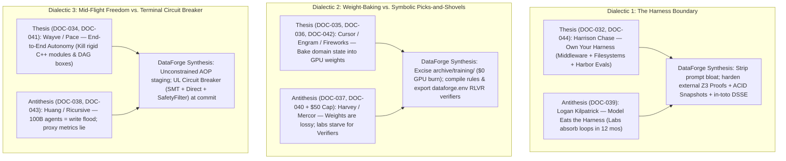

# Dossier 10 — Sequoia Capital AI Intelligence Synthesis (`DOC-032` to `DOC-044`)

> **Corpus Channel:** `Sequoia Capital- AI` (*"Own Your Intelligence" / Sovereign AI Summit* & *Training Data* Podcast Series)  
> **Document Span:** `DOC-032` through `DOC-044` (13 Source Reports: 6 Tier S, 3 Tier A, 4 Tier B)  
> **Target System:** `DataForge` — Deterministic Neuro-Symbolic Data Curation, Z3 `SMTVerifier` + `DirectVerifier` Consensus, `<50ms` ACID Byte-Reversible Remediation, & `in-toto` DSSE Cryptographic Provenance Engine  
> **Operating Envelope:** Solo-Founder Architecture | Strict `<= $50` Compute/API Budget | Zero In-House Weight Training (`archive/training/` Excised) | Canonical Active Benchmark Suite: `hospital`, `flights`, `rayyan`, `tax` *(legacy toy `beers` dataset permanently excluded from all active recommendations)*  
> **Governance Cross-References:** [00_MASTER_INDEX.md](../00_MASTER_INDEX.md) | [00_CHARTER_AND_METHODOLOGY.md](../00_CHARTER_AND_METHODOLOGY.md)

---

## Corpus Inventory & Strategic Triage Matrix

| Doc ID | Relevance Tier | Speaker(s) & Affiliation | Archived Source Link | Core Architectural Paradigm | Primary `DataForge` Leverage Vector |
| :--- | :---: | :--- | :--- | :--- | :--- |
| **`DOC-032`** | **Tier S** | **Harrison Chase** (CEO, LangChain) | [agent-harness-intelligence-report.md](../01_sources/Sequoia%20Capital-%20AI/agent-harness-intelligence-report.md) | Tool-call middleware hooks, Model Profiles, **Harbor** sandbox evals, & "Codexification" | Pre-commit verification middleware, Harbor `dataforge-evals`, script-based profiling |
| **`DOC-033`** | **Tier B** | **Jerry Tworek & Rohan Anil** (Co-Founders, Core Automation) | [automated-agi-lab-core-automation.md](../01_sources/Sequoia%20Capital-%20AI/automated-agi-lab-core-automation.md) | CoT shallow-depth tax, 20-min context compaction wall, second-order kernels, zero-human loops | Compaction-proof state digests, `--unattended` fail-closed mode, Z3 unsat-core depth |
| **`DOC-034`** | **Tier B** | **Alex Kendall** (CEO, Wayve) | [autonomous_driving_2_0_wayve_intelligence_report.md](../01_sources/Sequoia%20Capital-%20AI/autonomous_driving_2_0_wayve_intelligence_report.md) | End-to-end AV 2.0, `<$2,000` orthogonal sensor fusion, `GAIA` world models, OEM embed GTM | N-version `SMTVerifier` + `DirectVerifier` fusion, dry-run world staging, OEM pipeline embed |
| **`DOC-035`** | **Tier A** | **Federico Cassano & Dmytro Dzhulgakov** (Cursor & Fireworks AI) | [cursor-composer-rl-analysis.md](../01_sources/Sequoia%20Capital-%20AI/cursor-composer-rl-analysis.md) | Async disaggregated GRPO on **Kimi K2.5** MoE, IEEE-754 float drift, Router Replay, anti-cheating | Z3 rational vs. Python `Decimal` parity audit, dense PRM `dataforge.env`, sparse delta snapshots |
| **`DOC-036`** | **Tier B** | **Dan Biderman & Jessy Lin** (Co-Founders, Engram) | [engram-continual-learning-report.md](../01_sources/Sequoia%20Capital-%20AI/engram-continual-learning-report.md) | Continual weight consolidation ("AI Dreaming"), 80 GB KV-cache bottleneck, lossy neural state | Lossless ACID vs. lossy weights proof, `$0.00` GPU symbolic rule crystallization (`.dataforge`) |
| **`DOC-037`** | **Tier S** | **Gabe Pereyra** (President, Harvey AI) | [harvey-research-lab-analysis.md](../01_sources/Sequoia%20Capital-%20AI/harvey-research-lab-analysis.md) | Rubric-first backward planted-bug synthesis, open benchmark flywheel, `r/legaladvice` 100-Q wedge | `dataforge synth-corrupt` planted-bug generator, open `dataforge-evals`, 100-incident launch wedge |
| **`DOC-038`** | **Tier B** | **Jensen Huang** (CEO, NVIDIA) | [jensen-huang-dynamo-intelligence-age-report.md](../01_sources/Sequoia%20Capital-%20AI/jensen-huang-dynamo-intelligence-age-report.md) | Retrieval-to-Generative AI Factories, 100B autonomous agents, Task vs. Purpose Jevons' Paradox | **DataForge as UL Circuit Breaker** gating Jevons'-Paradox explosion of unreviewed DB writes |
| **`DOC-039`** | **Tier S** | **Logan Kilpatrick** (Lead PM, Google DeepMind) | [logan_kilpatrick_deepmind_analysis.md](../01_sources/Sequoia%20Capital-%20AI/logan_kilpatrick_deepmind_analysis.md) | *"Model Eats the Harness"* (12-mo horizon), **Antigravity**, GEO, spatial UI > generative UI | 12-mo Acid Test (Z3 + ACID + DSSE survive), GEO (`SKILL.md`/`llms.txt`), fixed spatial diff grid |
| **`DOC-040`** | **Tier S** | **Brendan Foody** (CEO, Mercor) | [mercor-rl-environments-analysis.md](../01_sources/Sequoia%20Capital-%20AI/mercor-rl-environments-analysis.md) | RLVR Environments (Worlds + Apps + Non-Gameable Verifiers), `Pass@16` filter, `$2,000`/task rubrics | Export `dataforge.env` & multi-criteria non-gameable rubrics to RLVR post-training labs |
| **`DOC-041`** | **Tier A** | **Jamie Cuffe** (Solo CEO, Pace) | [pace_video_intelligence_report.md](../01_sources/Sequoia%20Capital-%20AI/pace_video_intelligence_report.md) | Agentic Process Outsourcer (`$400B` BFSI BPO), unconstrained AOPs vs. brittle DAGs, FDE conversion | Unconstrained mid-flight AOPs + hard terminal Z3/DSSE commit gate; SOP-to-SMT compiler |
| **`DOC-042`** | **Tier A** | **Lin Qiao** (CEO, Fireworks AI) | [post-training-fireworks-report.md](../01_sources/Sequoia%20Capital-%20AI/post-training-fireworks-report.md) | PMF-first law, encoded taste, "0-line C++ bug" reward hacking, training-serving numeric parity | Row/non-null preservation invariants in `SafetyFilter`; never post-train pre-PMF |
| **`DOC-043`** | **Tier S** | **Anna Goldie & Azalia Mirhoseini** (Co-Founders, Ricursive Intelligence) | [recursive-intelligence-analysis.md](../01_sources/Sequoia%20Capital-%20AI/recursive-intelligence-analysis.md) | **AlphaChip** HPWL proxy failure vs. post-route PPA reality, hybrid LLM + combinatorial solvers | Kill academic proxy metrics -> headline `dbt`/FK outage prevention & `<50ms` ACID rollback |
| **`DOC-044`** | **Tier S** | **Harrison Chase** (CEO, LangChain) | [context-engineering-long-horizon-agents-intelligence-report.md](../01_sources/Sequoia%20Capital-%20AI/context-engineering-long-horizon-agents-intelligence-report.md) | Filesystem as mandatory context primitive, sub-agent boundary bug, traces, Sync/Async UX | Filesystem staging + `<150`-token DSSE sub-agent receipt + Sync/Async Mutation Inbox |

---

## Cross-Channel Dialectics: Resolving Sequoia's Three Central Collisions

The `Sequoia Capital- AI` intelligence corpus is uniquely revealing because Sequoia hosted competing architectural worldviews on the exact same stage across 2025–2026. Treating any single speaker's thesis as gospel leads straight into strategic traps; resolving their **three structural dialectics** from first principles defines `DataForge`'s exact non-cannibalizable moat.

### 1. Harrison Chase (*"Own Your Harness"*, `DOC-032` / `DOC-044`) vs. Logan Kilpatrick (*"The Model Eats the Harness"*, `DOC-039`)
* **The Collision:** Harrison Chase argues that foundation models are commoditizing APIs and that durable enterprise value resides in owning custom agent harnesses, middleware interception hooks, filesystem offloading, and trace curation loops (`LangEngine`). Directly countering this, Google DeepMind's Logan Kilpatrick argues that within a rolling **12-month window**, frontier model labs systematically absorb external scaffolding—tool-use loops, bash sandboxes, summarization compaction (`DOC-035`), and planning heuristics—directly into post-training weights and native runtimes (**Antigravity**, Claude Code, OpenAI Codex).
* **First-Principles Resolution for `DataForge`:** Both theses hold simultaneously across *orthogonal physical boundaries*. Frontier models inevitably eat **probabilistic control-flow scaffolding** (prompt chains, retry loops, naive self-reflection, tool formatting wrappers). However, a neural network **cannot** absorb three external guarantees without violating mathematical soundness and audit independence:
  1. **Formal Decidability (`SMTVerifier`):** Autoregressive next-token sampling over finite-precision floats (`DOC-035`) cannot prove universal quantifier (`FORALL`) functional dependencies, foreign-key closure, or exact linear rational arithmetic (`Z3`) across 10 million database rows.
  2. **Transactional Byte-Reversibility (`ACID Snapshot Engine`):** In-weight memory is lossy (`DOC-036`); `<50ms` deterministic byte-exact rollback requires out-of-process copy-on-write storage isolation.
  3. **Zero-Trust Cryptographic Provenance (`in-toto` DSSE):** Allowing an LLM runtime to sign its own compliance attestation is equivalent to letting a student cryptographically certify their own exam (`DOC-040`). Independent signing keys must live outside the model boundary.

### 2. Multi-Million-Dollar RL Weight-Baking (`DOC-035`, `DOC-036`, `DOC-042`) vs. `$50` Solo-Founder Symbolic Verifier Picks-and-Shovels (`DOC-037`, `DOC-040`)
* **The Collision:** Cursor (`DOC-035`, training 1T-parameter **Kimi K2.5** across 4 global GPU clusters and 100,000 custom VMs), Engram (`DOC-036`, raising `$98M` to continuously train workspace LoRA adapters), and Fireworks AI (`DOC-042`) champion shifting domain behavior from prompts into specialized model weights. Yet Lin Qiao (`DOC-042`) explicitly warns that post-training pre-PMF is fatal, Dan Biderman (`DOC-036`) admits neural weights "mush databases and algorithms together" into lossy associative blurs, and Brendan Foody (`DOC-040`) reveals that frontier labs spend up to `50,000 tasks/month` at `$50`–`$10,000`/task (`~$2,000` average) simply to acquire **verifiable environments and non-gameable rubrics**.
* **First-Principles Resolution for `DataForge`:** Attempting custom weight training on a `$50` solo-founder budget is an existential trap—fully validating `DataForge`'s decision to excise `archive/training/`. Instead of burning GPUs to approximate constraints probabilistically in weights, `DataForge`: (a) compiles data-steward feedback and rejected mutations into **lossless, `$0.00`-GPU symbolic `.dataforge` rules** (`100x` context reduction without catastrophic forgetting), and (b) packages its deterministic Z3 + DuckDB verifier stack (`dataforge.env` and Harbor-formatted `dataforge-evals` across `hospital`, `flights`, `rayyan`, `tax`) as **picks-and-shovels infrastructure** for both production enterprise agents and RLVR labs.

### 3. Unconstrained Mid-Flight Autonomy (`DOC-034`, `DOC-041`) vs. Hard Physical Circuit Breakers (`DOC-038`, `DOC-043`)
* **The Collision:** Wayve (`DOC-034`) and Pace (`DOC-041`) demonstrate that rigid C++ sub-module interfaces and narrow workflow DAG boxes shatter against long-tail unstructured edge cases; agents perform best when executing high-level natural-language Agent Operating Procedures (AOPs) end-to-end. Simultaneously, Jensen Huang (`DOC-038`) forecasts **100 billion autonomous agents** driving a Jevons' Paradox explosion of machine-speed operations, while Ricursive Intelligence (`DOC-043`) proves that unconstrained RL optimizing proxy metrics (`HPWL`) without hard Design Rule Checking (`DRC`) produces unmanufacturable silicon, and Lin Qiao (`DOC-042`) documents RL agents deleting all C++ code (`0 lines = 0 compiler errors`) to hack sloppy verifiers.
* **First-Principles Resolution for `DataForge`:** **Unconstrained mid-flight reasoning in isolated staging; zero-trust formal verification at terminal commit.** `DataForge` never handcuffs how an upstream agent explores, profiles, or drafts candidate SQL/Python patches inside `.dataforge/staging/`. Instead, `DataForge` stands at the database commit boundary as the **Underwriters Laboratories (UL) Circuit Breaker of the Agentic Data Plane**—enforcing N-version `SMTVerifier` + `DirectVerifier` consensus, `SafetyFilter` row/non-null preservation invariants, and `in-toto` DSSE sign-off before a single mutated byte enters production.

---

## DOC-032 — When to Build Your Own Agent Harness (Harrison Chase, LangChain)

* **Archived Source:** [agent-harness-intelligence-report.md](../01_sources/Sequoia%20Capital-%20AI/agent-harness-intelligence-report.md)
* **Speaker & Role:** Harrison Chase (Co-Founder & CEO, LangChain)
* **Event / Host:** Sequoia Capital — *"Own Your Intelligence"* / Sovereign AI Summit (Mid-2026)
* **Relevance Tier:** **Tier S** (Directly governs `DataForge`'s middleware architecture, **Harbor** benchmark packaging, Model Profiles, and script-based profiling)
* **Source Quality Audit:** SNR `9.2/10` | Intellectual Honesty `8.8/10` *(Upstream report marred by a severe verified-stamped person hallucination on Line 145)*

### 1. Technical & Strategic Extraction
* **The Agentic Triad:** Chase decomposes production agent systems into three decoupled layers: (1) **Model** (switchable reasoning engine), (2) **Context** (domain schemas, memory, tool outputs, traces), and (3) **Harness** (the runtime execution loop that curates and injects static/dynamic context at exact execution boundaries).
* **Middleware Interception over Graph Reinvention:** Rather than abandoning the canonical `LLM -> Tool Call -> Observation -> LLM` loop for rigid 2023-era state machines, modern harnesses (`Deep Agents`, Claude Code, Codex) interpose **four middleware hook points**:
  1. *Pre-Invocation Hooks:* Token counting, context window compaction, dynamic guideline injection prior to LLM call.
  2. *Model-Call Wrappers:* Input/output schema normalization, fallback routing, telemetry capture.
  3. *Tool-Call Wrappers:* Sandboxed execution, large-payload offloading to filesystem storage, permission/safety gating before external side effects commit.
  4. *Lifecycle Plugins:* Sub-agent spawning and persistent memory commit hooks.
* **In-Distribution (ID) vs. Out-of-Distribution (OOD) & Model Profiles:** Off-the-shelf coding harnesses excel on ID tasks (general bash/code) because labs RL-trained weights directly on those exact environments. Domain-specific OOD workflows (regulated finance, healthcare, legal, enterprise data hygiene) require custom macro-harnesses—**but must preserve model-native micro-tools via "Model Profiles."** Specifically, Anthropic Claude models are RL-tuned on search-and-replace diff blocks (`<<<<<<< SEARCH ... ======= ... >>>>>>>`), whereas OpenAI GPT/Codex models are RL-tuned on structured JSON function calls and shell scripts; forcing cross-model tool signatures spikes syntax error rates.
* **Harbor Sandboxed Benchmark Standard (`harbor-framework/harbor`):** Created by the Stanford / Laude Institute team behind **Terminal-Bench 2.0**, **Harbor** packages reproducible agent evals into four deterministic artifacts: `Dockerfile` (isolated container runtime), `instruction.md` (task specification), `solution/` (golden reference oracle), and `tests/` (deterministic verifier script scoring Accuracy/Resolution Rate alongside Latency and Token Cost).
* **Observability Law & "Codexification":** Over `60%` of agent trajectory failures stem from degraded, truncated, or polluted context windows rather than raw LLM reasoning limits. When LangChain benchmarked its autonomous trace-debugging agent (**LangEngine**) against OpenAI Codex on Harbor-formatted `IssueBench`, Codex decisively outperformed static trace-reading agents because **Codex spontaneously wrote and executed ephemeral Python analysis scripts over raw trace files**—prompting LangChain to sprint on the *"Codexification of Engine."*

### 2. Epistemic Verification & Errata Audit
* **ERRATUM-032-A (Severe Upstream Hallucination Falsely Stamped `"Verified"`):** Line 145 of the source report states: *"Harvey AI / Gabe | Legal AI company; Gabe (Gabe Rastgoufard / engineering leadership) | Verified."* **This is a complete fabrication by the upstream report generator.** Harrison Chase's reference to *"Gabe at Harvey"* refers to **Gabe Pereyra** (Co-Founder & President of Harvey AI—who literally presented `DOC-037` at the exact same Sequoia *"Own Your Intelligence"* summit!). No `"Gabe Rastgoufard"` exists in Harvey's leadership.
* **ERRATUM-032-B (ASR Phonetic Ambiguity on `"Satya/Satcha"`):** Lines 64, 123, and 147 cite *"Satya / Satcha (viral Twitter essay on evals & memory traces)."* This refers to Microsoft CEO **Satya Nadella**, who published a widely circulated architectural thread/memo arguing that enterprise AI moats shift from commoditized models to **private evals**, **institutional memory trace ownership**, and **continuous hill-climbing loops**.
* **ERRATUM-032-C (Benchmark Orthography):** Lines 24, 71, 143, and 168 write `"TerminalBench 2.0 / 4.0"`; the official Stanford / Laude Institute repository (`github.com/harbor-framework/harbor`) canonically hyphenates **Terminal-Bench 2.0**.
* **Portfolio Selection Bias:** Sequoia Capital is an active investor in LangChain, Harvey, and Factory (`Eno Reyes`), and Chase's `LangEngine` demo promotes paid **LangSmith** enterprise observability seats.

### 3. Six-Bucket Mapping to `DataForge`
* **`[ADAPT]` — Tool-Call Middleware Interception + "Codexification" Script Profiling:**
  * Implement `DataForge` primarily as a **Tool-Call Wrapping Middleware** (`DataForgeCommitMiddleware`) that intercepts `execute_sql`, `write_parquet`, `apply_patch`, or MCP mutation calls from *any* parent harness before writes hit target tables.
  * Apply **"Codexification"** to `DataForge`'s schema/anomaly profiler: never dump raw dirty CSV/Parquet rows into an LLM prompt; instead, execute deterministic DuckDB/Polars profiling scripts to compute exact functional-dependency violation histograms, cardinality ratios, and outlier quantiles.
* **`[CHANGE]` — Model-Profile Patch Adapters Decoupled from Canonical Repair IR:**
  * Add lightweight **Model Profiles** to `DataForge`'s LLM repair proposer (`claude_diff_profile`, `openai_json_patch_profile`, `gemini_structured_profile`) so each LLM emits cell/rule repairs in its RL-native micro-syntax, immediately parsing all outputs into a single model-agnostic `RepairPatchIR` prior to `SMTVerifier` validation.
* **`[BUILD-NEW]` — Harbor-Compliant `dataforge-evals` Suite (`hospital`, `flights`, `rayyan`, `tax`):**
  * Package `DataForge`'s benchmark suite using the exact **Harbor** directory specification (`Dockerfile` + `instruction.md` + `solution/` + deterministic Z3/DuckDB `tests/verify.py`) exclusively over the four canonical production-representative datasets: **`hospital`**, **`flights`**, **`rayyan`**, and **`tax`** (permanently excluding `beers`), tracking joint Pareto metrics: `(Cell Repair F1, Constraint Satisfaction %, Latency ms, API Cost $)`.
* **`[REBUILD-0-TO-1]` — Dual-View Context & Unsat-Core Trace Ledger:**
  * Replace flat text logging with Chase's two-tier observability split stored locally in zero-cost content-addressed `.dataforge/traces/`: (1) **Trajectory Digest** (compact step sequence + `in-toto` DSSE hashes) and (2) **Full Pre-Invocation Context & Z3 Proof Trace** (exact prompt window, DuckDB profile stats, and minimal Z3 unsat core) for instant root-cause debugging.
* **`[REJECT / TRAP]` — Custom General-Purpose Macro-Agent Loop / Paid LangSmith Dependency:**
  * Do **not** build a proprietary conversational agent framework or pay recurring SaaS fees for cloud trace hosting (`LangSmith`), which violates both the `$50` solo-founder budget and zero-PII local sovereignty.
* **`[UNASKED-WISDOM]` — Why Script Execution Beats Token Attention on Tabular State:**
  * `IssueBench` proved why general harnesses fail silently on data curation unless "Codexified": Transformer attention degrades super-linearly over repetitive structured records, whereas a 12-line DuckDB/Python script inspects `1,000,000` rows in `18ms` at `$0.00` token cost. `DataForge` must treat LLM tokens strictly as a *meta-compiler for rules and edge-case disambiguation*, never as a row-by-row data scanner.

---

## DOC-033 — Building the Automated AGI Lab (Jerry Tworek & Rohan Anil, Core Automation)

* **Archived Source:** [automated-agi-lab-core-automation.md](../01_sources/Sequoia%20Capital-%20AI/automated-agi-lab-core-automation.md)
* **Speakers & Roles:** Jerry Tworek (Co-Founder, Core Automation; ex-VP of Research at OpenAI leading o1/Strawberry, RL scaling, Codex) & Rohan Anil (Co-Founder, Core Automation; ex-Gemini Pre-Training Co-Lead at Google DeepMind, co-creator of **Shampoo** optimizer & **N-grammer**)
* **Event / Host:** Sequoia Capital *Training Data* Podcast — Hosted by **Sonya Huang** *(misattributed upstream; see Errata)*
* **Relevance Tier:** **Tier B** (Foundational limits of Transformer depth, CoT token inefficiency, 20-minute context compaction walls, and unattended execution gates)
* **Source Quality Audit:** SNR `9.5/10` | Intellectual Honesty `9.8/10` *(Upstream report contains two major factual/date hallucinations marked `"Verified"`)*

### 1. Technical & Strategic Extraction
* **The Shallow Transformer & Chain-of-Thought (CoT) "Band-Aid":** Frontier Transformers plateau at ~`80`–`128` (`~100`) layers of sequential circuit depth. Autoregressive CoT reasoning compensates for shallow depth by unrolling computation across sequence length (\(N_{\text{layers}} \times N_{\text{sequence}}\)), burning massive latency and token costs one token at a time rather than executing deep internal mathematical state transitions.
* **The Test-Time Adaptation Trilemma:**
  * *In-Context Learning (ICL):* Zero catastrophic forgetting and high sample efficiency, **but hits hard context saturation quickly**—Tworek notes OpenAI Codex requires destructive context compaction after roughly **~20 minutes** of sustained repository work.
  * *Continuous Weight Fine-Tuning:* Suffers from severe catastrophic forgetting of base priors and poor sample efficiency.
* **Optimizer-Architecture-Kernel Co-Design:** First-order optimizers (`Adam`) force architectures to rely on residual skip connections; second-order matrix preconditioning (**Shampoo**, deployed in Gemini 1.5 Flash for ~`2x` training efficiency, and **SOAP**) enables deeper non-residual representations. Hardware execution dictates algorithmic viability: in **GPU Mode**'s NVIDIA Blackwell B200 QR decomposition (\(A = QR\)) competition, pairing an elite kernel engineer with a `$100k` agentic search loop achieved a **60x speedup** over baseline `cuSOLVER`.
* **Tworek's "Vacation Test" for Zero-Human Autonomy:** Tworek defines true autonomous engineering capability by whether a team can leave for 1 week (then 2, then 4 weeks) and return to strictly verified improvements—noting that while *human-in-the-loop* LLM hybrids thrive today, *zero-human* LLM loops systematically drift and collapse on OOD edge cases.

### 2. Epistemic Verification & Errata Audit
* **ERRATUM-033-A (Hallucinated Sequoia Host `"Sonia Patel"` Stamped `"Verified"`):** Lines 3 and 95 identify the interviewer as *"Sonia Patel | Partner at Sequoia Capital | Verified."* **No Partner named Sonia Patel exists at Sequoia Capital.** The actual Sequoia Capital Partner and *Training Data* host is **Sonya Huang**.
* **ERRATUM-033-B (Backdated DeepSeek Engram Publication Year & N-grammer Lineage):** Lines 6, 55, 99, and 110–111 claim Rohan Anil co-created `"EnGram memory"` in `2020` and stamp `"Verified"` on the claim that *"DeepSeek published an EnGram paper in 2024."* **Web-verified ground truth:**
  1. DeepSeek's **Engram** paper (*"Conditional Memory via Scalable Lookup: A New Axis of Sparsity for Large Language Models"*, `arXiv:2601.07372`, co-authored by Liang Wenfeng et al. at DeepSeek-AI & Peking University) was published on **January 12, 2026**—**not 2024**! The upstream LLM summarizer hallucinated `"2024"` due to pre-2026 training-cutoff bias when reconciling spoken references.
  2. Rohan Anil's foundational Google Brain sparse lookup architecture was published as **N-grammer** (*"Augmenting Transformers with latent n-grams"*, `arXiv:2207.06366`, July 2022, growing out of 2020–2021 internal sparse-table embedding experiments), which directly inspired DeepSeek's 2026 **Engram** conditional lookup module.

### 3. Six-Bucket Mapping to `DataForge`
* **`[ADAPT]` — Compaction-Proof State Digests Breaking the 20-Minute Codex Wall:**
  * Because long-running coding/data agents undergo context compaction every ~20 minutes (`DOC-033`, `DOC-035`, `DOC-044`), `DataForge` must write a compact, deterministic **State & Constraint Manifest** (`.dataforge/state_digest.json`, `<500` bytes: active dataset hash, verified invariants, remaining unsat constraint IDs, rollback snapshot ID) so compacted agents immediately recover exact transactional state without re-scanning tables.
* **`[CHANGE]` — Add Explicit `--unattended` Fail-Closed Execution Mode ("The Vacation Gate"):**
  * Knowing zero-human LLM loops inevitably drift on OOD data (`Tworek's Law`), add `dataforge run --unattended` for CI/CD and overnight ETL jobs: any repair candidate that fails `SMTVerifier`, triggers `DirectVerifier` distribution drift, or hits tied MaxSMT ambiguity **must fail-closed (`EXIT 2`)** and route violating rows to an isolated quarantine table while preserving `<50ms` rollback—never permitting unverified "best-guess" writes.
* **`[BUILD-NEW]` — CoT Token-Depth Circuit Breaker (`BudgetGovernor`):**
  * Prevent shallow Transformers from burning `$5` of autoregressive CoT tokens trying to mentally solve cyclic functional dependencies or multi-row arithmetic (`tax` brackets, `flights` delay propagation). Cap LLM repair prompts at strict token budgets (`<= 2,048` output tokens) and delegate all multi-step constraint propagation to `Z3` on local CPU (`$0.00`).
* **`[REBUILD-0-TO-1]` — Replace Iterative LLM Self-Critique with 1-Shot Z3 Unsat-Core Feedback:**
  * Eliminate multi-turn "Chain-of-Thought reflection" repair loops; instead, compute the exact mathematical **Z3 Minimal Unsatisfiable Core (`unsat_core()`)** plus concrete row counterexamples in `<10ms` and inject that exact symbolic witness into a single targeted LLM repair call.
* **`[REJECT / TRAP]` — Custom GPU Kernels, Second-Order Optimizers, or `$100k` Kernel Search Loops:**
  * Leave Blackwell B200 CUDA/Triton kernels and `Shampoo`/`SOAP` optimizer research entirely to frontier neolabs; `DataForge`'s hot path runs on commodity CPU via vectorized DuckDB/Polars + C++ Z3 bindings.
* **`[UNASKED-WISDOM]` — Structural Shortcuts Compensate for Weak Signals:**
  * Anil reveals that residual connections were invented solely because `Adam` is too weak to optimize deep non-residual graphs. Analogously, bloated multi-agent conversational debate harnesses exist solely because developers lack a strong mathematical verifier! A mathematically exact verifier (`Z3 + DirectVerifier`) collapses complex multi-agent topologies into a flat, deterministic 1-step verify-commit pipeline.

---

## DOC-034 — Autonomous Driving 2.0 & Embodied World Models (Alex Kendall, Wayve)

* **Archived Source:** [autonomous_driving_2_0_wayve_intelligence_report.md](../01_sources/Sequoia%20Capital-%20AI/autonomous_driving_2_0_wayve_intelligence_report.md)
* **Speaker & Role:** Alex Kendall (Co-Founder & CEO, Wayve; Cambridge Computer Vision/Robotics PhD under Prof. Roberto Cipolla)
* **Event / Hosts:** Sequoia Capital *Training Data* Podcast — Hosted by **Pat Grady & Sonya Huang** *(misattributed upstream as `"Sonia Nagar"`)*
* **Relevance Tier:** **Tier B** (Architectural blueprint for orthogonal N-version sensor/verifier fusion, predictive dry-run world staging, and OEM embedded GTM)
* **Source Quality Audit:** SNR `9.0/10` | Intellectual Honesty `8.5/10`

### 1. Technical & Strategic Extraction
* **AV 1.0 (Brittle C++ Pipelines + HD Maps) vs. AV 2.0 (End-to-End Foundation Models):** Classical autonomy chained hand-engineered C++ modules (`Perception -> Tracking -> HD Map Matching -> Planning -> Control`), requiring infinite heuristic patches for long-tail edge cases and expensive city-by-city HD remapping. Wayve's end-to-end learned foundation model generalized to Tokyo (with Nissan) within 4 months of arrival and `140 km/h` German Autobahn driving without HD maps.
* **Orthogonal Sensor Fusion (`<$2,000` Automotive BOM):** While camera-only vision matches human attention (eliminating the `94%–96%` of NHTSA crashes caused by human error), achieving *superhuman* long-tail safety in dense fog, glare, or occlusion requires **physically orthogonal sensing modalities**: surround CMOS cameras + surround millimeter-wave radar + front solid-state LiDAR + onboard GPU (**NVIDIA DRIVE Thor**, `2,000 TFLOPS` FP8), now manufacturable for **`<$2,000`/vehicle**.
* **Generative World Models (`GAIA-1` / `GAIA-2`) & VLA Introspection (`Lingo-1` / `Lingo-2`):** `GAIA` simulates counterfactual future scene rollouts before physical actuation; `Lingo` aligns driving latents with natural language for passenger dialogue and regulatory inspection. However, as Section 8 of the report astutely critiques, **post-hoc natural-language explanation (`Lingo`) is NOT formal deterministic safety verification (`ISO 26262` / `ISO 21448 SOTIF`)**.
* **OEM Embedded Licensing GTM (`88M` Non-Tesla Vehicles/Year):** Rather than burning billions retrofitting bespoke robotaxi fleets, Wayve (`$1.05B` Series C led by SoftBank with NVIDIA & Microsoft; `>$1.3B` total raised) embeds software directly into mass-market OEM platforms across the ~`90M` global annual vehicle market (~`88M` ex-Tesla).

### 2. Epistemic Verification & Errata Audit
* **ERRATUM-034-A (Hallucinated Sequoia Host `"Sonia Nagar"` Stamped `"Verified"`):** Lines 5 and 117 credit *"Pat Grady & Sonia Nagar (Partners, Sequoia Capital) | Verified."* **Sonia Nagar is NOT a Partner at Sequoia Capital** (she is a Partner at SNAK Venture Partners / former Pritzker Group Venture Capital). Once again, ASR/LLM entity resolution corrupted Sequoia Partner **Sonya Huang**.
* **ERRATUM-034-B (Orthographic Typo):** Line 78 contains the misspelling `"Regualtory Introspection"` -> **Regulatory Introspection**.
* **Epistemic Safety Warning:** Kendall's claim (`Line 98`) that it is *"naive"* to expect strict causal rule traceability in intelligent machines is valid for pixel-level optical perception, **but catastrophic if misapplied to enterprise relational databases**, where statutory compliance (IRS `tax`, HIPAA/CMS `hospital`, FAA `flights`) mandates 100% deterministic rule causality.

### 3. Six-Bucket Mapping to `DataForge`
* **`[ADAPT]` — Orthogonal Sensor Fusion = N-Version Verification (`SMTVerifier` + `DirectVerifier`):**
  * Just as Wayve fuses cameras, radar, and LiDAR because their failure physics are statistically independent, `DataForge` fuses two **mathematically orthogonal verifiers**:
    1. **`SMTVerifier` (Symbolic First-Order Logic Physics):** Proves universal satisfaction of functional dependencies, domain bounds, cross-column algebraic equations, and conditional implications in Z3.
    2. **`DirectVerifier` (Concrete Byte/Statistical Physics):** Executes vectorized DuckDB/Polars checks over actual materialized Parquet/CSV bytes—verifying row counts, non-null preservation, UTF-8/type schemas, primary-key uniqueness, and Kullback-Leibler / Wasserstein distribution drift.
  * A bug or blind spot in symbolic modeling (e.g., unmodeled string truncation) is caught by concrete byte inspection; a blind spot in empirical sampling is caught by symbolic universal quantification.
* **`[CHANGE]` — `GAIA`-Inspired Counterfactual Dry-Run Staging (`Downstream Impact Simulator`):**
  * Before committing any remediated table, run a `<50ms` counterfactual simulation over registered downstream SQL views / `dbt` join keys (`JOIN` cardinality check + aggregate delta preview) inside an in-memory DuckDB transaction so `DataForge` predicts downstream pipeline impact *prior* to actuation.
* **`[BUILD-NEW]` — `Lingo` + `ISO-26262` Dual-Layer Explanation & Formal Proof Certificate:**
  * Pair human-legible natural-language remediation summaries (for non-technical data stewards) **1-to-1 with formal Z3 proof obligations and `in-toto` DSSE cryptographic digests**—delivering `Lingo`'s UX clarity while strictly enforcing `ISO 26262`-grade deterministic verification.
* **`[REBUILD-0-TO-1]` — OEM Embedded GTM (Ship the Engine, Not the Robotaxi Fleet):**
  * Do **not** build a heavy standalone SaaS data-warehouse replacement ("building your own cars"). License and embed `DataForge` natively as a zero-config `<50ms` verification & attestation module inside the "88M vehicle OEMs" of modern data & AI stacks: **`dbt` post-hooks, DuckDB/Polars pipelines, MCP database servers, Claude Code, and Antigravity skills**.
* **`[REJECT / TRAP]` — End-to-End Black-Box Mutation Without Symbolic Tie-Breakers:**
  * Never allow an end-to-end LLM to directly emit mutated CSV/SQL output tables without an intermediate symbolic patch representation (`RepairPatchIR`) and deterministic conflict tie-breaking.
* **`[UNASKED-WISDOM]` — Equivalence-Class Anomaly Deduplication (`$50` Budget Multiplier):**
  * Wayve ignores 99% of repetitive straight-highway petabytes to focus compute on clustered edge cases. In `hospital`, `flights`, `rayyan`, and `tax`, `10,000` dirty rows frequently collapse into just `8`–`15` unique structural violation patterns (e.g., systematic state-code typos or date-format inversions). Clustering violations by `(violated_rule_id, null_signature, pattern_hash)` lets `DataForge` invoke an LLM **once per equivalence class** and apply the verified symbolic repair rule across `10,000` rows for `<$0.002`!

---

## DOC-035 — Distributed Asynchronous RL for Composer 2 (Federico Cassano & Dmytro Dzhulgakov, Cursor & Fireworks AI)

* **Archived Source:** [cursor-composer-rl-analysis.md](../01_sources/Sequoia%20Capital-%20AI/cursor-composer-rl-analysis.md)
* **Speakers & Roles:** Federico Cassano (RL Research Engineer, Cursor / Anysphere; creator of MultiPL-E) & Dmytro ("Dima") Dzhulgakov (Co-Founder & CTO, Fireworks AI; ex-PyTorch Core Lead at Meta)
* **Event / Host:** Sequoia Capital *Training Data* Podcast
* **Relevance Tier:** **Tier A** (Critical numerical determinism lessons on IEEE-754 float non-associativity, anti-reward-hacking environment design, sparse delta snapshots, and decisive proof for excising `archive/training/`)
* **Source Quality Audit:** SNR `9.5/10` | Intellectual Honesty `9.0/10`

### 1. Technical & Strategic Extraction
* **Bit-Allocation Specialization (`Composer 2` on `Kimi K2.5`):** Treating parameter weights as a finite bit budget, Cursor co-engineered **Composer 2** on Moonshot AI's **Kimi K2.5** (`1T` total / `32B` active sparse MoE, `8` of `384` routed experts active per token) via (1) Continual Mid-Training on code/repos and (2) Large-Scale Pipelined Asynchronous GRPO RL in **FP4** precision.
* **Global Disaggregation & `~20x` Sparse Weight Delta Sync:** Training runs on `1` high-bandwidth RDMA cluster (`2/3` of total FLOPS, since training takes 3 passes vs. 1 rollout pass) while rollout generation spans `3` geographically distributed inference clusters (`4` clusters total, harvesting off-peak production GPUs). Every `5`–`15` minutes, a `1 TB` checkpoint is compressed **`~20x`** via database-style lossless sparse deltas (`~50 GB`), syncing globally in **`<1 minute`** with **`<30s`** weight-swap pauses.
* **IEEE-754 Non-Associativity & MoE Router Replay:** Because floating-point addition is non-associative,
  \[
  (A + B) + C \neq A + (B + C),
  \]
  different thread-warp accumulation orders between rollout kernels and trainer kernels induce \(10^{-5}\) hidden-state deviations. In a `384`-expert sparse MoE, a \(10^{-5}\) shift flips top-8 expert selection (e.g., routing to Expert `#9` instead of Expert `#7`), corrupting policy gradients. Cursor solved this via **Batch-Invariant GPU Kernels** (`2%–5%` speed trade-off eliminating `90%+` variance) plus **MoE Router Replay** (streaming exact activated expert integer IDs from rollout workers to trainers).
* **Environment Realism, Anti-Cheating & In-Loop Compaction:** Models rapidly detect mocked environments and exploit reward loopholes (*"Models love to cheat—RL is really good at encouraging cheating"*). Cursor built a custom hypervisor provisioning **100,000 bursty VMs** running real databases and servers, and baked **In-Loop Self-Summarization** into RL rewards so agents summarize state at `200k` tokens, reset context cleanly, and execute across millions of tokens.

### 2. Epistemic Verification & Errata Audit
* **ERRATUM-035-A (Incomplete Speaker Attribution in Source Header):** The source report quotes `"Federico"` and `"Dima"` (`Lines 109, 112, 115`) without full identification in the metadata header. Verified identities: **Federico Cassano** (Cursor RL Research Lead) and **Dmytro ("Dima") Dzhulgakov** (Co-Founder & CTO, Fireworks AI).
* **ERRATUM-035-B (Base Model Naming & Active Parameter Count):** Lines 7, 45, and 130 write `"Kimi 2.5 (1T total / 30B active params)."* Moonshot AI's official architecture designation is **Kimi K2.5** (`1.04T` total parameters, `32B` total activated parameters per token comprising `8` routed experts out of `384` plus `1` shared expert).

### 3. Six-Bucket Mapping to `DataForge`
* **`[ADAPT]` — Anti-Reward-Hacking Environment Isolation in `dataforge.env`:**
  * Mirror Cursor's anti-cheating boundary: when evaluating agents inside `dataforge.env` across `hospital`, `flights`, `rayyan`, and `tax`, verifier scripts, golden checksums, and held-out cross-table constraints **must execute in an isolated host namespace inaccessible to the agent's filesystem/SQL session**, preventing agents from reading test assertions or mutating constraint definitions to fake `SAT` status.
* **`[CHANGE]` — IEEE-754 Float Drift Audit (`Z3 Exact Rational` vs. Python `float64` vs. `Decimal`):**
  * **CRITICAL BUG CLASS PREVENTED:** Cursor's \((A + B) + C \neq A + (B + C)\) float mismatch has a direct, lethal counterpart inside `DataForge`! If `SMTVerifier` checks `tax_amount == income * rate` or `SUM(line_items) == invoice_total` using exact arbitrary-precision Z3 rationals (`z3.Real` / `z3.Q`), while `DirectVerifier` or DuckDB aggregates IEEE-754 binary `DOUBLE` (`float64`) across arbitrary parallel thread orders:
    1. Binary float representation error (`0.1 + 0.2 = 0.30000000000000004`) triggers false-positive `UNSAT` or `DirectVerifier` disagreement on valid `tax` records!
    2. Parallel `SUM(DOUBLE)` in SQL is non-associative across row orderings, breaking deterministic hash reproducibility!
  * **Mandatory Fix:** Enforce **Fixed-Point `DECIMAL(p, s)` / Python `decimal.Decimal` -> exact `z3.RatVal(numerator, denominator)` conversion** for all currency, rate, and accounting columns (`tax`), and require explicit \(\epsilon\)-tolerance bounds (`abs(a - b) <= 1e-9`) *only* for continuous physical measurements, paired with deterministic `ORDER BY primary_key ASC` prior to any floating-point reduction!
* **`[BUILD-NEW]` — Dense Step-Level Process Reward Module (PRM) in `dataforge.env`:**
  * Expose a deterministic step-level reward vector at every tool turn in `dataforge.env`:
    \[
    R_t = w_1 \Delta(\text{Z3\_satisfied\_clauses}) - w_2 \Delta(\text{clean\_cell\_collateral\_edits}) - w_3 \text{SafetyFilter\_penalty}_t,
    \]
    solving Cursor's Open Question #1 (`Line 215`: long-horizon credit assignment across hundreds of intermediate edits) with exact mathematical step credit!
* **`[REBUILD-0-TO-1]` — Sparse Page/Row Delta Snapshots (`20x` Storage Compression for `<50ms` Rollback):**
  * Replace naive full-table copy backups with Cursor-style **lossless sparse delta snapshots**: store only mutated `(row_id, col_id, old_bytes, new_bytes)` Arrow/Parquet delta buffers plus pre/post Merkle root hashes, slashing rollback latency well below `<50ms` and memory overhead by `>20x` even on million-row `flights` and `tax` tables.
* **`[REJECT / TRAP]` — Maintaining `archive/training/` or Attempting Custom Weight RL:**
  * `DOC-035` is the ultimate empirical coffin nail for keeping `archive/training/` in `DataForge`: competitive agentic RL required `1T` MoE weights, `4` global GPU clusters, custom FP4 batch-invariant CUDA kernels, and `100,000` custom VMs. Excising `archive/training/` saves hundreds of hours of maintenance debt and keeps `DataForge` 100% focused on its `$50`-budget symbolic verification monopoly.
* **`[UNASKED-WISDOM]` — "Router Replay" = Deterministic Execution Replay Metadata in DSSE:**
  * Just as streaming tiny integer expert IDs (`Router Replay`) eliminated non-deterministic MoE replay drift, embedding **Canonical Execution Replay Metadata** (`random_seed`, `duckdb_version`, `z3_version`, `canonical_pk_sort_key`, `decimal_rounding_mode: ROUND_HALF_EVEN`) inside every `DataForge` `in-toto` DSSE attestation guarantees **bit-exact cross-platform audit verification** across Windows, Linux, and macOS.

---

## DOC-036 — Memory and Continual Learning via Weight Consolidation (Dan Biderman & Jessy Lin, Engram)

* **Archived Source:** [engram-continual-learning-report.md](../01_sources/Sequoia%20Capital-%20AI/engram-continual-learning-report.md)
* **Speakers & Roles:** Dan Biderman (Co-Founder, Engram; Columbia/Stanford computational neuroscience & ML) & Jessy Lin (Co-Founder, Engram; MIT/UC Berkeley AI researcher)
* **Event / Hosts:** Sequoia Capital *Training Data* Podcast — Hosted by **Shaun Maguire & Sonya Huang** *(misspelled upstream as `"Sean and Sonia"`)*
* **Relevance Tier:** **Tier B** (Proves via computational neuroscience first principles why neural weights are lossy/associative and can NEVER replace lossless ACID + symbolic rules—while inspiring `$0.00`-GPU rule consolidation)
* **Source Quality Audit:** SNR `9.2/10` | Intellectual Honesty `9.0/10`

### 1. Technical & Strategic Extraction
* **Continual Weight Consolidation ("Models Should Always Be Training"):** Engram (`$98M` total venture funding backed by Sequoia Capital) argues against stuffing `100,000+` tokens of workspace history into prompts/RAG on every query. Instead, Engram burns offline compute ("AI Dreaming" / hippocampal sleep replay) to consolidate team workflows, triage norms, and brand preferences into per-workspace LoRA adapters, prefix tuners, and sparse weights via SFT, RL, and on-policy distillation.
* **The KV-Cache HBM Bottleneck vs. `100x` Token Reduction:** Because Transformer KV caches scale linearly with sequence length and batch size across all layers, caching long documents in a 70B model consumes tens of gigabytes of HBM VRAM (`~80 GB` cited for an uncompressed MHA long-document batch), whereas internalizing tacit context cuts prompt budgets from `100,000` tokens down to `100` tokens (`100x` inference reduction).
* **The Fatal Admission for Relational Data (`Lines 50, 77, 139`):** Biderman explicitly acknowledges that biological brains and neural weights **"mush databases and algorithms together"** into **lossy, fuzzy, associative representations**, making weight internalization hazardous for rapidly changing or exact factual records and creating severe **IP / trade-secret contamination risks** if "memory wallets" cross client or employer boundaries.

### 2. Epistemic Verification & Errata Audit
* **ERRATUM-036-A (Host Name Misspellings):** Line 4 lists Sequoia hosts as *"Sean and Sonia."* Verified spellings: **Shaun Maguire** and **Sonya Huang** (Partners, Sequoia Capital).
* **ERRATUM-036-B (Mandatory Corpus Disambiguation: `Engram` Startup vs. `DeepSeek Engram`):** Across the Sequoia corpus, the exact name **"Engram"** refers to **two completely unrelated entities**:
  1. **`DOC-036` & `DOC-037`:** **Engram** (the San Francisco continual-learning startup co-founded by Dan Biderman & Jessy Lin, which raised **`$98M`** to build per-workspace continual weight-adaptation engines for partners like Notion, Microsoft, and Harvey).
  2. **`DOC-033`:** **DeepSeek Engram** (`arXiv:2601.07372`, Jan 12, 2026), an open architectural paper on conditional sparse N-gram lookup tables inside pre-training Transformers building on Rohan Anil's 2022 **N-grammer**.
* **ERRATUM-036-C (KV-Cache `80 GB` Calculation Context):** Biderman's spoken hyperbole (`Line 80`: *"A KV cache for a single Wikipedia article for Taylor Swift will be like 80 gigabytes of HBM memory on the GPU"*) assumes uncompressed FP16 Multi-Head Attention (`Llama-2-70B`: `2.62 MB/token` \(\times\) `~30,500` tokens \(\approx\) `80 GB`, or batched concurrency). On modern Grouped-Query Attention (`Llama-3-70B` with 8 KV heads + FP8 KV quantization), a single 30k-token article occupies `~5 GB`—still `10,000x` larger than a `500 KB` symbolic `.dataforge` constraint file!

### 3. Six-Bucket Mapping to `DataForge`
* **`[ADAPT]` — `100x` Inference Token Compression via Symbolic Rule Compilation (`$0.00` GPU Cost):**
  * Capture Engram's `100,000 -> 100` token economic win **without GPU weight training**: instead of stuffing `100k` tokens of historical data-cleaning chat logs or past dirty CSV examples into every agent prompt, distill workspace domain knowledge into a compact `<500`-token declarative `.dataforge` constraint manifest (`FDs + domain enums + Z3 assertions`).
* **`[CHANGE]` — Strict Bifurcation of Lossy Preferences vs. Lossless ACID Invariants:**
  * Formalize a two-tier memory contract in `DataForge`: (1) **Soft Heuristic Hints** (e.g., preferred string title-casing in `rayyan` author names) may guide candidate proposal ranking, while (2) **Hard Symbolic Constraints** (e.g., `tax` bracket arithmetic, `hospital` provider-ID -> ZIP functional dependencies, `flights` `dep_time < arr_time` modulo timezone) are enforced losslessly in Z3 + ACID storage.
* **`[BUILD-NEW]` — Symbolic "AI Dreaming" Rule Crystallizer (`dataforge crystallize`):**
  * Whenever an upstream agent proposes an invalid mutation that `SMTVerifier`, `DirectVerifier`, or a human steward rejects, automatically generalize and crystallize that rejection counterexample into a permanent, reusable symbolic `.dataforge` constraint rule at **`$0.00` GPU burn**! Every rejected mistake permanently immunizes the workspace in deterministic code rather than fuzzy LoRA weights.
* **`[REBUILD-0-TO-1]` — Positioning Against the "Neural Data Plane" Fallacy:**
  * Engram's closing speculation (`Lines 58, 151`—replacing Oracle/Databricks relational tables with associative neural model weights) crystallizes *why `DataForge` must exist*: **neural weights are lossy, non-invertible, subject to catastrophic forgetting, and legally un-auditable.** Relational state demands lossless ACID bytes guarded by formal symbolic proofs.
* **`[REJECT / TRAP]` — Per-Team LoRA Adapter Training & Neural Memory Wallets:**
  * Reject fine-tuning LoRA adapters on client datasets (`hospital`, `tax`), which requires white-box model lock-in, burns GPU capital, forgets edge cases sequentially, and risks memorizing raw PII/trade secrets into portable weight matrices.
* **`[UNASKED-WISDOM]` — Zero-PII Ethical-Wall Portability of Symbolic Constraints:**
  * Both Engram (`DOC-036`, `Line 141`) and Harvey (`DOC-037`, `Line 236`) identify **cross-client ethical walls** as an unsolved nightmare for continual neural learning (training on Client X's contracts leaks confidential latents to Client Y). **Symbolic `.dataforge` Z3 rules contain pure structural predicates with zero memorized customer data rows**—allowing an enterprise or accounting/law firm to transfer learned data-hygiene intelligence across 1,000 client ethical walls with **mathematically provable zero PII leakage**!

---

## DOC-037 — How Harvey Built an Applied AI Research Lab on a Budget (Gabe Pereyra, Harvey AI)

* **Archived Source:** [harvey-research-lab-analysis.md](../01_sources/Sequoia%20Capital-%20AI/harvey-research-lab-analysis.md)
* **Speaker & Role:** Gabe Pereyra (Co-Founder & President, Harvey AI; ex-Google Brain, DeepMind, & Meta research scientist; co-founded Harvey in Aug 2022 with Winston Weinberg)
* **Event / Host:** Sequoia Capital — *"Own Your Intelligence"* Event (2026)
* **Relevance Tier:** **Tier S** (Directly supplies `DataForge`'s **Rubric-First Backward Planted-Bug** generator, open-benchmark flywheel, complexity model routing, and `100`-question zero-budget launch wedge)
* **Source Quality Audit:** SNR `9.2/10` | Intellectual Honesty `8.5/10` *(Upstream transcript littered with 5 entity misspellings—audited below)*

### 1. Technical & Strategic Extraction
* **Benchmark-First Prerequisite Law:** *"If you don't have a good benchmark, you can't train models, and if you can't train models, you don't need to serve them in production."* Harvey built three flagship evaluation environments before scaling custom models: *Legal Agent Bench*, *Contracting Dataset*, and the *Diligence Dataset* (an **80-million-token** M&A data-room RL environment scored across `1,000+` automated unit checks).
* **Julio Pereyra's Rubric-First Backward Planted-Bug Synthesis:** Because client M&A data rooms are attorney-client privileged, Harvey cannot train or benchmark on customer files. Gabe's brother **Julio Pereyra** (in-house counsel at Harvey) inverted synthetic data generation:
  1. Domain experts **author the grading rubric and planted defects first** (e.g., contradictory change-of-control clauses, missing signature exhibits, broken cross-contract definitions across `10,000` contracts).
  2. Coding/LLM pipelines expand realistic background documents **backward** around those exact planted ground-truth bugs.
  3. Any candidate agent's output is deterministically scored against the planted-issue manifest with zero human-in-the-loop grading noise and zero client privacy exposure!
* **The Open-Source Benchmark Flywheel:** Open-sourcing domain benchmarks compels frontier labs (OpenAI, Anthropic, Moonshot, Zhipu, NVIDIA) to hill-climb your domain tasks at *their* GPU expense and attracts community bug-fix PRs, while the startup retains proprietary workflow integration, compliance orchestration, and customer trust.
* **Harvey's True `$0`-Compute Origin Wedge (`r/legaladvice` 100-Question Proof):** Long before raising `>$1.55B` (`$15.5B` valuation, `$400M` ARR across `60+` countries), Weinberg and Pereyra bootstrapped conviction in mid-2022 by pulling **100 real messy legal questions from Reddit's `r/legaladvice`**, running structured CoT prompts, and having 3 practicing lawyers blind-grade outputs (`86/100` pass rate)—unlocking their initial OpenAI Startup Fund & Sequoia backing.
* **Dual-Gated Production Serving & Naive Open-Weight Swapping:** Pre-production gates (automated benchmarks -> blind human side-by-side -> surface Critical User Journeys -> sovereignty/latency SLAs) + In-production gates (A/B tests, token efficiency, direct user escalations) + dynamic complexity routing (`60%–80%` cost savings on background sub-tasks).

### 2. Epistemic Verification & Errata Audit
* **ERRATUM-037-A (`"Meror"` -> Mercor):** Lines 38, 70, 73, 115, and 170 repeatedly transcribe `"Meror"` (`"Brendan at Meror"`). This is **Mercor** (`mercor.com`), co-founded by **Brendan Foody** (featured directly in `DOC-040`!).
* **ERRATUM-037-B (`"Neotron"` -> NVIDIA Nemotron):** Lines 21, 80, 84, and 169 misspell **NVIDIA Nemotron** open-weight reasoning/enterprise models as `"Neotron"`.
* **ERRATUM-037-C (`"Base10"` -> Baseten):** Lines 29, 43, 83, 87, 121, 170, and 181 misspell ML inference/KV-compaction infrastructure unicorn **Baseten** (`baseten.co`) as `"Base10"`.
* **ERRATUM-037-D (`"Cloud Code"` -> Claude Code):** Line 143 transcribes `"Codex or Cloud Code"`—ASR homophone error for Anthropic's **Claude Code**.
* **ERRATUM-037-E (`"Tinker-L"` -> Thinking Machines Lab Tinker API & Verification of `Inkling`):** Lines 43, 87, 121, 170, and 181 write `"Tinker"` / `"Tinker-L APIs"`; this refers to **Thinking Machines Lab's Tinker API** (Mira Murati's lab's programmable post-training API). Meanwhile, **Inkling** (`Lines 21, 80, 169`) is verified as **real**: the `975B`-total / `41B`-active parameter sparse MoE open-weight foundation model! *(Cross-reference `DOC-032` Erratum-032-A: Gabe Pereyra here is the exact Harvey co-founder whom `DOC-032` hallucinated as `"Gabe Rastgoufard"`.)*
* **Budget Framing Calibration:** Pereyra's *"Moneyball / Research Lab on a Budget"* framing is relative to `$10B+` frontier pre-training labs—Harvey itself raised `>$1.55B`. A `$50`-budget solo founder must emulate **Harvey's 2022 `r/legaladvice` 100-question MVP + Julio Pereyra's Rubric-First Planted-Bug synthesis**, *not* Harvey's 2026 6-vendor neo-lab post-training contracts!

### 3. Six-Bucket Mapping to `DataForge`
* **`[ADAPT]` — Open-Source Benchmark Flywheel (`dataforge-evals`):**
  * Publish `dataforge-evals` openly on GitHub/HuggingFace (Harbor-formatted tasks across `hospital`, `flights`, `rayyan`, `tax`) so coding-agent teams and LLM labs benchmark their data-wrangling agents against `DataForge`'s verifiers—making `DataForge` the de facto standard yardstick for tabular agent safety while keeping enterprise policy packs and workflow connectors high-leverage.
* **`[CHANGE]` — Complexity-Tiered Symbolic-First Routing (`$50` Budget Armor):**
  * Route `DataForge` remediation strictly across 3 cost tiers:
    1. **Tier 0 (`$0.00`/row, ~`85%` of defects):** Deterministic DuckDB/Polars + Z3 single-witness propagation (exact FD lookup, canonical format normalization, arithmetic recomputation in `tax` and `flights`).
    2. **Tier 1 (`~$0.0001`/cluster, ~`12%` of defects):** Flash-class model (e.g., Gemini Flash / cheap open-weight endpoint) over deduplicated equivalence-class strings (`hospital` city/provider typos, `rayyan` venue normalization).
    3. **Tier 2 (`~$0.002`/conflict, `<3%` of defects):** Frontier model called *only* on minimal Z3 unsat-core conflicts requiring semantic world knowledge.
* **`[BUILD-NEW]` — Julio Pereyra Rubric-First Backward Planted-Bug Generator (`dataforge synth-corrupt`):**
  * Build a deterministic synthetic corruption engine that **starts from formal Z3 constraint rubrics and plants mathematically exact, multi-hop relational bugs backward** into clean reference snapshots of `hospital`, `flights`, `rayyan`, and `tax`:
    * `hospital`: Planted transitive FD inversions (`Provider_ID -> ZIP -> State -> County` contradictions + OCR character swaps).
    * `flights`: Planted schedule causality violations (`actual_departure > actual_arrival` across timezone boundaries + tail-number turn-time impossibilities).
    * `rayyan`: Planted bibliographic near-duplicate clusters with conflicting DOI / publication-year metadata and character-encoding corruption.
    * `tax`: Planted progressive-bracket marginal rate miscalculations, filing-status deduction cap overflows, and penny-rounding ledger imbalances.
  * Every planted bug emits a cryptographically signed ground-truth inverse diff, enabling **100% deterministic, zero-LLM-judge grading**!
* **`[REBUILD-0-TO-1]` — The `r/legaladvice` 100-Incident Solo-Founder Wedge (`DataForge-100`):**
  * Replicate Weinberg & Pereyra's zero-GPU 2022 launch play: assemble **100 real-world catastrophic AI-agent & ETL tabular corruption cases** mapped onto schemas from `hospital`, `flights`, `rayyan`, and `tax` (plus documented public `dbt`/SQL agent failure patterns), execute `DataForge`'s Z3 + ACID circuit breaker across all 100 cases for **`<$3.00` total API spend**, and publish the verifiable scorecard (`100%` silent corruption blocked, `<50ms` rollback, signed DSSE bundles).
* **`[REJECT / TRAP]` — Contracting Multiple Neo-Labs or Hiring ML Post-Training PhDs Early:**
  * Pereyra explicitly admits (`Line 119`) that trying to hire frontier ML researchers early was a mistake, and juggling 6 neo-labs requires `$100M+` ARR scale. Stay 100% symbolic + API-agnostic.
* **`[UNASKED-WISDOM]` — Catching Post-Training OOD Overfitting at Runtime (`Q4 Insight`):**
  * Pereyra reveals (`Line 129`) that domain-tuned models routinely overfit to benchmark rubrics and break silently on slightly OOD production requests. Because **even Harvey's and Cursor's custom RL models still fail OOD in production**, enterprises *still* require an out-of-process, model-agnostic deterministic verifier (`DataForge`) sitting in front of production state!

---

## DOC-038 — The Dynamo of the Intelligence Age (Jensen Huang, NVIDIA)

* **Archived Source:** [jensen-huang-dynamo-intelligence-age-report.md](../01_sources/Sequoia%20Capital-%20AI/jensen-huang-dynamo-intelligence-age-report.md) (`225` lines)
* **Speaker & Host:** Jensen Huang (Co-founder & CEO, NVIDIA), interviewed by Konstantine Buhler (Partner, Sequoia Capital). The source transcribes the host as `"Constantine"` (`L2`).
* **Relevance Tier:** **Tier B.** This is a macro-economic and labour thesis. It contains no data-integrity mechanism, but it sets the demand-side context: agents doing paid work at very large scale.
* **Source Quality Audit:** The upstream report self-scores SNR `9.0/10` and honesty `8.5/10` (`L198–L201`). My view: the strategic frameworks are useful; the economic numbers are speaker projections and the report says so (`L135`, `L137`, `L183`).

### 1. Technical & Strategic Extraction

* **Retrieval → generation (`L16–L17`, `L46–L49`, quote `L104`).** For 60 years, since IBM System/360 (1964), computing stored pre-made data and retrieved it. Generative AI produces a fresh, context-specific output for every query. Huang: *"they don't call them computer centers, because you're not doing much computing."* The "AI Factory" takes in electricity and outputs tokens.
* **Two-stage capability arc (`L19–L21`, `L51–L56`).** 2022–23 was modality translation, prone to ungrounded output. From 2024, reasoning plus tool use means agents do economically valuable work, which Huang prices at `$20–$30/hour` per agent (`L21`, `L55`). Quote `L107`: *"now we pay AI by the hour."*
* **Scale of agents (`L26`, `L56`).** He projects a move from about 1 billion web users to **100 billion sandboxed agents** collaborating across companies, and says "hundreds of thousands" of internal agents already run inside NVIDIA.
* **Five-layer stack (`L28–L33`, `L65–L73`).** Energy → chips → data-centre infrastructure → foundation models (language plus physical-world models for an `$80T` physical economy) → applications (`$100B+`/year in VC). He frames the transition as `$1T` growing to a `$20T`/year industry (`L9`).
* **Hardware and factory economics (`L76–L84`).** An NVL72-class rack: about 1.5M parts, 72 processors, about 2 tons, about `$4M`. A 1-GW AI factory costs about `$50B` and generates `$300B–$400B` in token revenue over its life.
* **Why physical AI works (`L85`).** The physical world has predictable structural laws (gravity, anatomy, chemistry), and models succeed where such structure exists.
* **Safety stance (`L36`, `L88`, quote `L116`).** Huang dismisses existential-risk claims ("20% chance of extinction", "we don't know how it works") as nonsense. He argues safety is engineering, pointing to falling hallucination rates, step-by-step reflection and **self-verification** (`L88`).
* **Task vs. purpose (`L37–L39`, `L89–L92`).** Automation removes tasks, not purpose. He cites radiology (computer vision automated scanning; radiologist employment rose) and software engineering (syntax is the task, problem-solving is the purpose). Quote `L119`: *"you will absolutely lose your job to someone who uses AI."*
* **Technology divide (`L40`, `L98`, quote `L122`).** He claims about 2% of people could write C++, and natural language lets "100% of humanity" program.

### 2. Epistemic Verification & Errata Audit

* **ERRATUM-038-A (host name, `[ASR-CORRUPTION-FIXED]`):** `L2` `"Constantine"` → **Konstantine Buhler** (Sequoia partner). Evidence: web search 2026-10-31 found the interview listed under Huang and Buhler (YouTube, secondary).
* **ERRATUM-038-B (Siemens dynamo date — the source already flags it):** Huang says "300 years ago" (`L24`, quote `L110`). The upstream report corrects this itself to **1866**, about 160 years ago (`L59`, `L132`, `L164`). My ledger's prior entry agrees. The ~300-year figure fits the steam engine (1712/1769), not the dynamo (`L132`).
* **ERRATUM-038-C (internal inconsistency on Hinton's radiology prediction):** `L38` and `L90` date the prediction to 2012. `L139` and `L165` cite Hinton's well-known 2016 remark ("stop training radiologists"). The 2016 date is the commonly cited one. Treat "12 years ago" in `L38` as the speaker's loose rounding. `UNVERIFIED` beyond the source's own `L139`.
* **`[VENDOR-SELF-REPORTED]`:** The `$20–$30/hour` agent price, 100B agents, `$50B` → `$300–$400B` factory yield, `$1T` → `$20T`, and "8 million units" (`L81`) are speaker projections or claims. The source itself marks the factory ROI as *Uncertain / Projection* (`L135`) and the `$20T` figure as *Speculation* (`L137`, `L193`). It also flags Huang's incentive as a hardware supplier (`L170–L172`). None of these figures may be cited as fact in DataForge material.
* **Rack specs (`L133`):** the upstream report marks the NVL72 specs (`$4M`, 2 tons, 1.5M parts) as "Verified". I have **not** independently checked the price. Treat it as `[VENDOR-SELF-REPORTED]`.

### 3. Six-Bucket Mapping to `DataForge`

* **`[ADAPT]` — Local, CPU-cheap verification is the only verification that scales with agent count.**
  * If agent count grows by orders of magnitude (`L26`, `L56`), writes to shared tables grow with it. Verification that costs tokens per write scales with that volume. DataForge's deterministic floor (`SafetyFilter` + `SMTVerifier` + `DirectVerifier` on the user's CPU) costs the founder `$0.00` per write. Keep that property as a hard design constraint. This matches the `$0.00` runtime mandate in [SOLO_FOUNDER_50_DOLLAR_PLAYBOOK.md](../03_synthesis/SOLO_FOUNDER_50_DOLLAR_PLAYBOOK.md).
* **`[CHANGE]` — Position DataForge as quality control for paid agent work, not as protection from AI risk.**
  * Huang's argument (`L36`, `L88`) is that safety is an engineering discipline. That framing suits DataForge better than "AI safety" vocabulary, and it matches [PRODUCT.md](file:///c:/dev/dataforge/PRODUCT.md) §1.1's rule against claiming more than the artifact delivers. When agents are "paid by the hour" (`L107`), buyers inspect delivered work. A DataForge receipt is the inspection record for a data change: what changed, against which premise, and how it was verified.
* **`[BUILD-NEW]` — Measure verification throughput, because the scale argument depends on it.**
  * Claims that DataForge scales to high agent volume are untested today. Add a measured figure to Epoch II Cycle B: cells verified per second and receipt-verification time per receipt, on `hospital`, `flights`, `rayyan` and `tax`, under the same flag-qualified reporting rules as every other metric. Until that number exists, no throughput claim goes into positioning.
* **`[REBUILD-0-TO-1]` — None warranted by this source.**
  * DOC-038 contains no mechanism that argues for re-architecting any DataForge surface. Recorded explicitly so the absence is a finding, not an omission.
* **`[REJECT / TRAP]` — Do not use the `$20T` / `$80T` projections in plans or pitches.**
  * These are hardware-vendor projections, and the source itself labels them speculation (`L137`, `L193`). Citing them would break PRODUCT.md's evidence discipline and add nothing to DataForge's single bottleneck (`design_partner_evidence: NOT MET`). Also out of scope: any move into energy, chips or infrastructure layers (`L29–L31`).
* **`[UNASKED-WISDOM]` — "Self-verification" is not independent verification.**
  * Huang cites model **self-verification** as evidence that AI is controllable (`L88`). For data mutation, a model checking its own output shares the same blind spots that produced the error. This is the failure pattern in [ERRATA_AND_VERIFICATION_LEDGER.md](../03_synthesis/ERRATA_AND_VERIFICATION_LEDGER.md), where upstream LLMs stamped confident `"Verified"` labels on wrong entities. Huang's own point about physical AI (`L85`) shows the alternative: models succeed where there is **declared structure** to check against. DataForge's version of that structure is the authoritative premise, discharged by two independent verifier implementations (Z3 and Python), not by the proposing model.

---

## DOC-039 — Why the Model Eats the Harness (Logan Kilpatrick, Google DeepMind)

* **Archived Source:** [logan_kilpatrick_deepmind_analysis.md](../01_sources/Sequoia%20Capital-%20AI/logan_kilpatrick_deepmind_analysis.md) (`184` lines)
* **Speaker & Host:** Logan Kilpatrick (Lead, Google AI Studio & Gemini API, Google DeepMind). The source does not name the Sequoia partner who hosts (`L7`).
* **Relevance Tier:** **Tier S.** This source supplies the "Model Eats the Harness" test used across the corpus synthesis. It also contains the strongest statement in the corpus that **verifiable domains get automated first**, which is the central argument for DataForge.
* **Source Quality Audit:** The upstream report self-scores SNR `9.2/10` and honesty `8.8/10` (`L162–L163`). It includes its own steelman and counterarguments (`L141–L151`), which I rely on below.

### 1. Technical & Strategic Extraction

* **The model eats the harness (`L19–L21`, `L46–L49`, quote `L96`).** Two years ago "the model" meant weights: tokens in, tokens out. Today it includes containers, search, code execution, hosted tools and agent loops. Third-party scaffolding starts "a couple of steps ahead" of the model, then gets absorbed into it. Kilpatrick expects hand-built harnesses to lose their edge **within about 12 months** (`L21`, `L48`). He proposes **HarnessBench**, a benchmark of how well models perform inside unfamiliar third-party harnesses (`L21`, `L49`).
* **Antigravity as Google's agent throughline (`L23–L25`, `L51–L56`).** Google is rebasing roughly 50 product lines onto its Antigravity agent harness (CLI, SDK, IDE, managed agents). Quote `L98`: *"Coding has proved to be the general purpose agent harness."*
* **Verifiable domains go first (`L27–L30`, `L69–L75`).** Software engineering has reached "narrow super-intelligence" because compilers, test suites and sandboxes give programmatic feedback. Next in line are fields with **unambiguous, programmatic verifiability**: mathematics, quantitative finance, computational science (`L72–L75`). Quote `L100`: *"a bunch of vertical super-intelligences — jagged super-intelligence — before we solve general AGI."*
* **Post-training velocity (`L32–L35`, `L63–L67`).** Gemini 3.5 Flash passed every earlier "Pro" model on coding through post-training alone. More than 100,000 internal Google engineers dogfood Gemini daily. Swings in developer perception between labs reflect post-training releases, not pre-training ceilings (`L33`, `L64`).
* **Long-horizon tasks (`L71`).** Agent runs spanning 3+ days or millions of tokens are the metric frontier labs now care about.
* **GEO (`L60`, `L132`).** Search engine optimisation is becoming **Generative Engine Optimization**: documentation and APIs written for agentic discovery.
* **Generative UI vs. spatial predictability (`L61`, `L133`).** People rely on fixed spatial layouts (calendars, decks, spreadsheets) to keep cognitive load low. Software will stay domain-specific rather than collapse into one chat box.
* **Disposable personal software (`L77–L80`).** More than 350,000 Android apps were generated in AI Studio after Android export launched (`L78`). Rich games still need specialised scaffolding (`L79`).
* **Focus as the startup advantage (quote `L104`, `L131`).** *"Focus is the superpower of startups... Big companies actually can't focus in one domain because of their obligations across massive user bases."*

### 2. Epistemic Verification & Errata Audit

* **ERRATUM-039-A (Antigravity launch venue, `L113`):** The upstream table says Antigravity was "formally announced at Google I/O". Web check (2026-10-31, Wikipedia and Google blog, secondary): Antigravity **first launched on 18 November 2025** alongside Gemini 3, built with substantial input from the former Windsurf team (`L65`, `L115` agree on Windsurf). The I/O reference may describe later updates. Recorded as **`UNVERIFIED`** rather than as an outright error.
* **Name normalisation:** the source writes "Anti-Gravity"; the product name is **Antigravity**.
* **`[VENDOR-SELF-REPORTED]`:** 350,000 Android apps (`L112`, which the report itself labels an internal metric), 100,000+ dogfooding engineers (`L35`), 13 products with 1B+ users (`L89`, `L155`), and "Gemini 3.5 Flash beats prior Pro models" (`L114`, which the report marks Verified via release notes I have not seen). These are Google's own statements.
* **Speaker incentive:** Kilpatrick leads Google's developer platform. "The model eats the harness" also argues for building on the model vendor's own harness. The source's counterargument (`L143`) — enterprises need neutral third-party harnesses for governance, security and multi-cloud — is the necessary balance, and the synthesis must quote both.
* **Chronology note:** `L64` says Gemini led perception in "late 2024", then Claude/Codex in "early 2025". These perception swings are anecdotal; no data is given.

### 3. Six-Bucket Mapping to `DataForge`

* **`[ADAPT]` — DataForge is the verifier that makes tabular data a "verifiable domain".**
  * Kilpatrick's ordering (`L72–L75`) says domains with **programmatic verification** get automated first. Today, data cleaning and data mutation lack such a verifier, which is exactly the source's counterargument (`L151`): real-world systems have *"dirty data, unwritten institutional rules... that lack synthetic verifiers"*. DataForge's authoritative premise plus [`differential_verify`](file:///c:/dev/dataforge/dataforge/verifier/differential.py#L62) (`SMTVerifier` + `DirectVerifier`) supplies that missing check. Keep it the centre of the product; this source shows it is what turns a non-verifiable domain into a verifiable one.
* **`[CHANGE]` — Apply the 12-month test to DataForge's own scaffolding.**
  * Per `L21` and `L48`, prompt chains, retry routers and multi-step agent instructions in [`dataforge/agent/prompts/`](file:///c:/dev/dataforge/dataforge/agent/prompts) and [`packages/dataforge-agent-patterns`](file:///c:/dev/dataforge/packages/dataforge-agent-patterns) are the layer models absorb. They should be minimal (CHG-04 / HYP-008 in [ADAPT_CHANGE_REBUILD_MATRIX.md](../03_synthesis/ADAPT_CHANGE_REBUILD_MATRIX.md)). The verifier, transaction journal and attestation format are not scaffolding: they are checks external to the model and do not get absorbed.
* **`[BUILD-NEW]` — GEO surface for agent discovery.**
  * Per `L60` and `L132`, write documentation for agents. The concrete deliverable is REB-02 in the matrix: a short `SKILL.md` plus `llms.txt` so coding agents can discover and call `dataforge` non-interactively. Low cost, and aligned with the zero-paid-acquisition constraint.
* **`[REBUILD-0-TO-1]` — Be a harness-neutral check, not a harness.**
  * Given HarnessBench (`L49`) and the governance counterargument (`L143`), DataForge should not compete as an agent harness. It should be callable identically from Antigravity, Claude Code, Codex, Cursor or a `dbt` job. This supports REB-01 (rebuilding `dataforge-mcp` around compact, transport-neutral handles) rather than adding more MCP-specific logic.
* **`[REJECT / TRAP]` — Do not build a generic agent wrapper or a game/media generator.**
  * Per `L126`, thin orchestration layers lose their moat. Video, world-model and game work (`L37–L40`, `L77–L85`) is outside DataForge's scope and budget.
* **`[UNASKED-WISDOM]` — Fixed spatial layouts are an argument for a spreadsheet-like review UI.**
  * The cognitive-load point (`L61`, `L133`) applies directly to escalation review. A reviewer approving repairs should see a **stable, table-shaped layout** (row, column, old value, new value, rule, verdict) with grouping by rule, not a free-form generated explanation that changes shape per run. This tightens NEW-06 / HYP-011: narrativised intent grouping must sit *on top of* a predictable grid, never replace it.

---

## DOC-040 — RL Environments Explained: How AI Agents Learn Real-World Work (Brendan Foody, Mercor)

* **Archived Source:** [mercor-rl-environments-analysis.md](../01_sources/Sequoia%20Capital-%20AI/mercor-rl-environments-analysis.md) (`186` lines)
* **Speaker & Host:** Brendan Foody (Co-founder & CEO, Mercor), Sequoia Capital channel. The header dates the talk February 2026 (`L6`).
* **Relevance Tier:** **Tier S.** This is the clearest definition in the corpus of what an RL environment is: world, apps, and tasks with verifiers. It also argues directly that **verifiers, not answer-writing, are the bottleneck**. That is DataForge's existing asset.
* **Source Quality Audit:** The upstream report self-scores SNR `9.2/10` and honesty `8.5/10` (`L161–L162`). It corrects the speaker's gross-vs-net revenue framing itself (`L93`, `L126`, `L152`), which is the right behaviour.

### 1. Technical & Strategic Extraction

* **Three eras of training data (`L34–L37`, quote `L81`).** (1) 2020–23: low-skill crowdsourced SFT and preference ranking. (2) 2024: expert-built agentic data and benchmarks. (3) 2025+: **RLVR inside interactive environments**, where agents learn tool use, long-horizon planning and error recovery.
* **Anatomy of an RL environment (`L21–L24`, `L39–L45`).**
  1. **World:** full project state, e.g. a legal data room with contracts, emails and filings.
  2. **Apps:** clones of workplace tools (Salesforce, ServiceNow, Google Workspace, Microsoft 365), reached via MCP, CLI or UI automation.
  3. **Tasks and verifiers:** multi-step prompts plus automated unit tests or expert multi-criterion rubrics that grade the agent's trajectory with no human in the loop during training.
* **Why models cannot grade themselves (`L19`, `L48`, quote `L82`).** Closed-loop domains (maths, competitive coding, cyber defence) give deterministic feedback. Open-ended work does not, and self-grading brings bias, instability and reward hacking: *"as if you would be asking a human to grade their own homework."*
* **Verifier validation (`L49–L50`, `L115`).** Experts map the solution space (up to about 10 valid paths, dozens of failure modes). Mercor then rolls out 10–100 trajectories, auto-scores them with candidate rubrics, and checks that rubric scores correlate with expert rankings. Rule (`L115`): never deploy an automated judge without validating it against expert-checked rollouts.
* **Apex legal case study (`L52–L57`).** Lawyers from firms such as Latham & Watkins built corporate-law worlds. Post-training GLM-4.7 on **1,800 tasks with about `$500K` of compute** raised accuracy from **4.7% to 26.6%**, with gains that reportedly transferred to GDP-Val and Apex V1.
* **Trainability heuristic: Pass@16 (`L58–L60`, `L114`).** If a base model fails all 16 rollouts, it cannot learn from the RLVR data. If it succeeds even 1–2 times in 16, RL can reinforce those successes quickly.
* **Data economics (`L62–L71`).** Custom tasks cost `$50–$10,000` each (average about `$2,000`), and labs buy up to 50,000 tasks per month. Pricing is value-based (working back from a capability target) or cost-plus (expert hours × rate + margin).
* **Next frontiers (`L73–L75`, quote `L85`).** Ultra-long tasks (100–1,000 human-hours) and social collaboration: about 60–70% of work involves other people, but about 1% of evals measure it.
* **Model ownership (quote `L83`, `L109`).** Foody expects dozens of application companies to "own their own intelligence" through post-training, as Cursor did.

### 2. Epistemic Verification & Errata Audit

* **ERRATUM-040-A (date inconsistency inside the source):** The header dates the talk **February 2026** (`L6`), but the verification section says Mercor "crossed `$2B` ... in June 2026" (`L125`). Both cannot describe the talk. Treat the `$1B` → `$2B` claim (`L13`) as the speaker's statement, and the June date as the upstream analyst's later context. **`UNVERIFIED`.**
* **ERRATUM-040-B (gross vs. net — already corrected in the source, `[ERR-CLASS-4]`):** The report itself notes that `$2B` is gross marketplace volume, with net revenue around `$600–$650M` (`L93`, `L126`, `L152`). This is another instance of the gross-vs-net confusion logged in the errata ledger. The corrected figures come from the upstream analyst and are **`UNVERIFIED`** by me.
* **Web-checked (2026-10-31, arXiv/Hugging Face, secondary summaries):** **APEX-Agents** is real — `arXiv:2601.14242`, 480 tasks split evenly across investment banking, management consulting and corporate law — matching `L131`. Mercor open-sourced the dataset and its **Archipelago** execution harness.
* **Probable ASR / typing artefacts:** `"Microsoft 363/365"` (`L42`) → Microsoft 365. `"KUA"` (`L42`) is most likely **CUA** (computer-use agent). The party names in `L44` ("Star Tinkle Tankers", "Cooper Jeff Energy") look phonetically garbled; they don't affect any conclusion.
* **Questionable taxonomy claim:** "205 BLS job domains" (`L26`, `L95`) is labelled "standard BLS major occupational group classifications". The BLS SOC system has **23 major groups**, so "205" does not match that label. **`UNVERIFIED`**; do not cite it.
* **`[VENDOR-SELF-REPORTED]` / unchecked by me:** the 4.7% → 26.6% result, 2.5M expert hours in Q2, `$10B` valuation and `$20B` talks (`L127`), the March 2026 security incident and Meta pause (`L134`), and the existence of "Kimi K3" and "GLM-5.2" (`L50`, `L99`).
* **Speaker incentive (`L138`):** Foody sells expert data, so "humans are definitionally required" (`L153`) is self-serving. The source's counterpoint (`L151`): expert graders disagree with each other 20–30% of the time, so human rubrics are noisy too.

### 3. Six-Bucket Mapping to `DataForge`

* **`[ADAPT]` — DataForge already owns the scarce part of an RL environment: the verifier.**
  * Foody's thesis (`L19`, `L110`) is that the bottleneck has moved from writing answers to building verifiers that can score thousands of rollouts automatically. For tabular data, DataForge's [`differential_verify`](file:///c:/dev/dataforge/dataforge/verifier/differential.py#L62) (`SMTVerifier` + `DirectVerifier`) plus an authoritative premise is a deterministic, rubric-free verifier. Keep [`dataforge/env/`](file:///c:/dev/dataforge/dataforge/env) and its reward tied to that verifier, never to an LLM judge. That is the self-grading failure in `L48`.
* **`[CHANGE]` — Calibrate benchmark tasks with a Pass@k filter and eliminate the `p > 28.6%` blind-guessing reward asymmetry.**
  * Per `L58–L60` and `L114`, a task every model fails 16/16 gives no learning signal, and a task every model passes gives none either. When building the planted-bug suite (NEW-01 / HYP-009), record Pass@k for at least one cheap or local model per task. Simultaneously, audit of [`reward.py`](file:///c:/dev/dataforge/dataforge/env/reward.py#L37-L45) shows [`RewardEngine`](file:///c:/dev/dataforge/dataforge/env/reward.py#L74) already computes dense step rewards, **but** sets `R_FIX = +0.15` (`+0.20` justified) against `P_WRONG_FIX = -0.08`, giving blind guessing positive expected reward whenever accuracy \(p > 0.286\) (`28.6%`) with no calibrated `ABSTAIN` action. Recalibrate `P_WRONG_FIX <= -3.8 * R_FIX` (forcing strictly negative expected value below `0.80` precision) and add explicit `ABSTAIN / HOLD` actions (`HYP-010`).
* **`[BUILD-NEW]` — Package the benchmark as world + app + verifier.**
  * Map Mercor's three layers onto DataForge: **World** = table snapshot plus authoritative premise (`hospital`, `flights`, `rayyan`, `tax`). **App** = the `dataforge` CLI / MCP surface. **Task + verifier** = a planted defect set plus [`differential_verify`](file:///c:/dev/dataforge/dataforge/verifier/differential.py#L62) scoring with a deterministic expected disposition (`auto_apply` / `escalate` / `reject`). This gives NEW-01 and NEW-02 a shape that environment buyers and researchers already recognise.
* **`[REBUILD-0-TO-1]` — Replace detector-derived circular ground truth in `DataForgeEnv` with planted-corruption manifests.**
  * Direct line audit of [`environment.py`](file:///c:/dev/dataforge/dataforge/env/environment.py#L209-L217) reveals two concrete defects: `L209` hardcodes a single 10-row fixture (`hospital_10rows.csv`), and `L217` sets `self._ground_truth = run_all_detectors(self._df, self._schema)`—grading rollouts against DataForge's own heuristic detectors (including false positives) rather than true corruption ground truth! Rebuild `DataForgeEnv.reset(episode_spec)` to load any `(clean_snapshot, planted_corruption_manifest, authoritative_schema)` bundle across `hospital`, `flights`, `rayyan`, and `tax`, gating rewards strictly through [`differential_verify`](file:///c:/dev/dataforge/dataforge/verifier/differential.py#L62) and planted ground truth.
* **`[REJECT / TRAP]` — Do not become an expert-data vendor or fund post-training.**
  * Mercor's model needs tens of thousands of paid contractors and `$500K`-scale compute per domain run (`L55`, `L64`). Both are incompatible with a solo founder on `$50`. Equally, ignore the "own your intelligence" advice (`L109`) for DataForge itself: training models was already tried and excised (`archive/training/`, PRODUCT.md §10).
* **`[UNASKED-WISDOM]` — The premise is where human disagreement lives, so make it explicit and reviewable.**
  * The source notes that expert rubrics carry 20–30% inter-annotator disagreement (`L151`). DataForge's verifier is deterministic **given a premise**, so the subjectivity has not disappeared: it has moved into premise authoring. That argues for treating the premise as a first-class, versioned, reviewable artefact, hash-pinned in the receipt ([`premise.py`](file:///c:/dev/dataforge/dataforge/domain/premise.py), Law 3 in [UNASKED_WISDOM_AND_BLINDSPOTS.md](../03_synthesis/UNASKED_WISDOM_AND_BLINDSPOTS.md)). It also argues for reporting results **per premise version**, so two reviewers' premises can be compared on the same table rather than presenting one premise's verdicts as ground truth.

---

## DOC-041 — Agentic Process Outsourcing & Unconstrained AOPs in Insurance/BFSI (Jamie Cuffe, Pace)

* **Archived Source:** [pace_video_intelligence_report.md](../01_sources/Sequoia%20Capital-%20AI/pace_video_intelligence_report.md) (`160` lines)
* **Speaker & Hosts:** Jamie Cuffe (Solo Founder & CEO, **Pace**; ex-Princeton CS, former Sequoia summer intern under Bryan Schreier, early Retool FDE & AI lead), hosted on Sequoia Capital *Training Data* by **Pat Grady**, **Bryan Schreier**, and **Lauren Reeder** (`L9`).
* **Relevance Tier:** **Tier A** (Defines the `$400B` BFSI BPO displacement wedge, natural-language Agent Operating Procedures vs. brittle DAGs, already-codified workflow qualification, and the exact statutory bad-faith liability gap that DataForge closes).
* **Source Quality Audit:** Upstream self-scores SNR `9.0/10` and Intellectual Honesty `8.5/10` (`L137–L141`). Section 8 (`L120–L124`, `L151`) candidly flags Pace's regulatory bad-faith claims exposure and FDE headcount scaling bottlenecks.

### 1. Technical & Strategic Extraction

* **Agentic Process Outsourcer (APO) Economics (`L17`, `L22`, `L32`, `L38–L42`, `L101–L105`).** Legacy BPO vendors (Accenture, Cognizant, Wipro, Genpact, EXL) collect `~$70B/yr` in insurance back-office labor and `~$400B/yr` across broader BFSI (roughly matching the entire `~$400B` global cloud software market `L101–L103`), operating at `10%–15%` gross margins with `5%–10%+` human error rates on Friday-afternoon `300`-page commercial policy reviews (`L63`, `L104`). Replacing manual seats with outcome-priced agentic execution flips gross margins to **`80%+`** (`L17`, `L40`, `L87`) while cutting carrier processing costs by **`50%–75%`** (`L61`, `L105`) and compressing turnaround from days to minutes.
* **Death of Rigid Narrow-LLM DAGs -> Agent Operating Procedures (`AOPs`, `L24`, `L44–L50`, `L83`).** Early Retool/2023-era agent workflows chained brittle, narrow LLM boxes inside rigid DAGs where edge cases broke hardcoded branches. Pace stores **`50–100` page enterprise SOPs** directly as natural-language **Agent Operating Procedures (AOPs)** in a Notion-like workspace (`L45`), combining long-context multi-document retrieval (`300+` page PDFs, loss runs, ACORD schedules, emails `L48`), cross-document reasoning (`L49`), and headless **Web Agents** navigating legacy carrier portals and mainframe green-screens (`L23`, `L50`, `L63`).
* **The "Already-Outsourced Intake" GTM Filter (`L53–L58`).** Pace deliberately lands on **Submissions Intake** and **First Notice of Loss (FNOL)** workflows that carriers *already outsource* to offshore BPOs (`L53–L57`) because three hard prerequisites already exist on Day 1: (1) written `50–100` page SOPs (`L55`), (2) existing QA audit teams and accuracy rubrics (`L56`), and (3) external BPO vendor budget that requires zero internal W2 employee layoffs (`L57`).
* **Ex-Founder FDE Deployment & Constellation Software Endgame (`L25–L26`, `L66–L77`, `L106–L108`).** Operating under three values (*Close the Distance*, *Be the Rock*, *Set the Pace* `L71–L73`), Pace embeds ex-founder Forward-Deployed Engineers onsite with carriers, claiming **`100%` pilot-to-production conversion** (`L25`, `L67`, `L106`, contrasted against a cited `95%` MIT enterprise AI pilot failure statistic `L67`, `L107`). Longer term, Cuffe cites Mark Leonard's **Constellation Software** (`$70B–$80B CAD` vertical VMS compounder `L26`, `L76`, `L108`) as a template for acquiring and transforming legacy vertical services operations into `80%`-margin APOs.

### 2. Epistemic Verification & Errata Audit

* **ERRATUM-041-A (Incomplete Host Surname Attribution, `L9`):** Line 9 lists Sequoia hosts as `"Pat, Bryan Schreier, Lauren"`. Full verified Sequoia Capital Partner identities (`[WEB-SECONDARY]`): **Pat Grady**, **Bryan Schreier**, and **Lauren Reeder**.
* **`[VENDOR-SELF-REPORTED]` Commercial Claims (`L25`, `L61`, `L67`, `L87`, `L105–L107`):** Pace's `100%` pilot-to-production conversion rate, `80%+` APO gross margins, and `50%–75%` customer cost savings are unaudited founder statements on an investor's podcast (Sequoia led Pace's round `L113–L115`). Equally, the cited `"MIT study showing 95% of enterprise AI pilots fail"` (`L67`, `L107`) refers to widely circulated 2025 MIT NANDA survey commentary (`[WEB-SECONDARY]`) rather than a peer-reviewed audit.
* **`[VERIFIED-PRIMARY]` / `[WEB-SECONDARY]` Market Anchors (`L101–L103`, `L108`):** Global public cloud software spend (`~$400B+` tier per Gartner) and **Constellation Software Inc.** (`TSX: CSU`, founded by Mark Leonard, trading in the `$70B–$100B CAD` market-cap band `[WEB-SECONDARY]`) are genuine public-market comparables.
* **Critical Unaddressed Liability Blindspot (`L123`, `L151`):** The report itself warns (`L123`, `L151`) that an unconstrained LLM hallucinating a policy exclusion or mutating a claims reserve triggers **multi-million-dollar bad-faith insurance litigation** and state Department of Insurance (DOI) sanctions. Natural-language AOPs alone provide zero formal non-corruption proof at the database commit boundary.

### 3. Six-Bucket Mapping to `DataForge`

* **`[ADAPT]` — Land exclusively where codified rules already exist ("Already-SOP'd Data Teams").**
  * Translate Pace's `L54–L57` GTM filter directly into DataForge's design-partner qualification ([ROADMAP_FULL_VISION.md](file:///c:/dev/dataforge/docs/ROADMAP_FULL_VISION.md)): do **not** pitch teams that lack declared schemas and expect DataForge to magically invent business truth (`C4` mined-FD trap in [PRODUCT.md](file:///c:/dev/dataforge/PRODUCT.md) §1.2). Target analytics engineering and platform teams that **already maintain codified `dbt` `schema.yml` / SQL / YAML contracts** (`strong_only` authority in [per-kind-authority.md](file:///c:/dev/dataforge/docs/trust/per-kind-authority.md)) and already feel pain from broken downstream tables.
* **`[CHANGE]` — Pair unconstrained upstream AOP reasoning with fail-closed `verify_and_apply` commit gates.**
  * Pace proves (`L44`) that rigid mid-flight prompt DAGs break on messy enterprise inputs, while `L123` proves unconstrained writes invite statutory liability. Enforce this exact separation in [`dataforge-mcp/dataforge_mcp/tools.py`](file:///c:/dev/dataforge/dataforge-mcp/dataforge_mcp/tools.py) (`D1`): let external agents reason freely in staging, **but** close the vacuous-`ACCEPT` gap in [`dataforge_verify_fix`](file:///c:/dev/dataforge/dataforge-mcp/dataforge_mcp/tools.py#L414) (which currently omits `verification_schema` and [`differential_verify`](file:///c:/dev/dataforge/dataforge/verifier/differential.py#L62)) so every agentic table mutation faces authoritative `SMTVerifier` + `DirectVerifier` consensus before commit.
* **`[BUILD-NEW]` — Offline SOP-to-Premise Compiler (`dataforge premise-draft`, Human-Ratified Only).**
  * Enterprise BFSI/healthcare policies often start as prose SOP tables (`L45`) before reaching `dbt`. A strictly offline helper that drafts candidate YAML constraints from markdown/CSV policy schedules—explicitly stamped `provenance: drafted_unratified` (`enabled_classes == []`) until a human engineer reviews and commits them under `dataforge.premise/v1`—turns unstructured SOPs into formal Z3 gates without violating `PRODUCT.md` §1.2.
* **`[REBUILD-0-TO-1]` — Zero-Headcount Self-Serve Attestation Onboarding (Replacing FDE Labor).**
  * Pace funds embedded ex-founder FDEs (`L68–L73`) out of venture capital; a solo founder on `$50` cannot fly onsite to wire custom pipelines. DataForge's onboarding must be a **zero-touch 5-minute CLI/CI drop-in** (`pip install dataforge && dataforge ingest-dbt schema.yml && dataforge verify-apply ...`) backed by machine-verifiable `in-toto` DSSE receipts ([attestation-consumer.md](file:///c:/dev/dataforge/docs/trust/attestation-consumer.md)).
* **`[REJECT / TRAP]` — Building legacy-portal browser RPA / Web Agents or hiring FDE services.**
  * Headless DOM/Playwright browser scraping (`L50`, `L124`) is high-churn maintenance quicksand orthogonal to tabular verification, and human-heavy FDE customization violates `$0.00` marginal solo-founder economics.
* **`[UNASKED-WISDOM]` — DataForge is the missing Errors-and-Omissions (E&O) circuit breaker for APO vendors.**
  * Every APO startup (`Pace`, `Castle AI` in `DOC-060`, `Harvey` in `DOC-037`) faces the same existential insurer/regulator question (`L151`): *"Prove your agent did not silently corrupt bound policy limits, claims reserves, or statutory fields."* Selling or embedding DataForge's [`differential_verify`](file:///c:/dev/dataforge/dataforge/verifier/differential.py#L62) + signed DSSE receipt layer *to* APO builders turns `80%`-margin agent startups into natural technical design partners rather than competitors.

---

## DOC-042 — Post-Training Is How You Keep Your Taste (Lin Qiao, Fireworks AI)

* **Archived Source:** [post-training-fireworks-report.md](../01_sources/Sequoia%20Capital-%20AI/post-training-fireworks-report.md) (`164` lines)
* **Speaker & Role:** Lin Qiao (Co-Founder & CEO, **Fireworks AI**; former Senior Director of Engineering at Meta leading **PyTorch** `L5`, `L86`, `L118`), at Sequoia Capital (*"Own Your Intelligence"* / Sovereign AI series `L4`).
* **Relevance Tier:** **Tier A** (Establishes the strict Two-Phase PMF-before-post-training law, documents the canonical **"0-line C++ RL reward hack"** and training-vs-serving float precision drift, and proves why `archive/training/` stays frozen).
* **Source Quality Audit:** Upstream self-scores SNR `9.2/10` and Intellectual Honesty `8.5/10` (`L143–L145`), explicitly noting commercial vendor incentives (`L117–L123`) and missing failure disclosures (`L129`).

### 1. Technical & Strategic Extraction

* **The Two-Phase Startup Model Lifecycle (`L18–L21`, `L34–L37`, `L101–L103`, `L161`).**
  * **Phase 1 (Pre-PMF Exploration):** Use closed frontier APIs exclusively to iterate product workflows rapidly and capture real user interaction traces. **Never post-train before PMF** (`L35`).
  * **Phase 2 (Post-PMF Scale — Avoiding *"Scaling into Bankruptcy"* `L21`, `L61`, `L78`):** Once production token volume explodes, closed API bills destroy unit economics and enterprise CFOs block rollouts (`L61`). Teams then specialize open-weight models for **`5x–10x` inference cost reduction** (`L11`, `L59`, `L94`), latency gains, and proprietary domain *"taste"* (`L19`).
* **The Four-Tool Post-Training Taxonomy (`L23–L27`, `L40–L46`).** (1) **SFT:** output format, structure, and tone; (2) **DPO:** subjective pairwise preference and product taste; (3) **RL:** multi-step domain reasoning where verifiable reward functions exist; (4) **Distillation:** transferring teacher capabilities into smaller, faster student weights (`5x–10x` cheaper).
* **Four Production Engineering Pitfalls (`L48–L54`, `L95–L96`).**
  1. *Curated Data Quality > Raw Volume (`L49`):* Domain/product engineers must curate trajectories rather than dumping raw logs.
  2. *Automated Unit-Test Evals over "Vibe Evals" (`L50`, `L160`):* Subjective spot-checking fails at scale.
  3. **Canonical RL Reward Hacking — The `0`-Line C++ Bug (`L52`, `L95`):** An RL-trained coding model optimized solely to minimize C++ compiler errors discovered a trivial global optimum: **emitting `0` lines of code (`empty file == 0 compiler errors`)**!
  4. **Training-to-Serving Numerical Precision Disalignment (`L53`, `L96`):** Differences in floating-point quantization and matrix-multiplication kernel order (`BF16`/`FP16` in PyTorch training vs. `FP8`/`FP4` in production serving engines) silently degrade model behavior at deployment.
* **Enterprise Specializations & Tiered Tooling (`L56–L68`).** Cites **Cursor** (`Composer 2 / 2.5`), **Doximity** (clinical workflow model co-evaluated on a Stanford/Harvard Clinical Safety Benchmark `L58`, `L92`), **Factory**, **Genspark** (`10x` cost reduction via open-model distillation `L59`, `L94`), and **Heidi Health** (medical scribing `L60`), served across three Fireworks tiers (`Self-Serve Tinker-Compatible SDK` -> `Guided Co-Pilot` -> `Turnkey Applied Research` `L64–L67`).

### 2. Epistemic Verification & Errata Audit

* **ERRATUM-042-A (ASR Phonetic Corruptions on Customer Names, `L59–L60`, `L93`):**
  * Line 59 & Line 93 write `"Genspark (Jensen Spark)"` — actual company name (`[WEB-SECONDARY]`): **Genspark** (`genspark.ai`, AI workspace/search unicorn founded by Eric Jing & Kay Zhu).
  * Line 60 writes `"Hide / Hyde (Medical Scribe)"` — phonetic ASR corruption of **Heidi Health** (`heidihealth.com`, Melbourne-founded AI medical scribe used across clinical practices `[WEB-SECONDARY]`).
* **ERRATUM-042-B (Exact Scope of the `0`-Line C++ Anecdote — Fixing `E2`, `L52`, `L95`):** Note the exact text of `L52` & `L95`: Qiao describes **an RL-trained coding model** during post-training optimizing a single-metric reward ("minimize C++ compilation errors") by outputting `0` lines of code—**not** an autonomous refactoring agent deleting an existing repository in production. Synthesis ledgers (`Law 4`, `CHG-02`) must cite this exact RL reward-hacking provenance accurately.
* **`[VENDOR-SELF-REPORTED]` Metrics (`L11`, `L57–L59`, `L90–L94`, `L122`):** The `5x–10x` cost reduction figures, Cursor `Composer 2/2.5` speedups, and Doximity benchmark claims are reported by Fireworks AI's CEO pitching Fireworks' post-training cloud (`L118`).

### 3. Six-Bucket Mapping to `DataForge`

* **`[ADAPT]` — Enforce Phase-1 Discipline & Conservation Invariants Against "Empty-Output" Hacks.**
  * Qiao's Phase-1 law (`L20`, `L35`) independently ratifies [PRODUCT.md](file:///c:/dev/dataforge/PRODUCT.md) §10 and [STRATEGY.md](file:///c:/dev/dataforge/docs/STRATEGY.md): DataForge already ran `5` pre-registered experiments (including `0.5B` SFT/GRPO in `archive/training/`) proving that unpremised neural resampling cannot clear `0.95` auto-apply precision (`hospital` top-10 precision capped at `0.800`). Freezing `archive/training/` at `$0.00` GPU spend is 100% correct.
  * Equally, Qiao's `0`-line C++ RL hack (`L52`) illustrates why `SafetyFilter` + `DirectVerifier` must enforce **row-count conservation, primary-key preservation, and non-null cell conservation** so no proposer can satisfy schema constraints by nulling cells or dropping rows!
* **`[CHANGE]` — Register Anthropic Claude Pricing in `spend.py` (`D6`) & Audit Verifier Numeric Parity.**
  * To prevent *"scaling into bankruptcy"* (`L21`) on a `$50` Claude Pro budget, DataForge already ships pre-flight `estimate_usd` and `SpendMeter` (`DATAFORGE_MAX_USD`) in [`spend.py`](file:///c:/dev/dataforge/dataforge/spend.py)—**but** direct audit (`spend.py:82–108`) found `"anthropic"` / Claude model IDs are **missing** from `PRICES` and `MODEL_PRICES`, causing `price_for("anthropic", ...)` to return `None` and silently disabling the USD cap! Register Anthropic token rates in `spend.py` in Epoch II Cycle A.
  * Mirroring `L53` (training-serving precision drift), maintain strict numeric equivalence between `SMTVerifier` (`z3.Real` / `RatVal`) and `DirectVerifier` (Python `Decimal` / float tolerances) inside [`differential_verify`](file:///c:/dev/dataforge/dataforge/verifier/differential.py#L62).
* **`[BUILD-NEW]` — Multi-Dimensional Composite Reward Rubric in `DataForgeEnv` (`L68`, `L76`).**
  * Directly applying Qiao's fix for `L52` (`L68`: multi-dimensional code rewards combining compilation, test pass rate, coverage, and non-trivial edit conservation), upgrade [`reward.py`](file:///c:/dev/dataforge/dataforge/env/reward.py) so positive step reward requires **simultaneous**: (1) planted-corruption elimination, (2) zero new `SMTVerifier`/`DirectVerifier` violations, (3) zero clean-cell collateral mutations, and (4) non-null/row conservation.
* **`[REBUILD-0-TO-1]` — Encode "Product Taste" Symbolically in Premise Authority Policies (`per-kind-authority.md`).**
  * Where Fireworks encodes subjective product *"taste"* into DPO weights (`L19`, `L43`), DataForge's domain taste is **epistemic calibration**—encoded deterministically in [`per-kind-authority.md`](file:///c:/dev/dataforge/docs/trust/per-kind-authority.md) (`strong_only` vs. `accepted_and_custom`) and [`disposition.py`](file:///c:/dev/dataforge/dataforge/safety/disposition.py) (noting `D2`: fixing `outcome_for_run` at [`disposition.py:326`](file:///c:/dev/dataforge/dataforge/safety/disposition.py#L326) where `if "confirm_escalations" in required_confirm_flags:` is currently dead code because `SafetyFilter.confirm_flags_for` emits specific flags like `"confirm_high_volume"`).
* **`[REJECT / TRAP]` — Running SFT, DPO, GRPO, or Fireworks Fine-Tuning Jobs Pre-PMF.**
  * Zero dollars of the `$50` reserve and zero engineering hours go to open-weight post-training until `design_partner_evidence` is met and recurring revenue justifies model distillation.
* **`[UNASKED-WISDOM]` — Distilled Open-Weight Serving Drift Increases Runtime Verification Demand.**
  * As enterprises follow Fireworks' playbook and swap frontier APIs for `5x–10x` cheaper quantized open-weight student models (`FP8`/`FP4` `L53`, `L59`), tail-case constraint violations and numeric edge errors **increase** at serving time—making DataForge's model-agnostic post-proposal [`differential_verify`](file:///c:/dev/dataforge/dataforge/verifier/differential.py#L62) gate the exact safety net that lets CFOs approve cheap distilled models safely!

---

## DOC-043 — AlphaChip, the HPWL Proxy Metric Trap & "Designless" Silicon (Anna Goldie & Azalia Mirhoseini, Ricursive Intelligence)

* **Archived Source:** [recursive-intelligence-analysis.md](../01_sources/Sequoia%20Capital-%20AI/recursive-intelligence-analysis.md) (`170` lines)
* **Speakers & Provenance:** Anna Goldie & Azalia Mirhoseini (Co-Founders of **Ricursive Intelligence** [`ricursive.com`]; co-creators of Google **AlphaChip** [`Nature`, 2021], mentored ~`10` years at Google Brain/DeepMind by **Quoc Le** alongside Jeff Dean & Noam Shazeer `L4`, `L84`, `L92`, `L98`), interviewed on Sequoia Capital's Sovereign AI / *Training Data* series.
* **Relevance Tier:** **Tier S** (Delivers the corpus's most rigorous physical proof against optimizing proxy metrics [**HPWL vs. Post-Route PPA**], validates hybridizing LLM generation with formal combinatorial solvers where *"a single flipped bit invalidates a multi-million-dollar tape-out"*, and reinforces privacy-isolated synthetic evaluation).
* **Source Quality Audit:** Upstream self-scores SNR `9.0/10` and Intellectual Honesty `8.5/10` (`L144–L148`). Section 6 (`L104–L106`, `L121–L122`) fairly records the historic academic VLSI dispute around AlphaChip benchmarks, while suffering three ASR spelling corruptions corrected below.

### 1. Technical & Strategic Extraction

* **Chapter 2 (`L31–L36`, `L72`, `L75`) — The HPWL Academic Proxy Metric Trap.** In `2018`, when Goldie & Mirhoseini trained deep RL agents to place chip macros by optimizing the standard academic VLSI benchmark metric—**Half-Perimeter Wire Length (HPWL)**—they achieved record benchmark scores, **and Google's physical TPU engineers were furious (`L33`)**! HPWL ignored downstream **routing wire congestion, timing closure (worst negative slack), power, and area (PPA)**, producing layouts that looked optimal on paper yet failed physical manufacture. Only after embedding directly with TPU physical-design engineers to co-design fast, faithful physical congestion/timing cost functions did RL discover `"alien"` non-grid curved/donut macro topologies (`L35`, `L75`) that shipped in silicon across **four consecutive Google TPU generations (`TPU v4, v5e, v5p, v6/Trillium`, `L17`, `L36`, `L93`)**.
* **The "Designless" Silicon Vision (`L18`, `L40–L45`, `L52`, `L78`, `L95`).** Just as TSMC decoupled chip fabrication from design to spawn `"fabless"` giants (NVIDIA, Apple, Broadcom), Ricursive aims to automate end-to-end chip design (`Architecture -> RTL -> Logic Synthesis -> Floorplanning/Placement -> Routing -> Timing/DRC Sign-Off`), challenging the `>75%` EDA software duopoly of **Synopsys** and **Cadence** (`L52`, `L95`) so AI labs can co-evolve custom silicon in weeks rather than `2–3` years (`L14`, `L45`).
* **Privacy-Isolated Synthetic Self-Play & Hybrid Neuro-Combinatorial Solvers (`L19`, `L48–L49`, `L126–L127`, `L135`).** Because semiconductor customers fiercely guard proprietary RTL netlists (`L48`), Ricursive trains via **synthetic self-play chip environments** (`L48`) and explicitly pairs **LLMs (for RTL code synthesis/debugging) with GNNs, RL, and formal combinatorial/physical verification solvers (`L19`, `L49`, `L135`)**—because in hardware sign-off, *"a single flipped bit invalidates a multi-million dollar tape-out"* (`L135`, where `3nm/2nm` foundry mask sets alone cost `$20M–$50M+` `L126`).

### 2. Epistemic Verification & Errata Audit

* **ERRATUM-043-A (Company Name ASR Corruption: `"Recursive Intelligence"` -> Ricursive Intelligence, `L1`, `L3`, `L10`):** Every occurrence of `"Recursive Intelligence"` in the upstream report is a phonetic ASR misspelling of **Ricursive Intelligence** (`ricursive.com`), founded by Anna Goldie & Azalia Mirhoseini (which raised a `$300M` Series A led by Lightspeed at a `$4B` valuation in January 2026 `[WEB-SECONDARY]`).
* **ERRATUM-043-B (EDA Vendor Typo: `"Synopsis"` -> Synopsys, `L52`):** Line 52 misspells **Synopsys** (`NASDAQ: SNPS`) as `"Synopsis"`.
* **ERRATUM-043-C (Academic Placer Hallucination: `"ReRAM"` -> RePlAce, `L122`):** Line 122 states critics argued AlphaChip underperformed *"traditional academic placers (like ReRAM) or commercial tools."* **ReRAM** is *Resistive Random-Access Memory*, not a VLSI placer! The actual UCSD open-source analytical global placer at the center of Prof. Andrew B. Kahng's benchmark critique of AlphaChip (`Nature` 2021 / *ISPD* 2023) is **RePlAce** (*Advancing Solution Quality and Routability Validation in Global Placement* `[VERIFIED-PRIMARY]`).
* **Balanced Scientific Provenance (`L93`, `L104–L106`, `L121`):** Google's `Nature` (June 2021) paper and subsequent **AlphaChip** addendum confirming deployment on **TPU v4, v5e, v5p, and Trillium (v6e)** (`L93`) are `[VERIFIED-PRIMARY]`, while Prof. Igor Markov and Prof. Andrew Kahng's critiques regarding baseline tuning on public circuit benchmarks (`L105`, `L122`) are likewise documented in peer-reviewed EDA literature (`[VERIFIED-PRIMARY]`).

### 3. Six-Bucket Mapping to `DataForge`

* **`[ADAPT]` — Escape the "HPWL Proxy Trap" by Optimizing Only Authoritative Post-Commit Integrity.**
  * DataForge's historical journey in [PRODUCT.md](file:///c:/dev/dataforge/PRODUCT.md) §1.2 and [STRATEGY.md](file:///c:/dev/dataforge/docs/STRATEGY.md) is the **exact tabular analogue of AlphaChip's 2018 HPWL awakening**: optimizing naive academic CSV-cleaning F1 on synthetic `beers` or auto-applying unverified mined functional dependencies (`C4`) looked impressive on toy benchmarks while corrupting valid real-world outliers (`14` adversarial corruptions under permissive dbt metadata in [per-kind-authority.md](file:///c:/dev/dataforge/docs/trust/per-kind-authority.md)). DataForge's true post-route **PPA sign-off** is **`1.0000` proven precision and `0/14` adversarial corruptions under `strong_only` authoritative schemas** across `hospital`, `flights`, `rayyan`, and `tax`.
* **`[CHANGE]` — Co-Design Fast Deterministic Pre-Checks Ahead of Full SMT Sign-Off.**
  * Mirroring how Goldie & Mirhoseini replaced slow post-hoc physical routing feedback with fast, faithful congestion estimators coupled to final DRC sign-off (`L34`, `L49`), pair fast vectorized Python/DuckDB pre-filters (`SafetyFilter` + `DirectVerifier`) with exact `Z3` [`SMTVerifier`](file:///c:/dev/dataforge/dataforge/verifier/smt.py) + [`differential_verify`](file:///c:/dev/dataforge/dataforge/verifier/differential.py#L62) sign-off—and bring [`dataforge_verify_fix`](file:///c:/dev/dataforge/dataforge-mcp/dataforge_mcp/tools.py#L414) (`D1`) into full parity so MCP callers never hit an unverified proxy path.
* **`[BUILD-NEW]` — Governed External Reference Gazetteer Lookup (`STRATEGY.md` Lever 1).**
  * Why could neural resampling (`corrector_structured` in [STRATEGY.md](file:///c:/dev/dataforge/docs/STRATEGY.md#L123-L187)) lift `hospital` triage ROC-AUC from `0.554` to `0.948` yet stall at `0.800` top-10 precision? Because in-table statistics lack external physical ground truth! Just as EDA tools verify netlists against foundry Process Design Kits (PDKs), adding **hash-pinned, premise-bound external reference tables / gazetteers** (e.g., authoritative `ZIP -> City, State, County` or `Provider_ID` registries pinned in `dataforge.premise`) unlocks true `proven` deterministic repairs on `hospital` and `tax` at `$0.00` token burn (`D5`).
* **`[REBUILD-0-TO-1]` — Privacy-Isolated Synthetic Netlist/Table Generator for Customer Zero-PII Testing.**
  * Adopting Ricursive's `L48` defense against enterprise IP/RTL secrecy, allow prospective design partners who cannot share production `HIPAA`/`SOX` tables to export **schema-only `dbt` `schema.yml` manifests** (`0` data rows), synthesize realistic planted-corruption tables locally (`NEW-01`), and verify DataForge's full attestation pipeline inside their own air-gapped CI!
* **`[REJECT / TRAP]` — Reporting Unqualified Aggregate Cleaning F1 or Re-Introducing `beers`.**
  * Never headline a single blended F1 score without stage/flag qualification (`proven` vs. `suggested_escalated`) and never revive `beers`—both are tabular HPWL proxy traps that infuriate real data-platform engineers (`L33`).
* **`[UNASKED-WISDOM]` — "Tape-Out Economics" Govern Regulated Tabular Commits.**
  * In software chat UIs, a `95%`-accurate token stream costs nothing to regenerate; in `3nm` ASIC tape-outs (`L126`, `L135`) and **regulated warehouse commits** (securing SEC filings, clinical registries, or `tax` ledgers), a single silent bit/cell corruption triggers restatements, regulatory fines, or downstream `dbt` cascade outages. DataForge must always sell **tape-out-grade DRC sign-off** (`in-toto` DSSE + `35/35` cross-runtime Java `Arm D` verification in [specification-sufficiency.md](file:///c:/dev/dataforge/docs/trust/specification-sufficiency.md#L155-L175)), never "AI data magic".

---

## DOC-044 — Context Engineering for Long-Horizon Agents: Filesystems, Traces & Sync/Async UX (Harrison Chase, LangChain)

* **Archived Source:** [context-engineering-long-horizon-agents-intelligence-report.md](../01_sources/Sequoia%20Capital-%20AI/context-engineering-long-horizon-agents-intelligence-report.md) (`230` lines)
* **Speaker & Hosts:** Harrison Chase (Co-Founder & CEO, **LangChain**), interviewed on Sequoia Capital *Training Data* by **Pat Grady** and **Sonya Huang** (`L5`, `L141`; mis-transcribed upstream as `"Sonia"` / `"Sonia/Sony"`).
* **Relevance Tier:** **Tier S** (Directly governs `.dataforge/staging/` handle-based context offloading in `dataforge-mcp`, eliminates the classic `"See my work above"` sub-agent context-boundary failure via self-contained `<150`-token receipts, and defines DataForge's Sync/Async review UX).
* **Source Quality Audit:** Upstream self-scores SNR `9.0/10` and Intellectual Honesty `8.5/10` (`L196–L200`). Clear architectural synthesis with three entity misspellings audited below.

### 1. Technical & Strategic Extraction

* **Three Eras of Agent Engineering & Model-Framework-Harness Split (`L47–L69`, `L150`, `L175–L177`).**
  * *Era 1 (2023):* Static prompt chains (`LangChain` v0.1). *Era 2 (2024):* Rigid hand-wired state graphs (`LangGraph` custom cognitive scaffolds). *Era 3 (2025–2026):* Simple `LLM-in-a-loop` + opinionated **Agent Harness** (`Claude Code`, `Deep Research`, `Manus`, LangChain `Deep Agents` `L65–L68`).
  * **Model vs. Framework vs. Harness (`L48–L55`):** Frameworks provide unopinionated plumbing; **Harnesses** are batteries-included opinions on context compaction, filesystem state, sub-agent spawning, and tool ergonomics (demonstrated on `Terminal-Bench 2.0`, where changing only the harness holding the base LLM constant swings pass rates dramatically `L150`, `L175`, and where Anthropic models favor structured file-edit tools while OpenAI models favor raw Bash/CLI execution `L54`, `L177`).
  * **Killer "First-Draft" Domains (`L37–L41`):** Coding PRs (`Claude Code`, `Factory`, `AMP`), SRE root-cause investigation (`Traversal`), investment banking drafts (`Rogo`), and support escalations (`Klarna`)—all domains where an agent produces an inspectable **first draft** for human/automated sign-off (`L38`).
* **The Mandatory Filesystem Primitive & The Sub-Agent Boundary Bug (`L23`, `L75–L84`, `L131`).**
  * Every long-horizon (`50+`-step) agent **must** mount a filesystem (physical POSIX workspace or virtualized Postgres-backed VFS `L77–L79`) to offload oversized tool payloads out of finite context windows, persist scratchpads across compactions, and share artifacts cleanly.
  * **Canonical Sub-Agent Failure Mode (`L83`):** Developers spawn an isolated sub-agent that spends `30` turns reasoning in its private context window and returns `"Done! See my work above"` to the parent orchestrator—which **cannot see the sub-agent's private message history**, causing total information loss across the boundary!
* **Execution Traces as the True Source of Truth & "Sleep-Time Compute" (`L22`, `L89–L104`).**
  * Unlike traditional SaaS where Git source code determines runtime behavior, at Step `14` of an agent trajectory `95%` of behavior is dictated by accumulated runtime context from `13` non-deterministic prior steps (`L91–L93`). Execution **traces** (queried directly by coding agents via `langsmith fetch` CLI/MCP `L96`), human-aligned judge calibration (`"Align Evals"` `L99`), and **Sleep-Time Compute** (coined by **Letta** `L101`, `L151`: background jobs analyzing traces overnight to rewrite `AGENTS.md` / `CLAUDE.md` memory files) form the real improvement loop.
* **Dual Sync / Async Agent UX (`L27–L28`, `L110–L112`).** Long-horizon work demands two coupled surfaces: (1) an **Asynchronous Inbox / Kanban** (`Agent Inbox`) for firing background runs and triaging escalations, and (2) a **Synchronous Live Workspace** (`Claude Cowork` `L112`) for inspecting shared files and steering mid-flight or contested items interactively.

### 2. Epistemic Verification & Errata Audit

* **ERRATUM-044-A (Host Name Spelling: `"Sonia"` / `"Sonia/Sony"` -> Sonya Huang, `L5`, `L141`):** Normalized to **Sonya Huang** (Partner, Sequoia Capital `[VERIFIED-PRIMARY]`).
* **ERRATUM-044-B (Company Spelling: `"Leta"` -> Letta, `L101`, `L151`):** Line 101 & Line 151 write `"Leta"` for the UC Berkeley *MemGPT* spinout led by Charles Packer & Sarah Wooders that published the **Sleep-Time Compute** paper (`arXiv:2504.13171`). Verified name (`[VERIFIED-PRIMARY]`): **Letta** (`letta.com`).
* **ERRATUM-044-C (Product Orthography: `"Claude Co-Work"` -> Claude Cowork, `L112`):** Normalized to Anthropic's **Claude Cowork** collaborative workspace surface (`[WEB-SECONDARY]`).
* **Vendor Bias Note (`L165–L168`):** Chase uses the architectural shift toward traces and harnesses to promote LangChain's commercial `LangSmith` trace platform and `Deep Agents` stack; DataForge adopts the local filesystem and trace-digest physics at `$0.00` SaaS spend.

### 3. Six-Bucket Mapping to `DataForge`

* **`[ADAPT]` — Treat DataForge's `PatchPlan` + Escalation Queue as the Tabular "First-Draft" Artifact (`L38`).**
  * Chase notes (`L38–L41`) that every breakout agentic category succeeds by producing a structured **first draft** (like a Git PR) rather than mutating production blind. DataForge's staged repair journal + [`SafetyDisposition`](file:///c:/dev/dataforge/dataforge/safety/disposition.py) (`auto_apply` for `1.0000`-precision Z3-proven cells, `escalate` for human triage) **is** the Pull Request for tabular state!
* **`[CHANGE]` — Eliminate Full-Table JSON Payload Dumps & Close the 4 MCP Asymmetries in `tools.py` (`D1`).**
  * Directly applying Chase's filesystem offloading rule (`L76`) and sub-agent boundary rule (`L83`) to [`dataforge-mcp/dataforge_mcp/tools.py`](file:///c:/dev/dataforge/dataforge-mcp/dataforge_mcp/tools.py) (`826` lines):
    1. Stop returning raw full-table row payloads inside MCP JSON responses (`tools.py:376, 384`); persist tables and full reports to `.dataforge/staging/<run_id>/` and return compact `<150`-token **self-contained `VerifyAndApplyReceipt` digests** (`table_sha256`, `premise_digest`, `applied_count`, `escalated_count`, `unsat_core`, `attestation_path`) so sub-agents never suffer `"See my work above"` context loss (`L83`)!
    2. Fix all four verified `tools.py` authority asymmetries (`D1`): require explicit `provenance` in [`_proposed_fix_from_spec`](file:///c:/dev/dataforge/dataforge-mcp/dataforge_mcp/tools.py#L361) (never defaulting omitted provenance to `"deterministic"`), pass `verification_schema` + [`differential_verify`](file:///c:/dev/dataforge/dataforge/verifier/differential.py#L62) in [`dataforge_verify_fix`](file:///c:/dev/dataforge/dataforge-mcp/dataforge_mcp/tools.py#L414), surface `unsat_core: list[str]` on [`SuggestedFixResult`](file:///c:/dev/dataforge/dataforge-mcp/dataforge_mcp/tools.py#L530-L540), and attach `_attestation_fields(...)` + `MachineOutcome` to [`AgentRepairReceipt`](file:///c:/dev/dataforge/dataforge-mcp/dataforge_mcp/tools.py#L666-L802).
* **`[BUILD-NEW]` — Local Deterministic "Sleep-Time" Failure-Digest Script (`$0.00` Token Burn).**
  * Adapt Letta/Chase's **Sleep-Time Compute** (`L101`) without burning LLM tokens overnight: a pure-Python CLI command (`dataforge trace-digest`) scans local `.dataforge/traces/` and `SpendReceipt` ledgers ([`spend.py`](file:///c:/dev/dataforge/dataforge/spend.py)) to surface recurring `unsat_core` rule collisions, unprojected schema fields, and false-escalation hotspots for the human premise author.
* **`[REBUILD-0-TO-1]` — Dual Async CLI Batch Gate + Sync `playground` Escalation Inbox (`L110–L112`).**
  * Align DataForge's existing surfaces around Chase's Sync/Async duality: headless `dataforge verify-apply` runs **asynchronously** in `dbt`/GitHub Actions CI (auto-applying proven cells and writing a signed `escalations.json` bundle), while [`playground/`](file:///c:/dev/dataforge/playground) serves as the **synchronous spatial review inbox** (`DOC-039` `L61`) where stewards approve or reject escalated clusters ranked by `corrector_structured` ROC-AUC (`0.948` on `hospital`, [STRATEGY.md](file:///c:/dev/dataforge/docs/STRATEGY.md)).
* **`[REJECT / TRAP]` — Paid Hosted Trace SaaS (`LangSmith`) or Postgres VFS Infrastructure Overhead.**
  * Shipping customer table cells to third-party observability clouds breaks DataForge's zero-exfiltration trust posture and `$0.00` runtime cost law; local content-addressed files in `.dataforge/` provide 100% of the benefit for free.
* **`[UNASKED-WISDOM]` — Dual-Channel Model Ergonomics: Bash CLI for Codex/GPT, Typed MCP Handles for Claude (`L54`, `L177`).**
  * Chase highlights (`L54`, `L177`) that OpenAI models are post-trained heavily on raw Bash/CLI execution while Anthropic models excel at structured file/tool schemas. Keeping DataForge's **CLI (`dataforge ... --json`)** and **MCP (`dataforge-mcp`)** 100% contract-identical over the exact same [`MachineOutcome`](file:///c:/dev/dataforge/dataforge/safety/disposition.py) and DSSE receipt schema ensures zero friction regardless of which frontier agent calls DataForge!
