# Dossier 14 — YC Guide Corpus: Systems Physics, Recursive Complexity Bounds, Deterministic Harnesses & Agentic Economics

> **Corpus Scope:** `DOC-052`, `DOC-053`, `DOC-059`–`DOC-066` (10 Primary Intelligence Reports in `documentation/01_sources/YC GUIDE/`)  
> **Governance & Index:** [00_MASTER_INDEX.md](../00_MASTER_INDEX.md) | [00_CHARTER_AND_METHODOLOGY.md](../00_CHARTER_AND_METHODOLOGY.md)  
> **Target System:** `DataForge` — Deterministic-First, Cryptographically Audited Tabular Verification, Repair & RL Environment Engine  
> **Active Canonical Benchmark Suites:** `hospital`, `flights`, `rayyan`, `tax`  
> **Strategic Tier Distribution:** **5 Tier S** (`DOC-053`, `DOC-060`, `DOC-061`, `DOC-065`, `DOC-066`) · **2 Tier A** (`DOC-052`, `DOC-063`) · **3 Tier B** (`DOC-059`, `DOC-062`, `DOC-064`)

---

## 1. Executive Synthesis & Cross-Corpus Architectural Thesis

Across all ten 2026 Y Combinator technical firesides, systems lectures, and founder syntheses, a single unified engineering law emerges—independently derived from **automata complexity** (`DOC-052`), **silicon memory physics** (`DOC-053`), **regulated financial state machines** (`DOC-060`), **empirical prompt ablation** (`DOC-061`), **autonomous vehicle safety architectures** (`DOC-065`), and **organizational tool harnesses** (`DOC-066`):

> **The Law of Materialized Deterministic Channeling:** Raw foundation-model scale destroys hand-crafted semantic heuristics (*Sutton's Bitter Lesson*), yet raw foundation-model outputs **cannot** satisfy global relational invariants across $N > L$ rows (`DOC-052`), **cannot** justify `1,000x` HBM/token serialization penalties over bulk tabular memory (`DOC-053`), **cannot** preserve bit-exact surgical non-mutation of clean cells (`DOC-062`), and **cannot** pass Day-1 statutory auditability (`DOC-060`, `DOC-065`). Winning systems channel frontier semantic synthesis into a **materialized, inspectable intermediate representation (`PatchPlan` IR)** verified prior to commit by **orthogonal deterministic engines (`DuckDB` / `Apache Arrow` + `Z3` `SMTVerifier` + `DirectVerifier` via [`differential_verify`](file:///c:/dev/dataforge/dataforge/verifier/differential.py#L62) + `SafetyFilter`)** and sealed with **cryptographic provenance (`in-toto` DSSE)**.

```mermaid
flowchart LR
    subgraph External["BYO-Agent / Zero-Token-Burn Surface (DOC-063, DOC-066)"]
        A["External Agent / CLI / RL Policy (Claude Code, Codex, dataforge.env)"]
    end

    subgraph Harness["DataForge Authoritative Verification Harness (DOC-060, DOC-061, DOC-065)"]
        B["System 1 Fast Path (DOC-053, DOC-065): Zero-Copy Arrow / DuckDB Profiling & Exact Normalizers"]
        C["System 2 Unhobbled Synthesis (DOC-061, DOC-064): Minimal Prompt + Typed PatchPlan IR Schema"]
        D["SafetyFilter Statutory Firewall (DOC-060): Zero-Discretion Schema, PII & Row-Count Gates"]
        E["Tri-Modal Verifier Oracle (DOC-052, DOC-053, DOC-065): DirectVerifier + Z3 Unsat-Core + differential_verify"]
        F["Unchanged-Cell Hash Witness (DOC-062): Surgical Coordinate Protection"]
    end

    subgraph Output["Audited Commit or Minimal-Risk Abstention (DOC-060, DOC-065)"]
        G["Clean Arrow/Parquet Table + Signed in-toto DSSE Receipt"]
        H["Typed QuarantineLane (Ambiguous Tail Abstention)"]
    end

    A --> B
    B -->|"Ambiguous Tail Only"| C
    B -->|"Deterministic Rules ($0.00)"| D
    C -->|"Materialized PatchPlan IR"| D
    D --> E
    E -->|"Unsat-Core Feedback (Bounded EM Loop)"| C
    E -->|"Verified"| F
    F -->|"100% Invariants Hold"| G
    E -->|"Irreconcilable Tie"| H
```

### Master Corpus Ledger & Epistemic Errata Summary

| Doc ID | Tier | Speaker(s) & Venue | Archived Source | Critical Epistemic / Errata Resolution | Primary `DataForge` Architectural Law |
| :--- | :---: | :--- | :--- | :--- | :--- |
| **`DOC-052`** | **Tier A** | **Francois Chaubard** (HRM & TRM Analysis) | [recursion-ai-scaling-analysis.md](../01_sources/YC%20GUIDE/recursion-ai-scaling-analysis.md) | `"François Chard"` → **Francois Chaubard** `[ASR-CORRUPTION-FIXED]` | Fixed-$L$ Transformers cannot compute $\Omega(N \log N)$ cross-row comparisons for $N > L$; `Z3` + `DirectVerifier` are mathematically irreducible. |
| **`DOC-053`** | **Tier S** | **Jeff Dean** (Chief Scientist, Google) | [jeff-dean-1-percent-rule-ai.md](../01_sources/YC%20GUIDE/jeff-dean-1-percent-rule-ai.md) | Control-char escape glitches noted; `1 pJ` vs. `1–2 nJ` (`1,000x` HBM) & TPU v1 verified | **`0–1%` Moat Rule** (`0%` LLM baseline on DSSE + `1M`-row proofs), **`1,000x` HBM I/O Law** (local Arrow/DuckDB), **`20 errors/day` Transistors → `differential_verify`**. |
| **`DOC-059`** | **Tier B** | **Alexandr Wang** (Scale AI / Meta MSL) | [alexandr-wang-yc-talk-intelligence-report.md](../01_sources/YC%20GUIDE/alexandr-wang-yc-talk-intelligence-report.md) | Meta join date `2024` → **June 2025** (`$14.3B` Scale AI deal, **Meta Superintelligence Labs**, *Muse Spark* 2026) `[STALE-CUTOFF-FALSE-ALARM-FIXED]` | Non-consensus data-infrastructure conviction; solo "Mecca-Goliath" leverage; spend tokens on *rule synthesis*, never bulk row scans. |
| **`DOC-060`** | **Tier S** | **YC *Root Access* Cohort** (Castle AI, Confido, Gumloop, Raindrop, Halluminate, Vapi) | [banking-ai-agents-intelligence-report.md](../01_sources/YC%20GUIDE/banking-ai-agents-intelligence-report.md) | `"Gum Loop"` → **Gumloop**, `"Lightseed"` → **Lightspeed**, `"Michael Cable"` → **Michael Seibel** `[ASR-CORRUPTION-FIXED]` | Regulated BFSI zero-discretion `SafetyFilter`, `in-toto` DSSE receipts, `100%` deterministic verification over `LLM-as-a-Judge`, anti-reward-hacking RL verifiers. |
| **`DOC-061`** | **Tier S** | **Boris Cherny** (Creator of Claude Code, Anthropic) | [claude_code_intelligence_report.md](../01_sources/YC%20GUIDE/claude_code_intelligence_report.md) | Contextualized `"Opus 5"` / `ARC-AGI-3` (`30%`) projection & Bun subsystem Rust port scope | **`CLAUDE_CODE_SIMPLE=1` `80%` Prompt Ablation Law**: strip legacy scaffolding in `llm_corrector.py` & `packages/dataforge-agent-patterns`; put `80%` effort in verifiers. |
| **`DOC-062`** | **Tier B** | **Jensen Huang** w/ **Garry Tan** (YC Startup School 2026) | [jensen_huang_nvidia_mindset.md](../01_sources/YC%20GUIDE/jensen_huang_nvidia_mindset.md) | `"Cloud Code"` → **Claude Code**, `"Alpamoa / Alphameo"` → **NVIDIA Alpamayo** `[ASR-CORRUPTION-FIXED]` | **Fine-grained surgical controllability**: coordinate-level `PatchPlan` diffs with bit-exact `unchanged_cell_protection`. |
| **`DOC-063`** | **Tier A** | **Garry Tan**, **Diana Hu**, **Jared Friedman** (*Lightcone*) | [state_of_startups_2026_report.md](../01_sources/YC%20GUIDE/state_of_startups_2026_report.md) | `"Gary Tan"` → **Garry Tan**, `"RKGI V3"` → **ARC-AGI-3**, `"After, Corey"` → **AfterQuery** (`$3.2B`), `"Data Curve"` → **Datacurve** (`DeepSWE`) `[ASR-CORRUPTION-FIXED]` | Bare MCP leaks system-of-record moats; labs spend `$1B+`/yr on external RL verifiers (**`dataforge.env`** wedge); solo founders `5% → 18–19%`. |
| **`DOC-064`** | **Tier B** | **Alex LeBrun** w/ **Nicolas Dessaigne** | [video-intelligence-report (1).md](../01_sources/YC%20GUIDE/video-intelligence-report%20%281%29.md) | Disentangled **AMI Labs** (March 2026, LeBrun & **Yann LeCun**, `$1.03B` seed) from **H Company** (May 2024, `$220M` seed, Sifre/Tuyls exit) `[PROVENANCE-CONFLATION-FIXED]` | *"Narrow tunnel problem, massive long-term vision"*; exploit Big Tech legal refusal to sign liability-grade correctness guarantees. |
| **`DOC-065`** | **Tier S** | **Dmitri Dolgov** (Co-CEO, Waymo) | [waymo_dmitri_dolgov_analysis.md](../01_sources/YC%20GUIDE/waymo_dmitri_dolgov_analysis.md) | `"Zeekr (Ohoi)"` → **Waymo Ojai** (6th-gen Zeekr robotaxi) `[ASR-CORRUPTION-FIXED]` | **Structure-Augmented End-to-End** (`PatchPlan` IR + `differential_verify`), **Ladder of Nines** (`90%` demo = `1%` work), **Audited `17x` Safety Moat** & `QuarantineLane`. |
| **`DOC-066`** | **Tier S** | **Garry Tan** & **Pete Koomen** (*Lightcone*) | [yc-ai-playbook-intelligence-report.md](../01_sources/YC%20GUIDE/yc-ai-playbook-intelligence-report.md) | `"Gary Tan"` → **Garry Tan**, `"Post Haven"` → **Posthaven**, `"Lightcode"` → **Lightcone** `[ASR-CORRUPTION-FIXED]`; `gbrain` verified `[STALE-CUTOFF-FALSE-ALARM-FIXED]` | **Pete Koomen's Inverted Horseless-Carriage Law**: deterministic local primitives wrapped *by* external BYO-token agents (`$0.00` founder token burn) + MECE/DRY tools. |

---

## DOC-052 — Recursion: The Next Scaling Law in AI Reasoning (HRM & TRM)

- **Archived Source:** [recursion-ai-scaling-analysis.md](../01_sources/YC%20GUIDE/recursion-ai-scaling-analysis.md) (`135` lines)
- **Strategic Tier:** **Tier A** (Formal Automata & Circuit-Complexity Proof for Hybrid Symbolic-Neural Architecture)
- **Speaker & Provenance:** **Francois Chaubard** (Founder/CEO of Focal Systems, Stanford AI alumnus; mis-transcribed in upstream ASR as `"François Chard"`), analyzing Sapient AI's **Hierarchical Reasoning Model (HRM)** and Alexia Jolicoeur-Martineau's **Tiny Recursive Model (TRM)**.
- **Source Quality Metrics:** Upstream Signal-to-Noise `9.5 / 10` · Intellectual Honesty `9.5 / 10`.

### 1. Exhaustive Line-by-Line Technical Extraction

1. **Historical Recurrence & The BPTT Wall (Lines 22–26):**
   - Between 2010 and 2016, Recurrent Neural Networks (RNNs), LSTMs, Alex Graves's 2016 NeurIPS keynote on **Adaptive Computation Time (ACT)**, Neural Turing Machines (NTMs), and Differentiable Neural Computers (DNCs) treated iterative state recurrence as foundational to general intelligence.
   - Unrolling Backpropagation Through Time (BPTT) across `20` to `10^9` steps caused severe vanishing/exploding gradients via repeated Jacobian matrix multiplications and prohibitive intermediate activation storage (which gradient checkpointing only converts into wall-clock recomputation latency).
2. **The Transformer Causal-Mask Trade-Off & Circuit Incompressibility (Lines 12, 27–34, 63, 80):**
   - Transformers bypassed BPTT via triangular causal masking—parallelizing training across sequence positions—at the cost of **zero latent temporal compression**: unlike RNN hidden states, standard Transformers retain `O(N)` KV-cache context with fixed per-token circuit depth $L$.
   - **Formal Circuit/Automata Lower Bound:** Comparison-based sorting has an information-theoretic lower bound of $\Omega(N \log N)$ sequential comparisons. A standard feed-forward Transformer of depth $L$ executes at most $L$ sequential composition layers in a single forward pass. Chaubard gives the concrete counterexample: sorting an unsorted list of $N = 31$ elements on an $L = 30$-layer Transformer in a single forward pass is **mathematically and physically impossible** without external memory/tape (just as classical Radix Sort achieves $O(N)$ only by writing to external bucket tapes).
   - **Incompressible Domains:** Comparison sorting, Sudoku, maze routing, rolling aggregations, relational uniqueness/functional-dependency enforcement over $N > L$ records, and ARC-AGI spatial transformations cannot collapse into fixed-depth feed-forward lookup.
3. **Token-Space CoT & Tool-Use Ceilings (Lines 13, 35–39, 64):**
   - **Chain of Thought (CoT)** emulates Turing-completeness at test time by externalizing recurrence into discrete 1D vocabulary tokens—forcing high-dimensional continuous vector representations through a lossy discrete bottleneck and upper-bounding reasoning by human-authored step-by-step trace distributions (failing where no human trace corpus exists, such as open Millennium Prize problems).
   - **External Tool Delegation (`list.sort()`):** Bypasses neural reasoning when an exact algorithm is already known, but cannot invent novel multi-step compositions without an iterative search/verification loop.
4. **Hierarchical Reasoning Models — HRM by Sapient AI (Lines 14, 40–49, 75, 77, 82, 97):**
   - Bio-inspired by multi-frequency cortical oscillations, HRM nests three loops: (a) high-frequency low-level network $L_{\text{NET}}$ iterating $T_L$ steps on local carry $Z_L$; (b) low-frequency high-level network $H_{\text{NET}}$ iterating $T_H$ steps on global carry $Z_H$; and (c) an outer deep-supervision refinement loop ($N_{\text{sub}}$).
   - Uses weight sharing across recurrent depth (`27M` parameters total), persistent non-zeroed carries $(Z_L, Z_H)$, and Deep Equilibrium Model (DEQ) `stop_grad` fixed-point approximations. Trained *tabula rasa* on `~1,000` augmented tasks, HRM reached `~70%` on ARC Prize 1 (contrasted against early zero-shot raw o3 baselines scoring `0%` without specialized search/tuning). Constantine's ablation study (within François Chollet's ARC research community) proved the **outer refinement loop** drove nearly all accuracy gains.
5. **Tiny Recursive Models — TRM by Alexia Jolicoeur-Martineau (Lines 15–16, 50–58, 66–67, 76, 78, 98, 107–128):**
   - **The "Delete 75% of the First Paper" Simplification:** TRM systematically ablated HRM, proving two separate networks ($L_{\text{NET}}, H_{\text{NET}}$) were redundant bio-plausible scaffolding. TRM collapses them into **one weight-shared 1-layer Transformer or MLP (`net`)** while keeping two distinct latent carry tensors $Z_L$ and $Z_H$ (denoted $X$ and $Y$ in TRM).
   - **Replacing Broken DEQ Assumptions with `T_back = 1`:** TRM proved empirically that HRM's DEQ equilibrium condition ($\Delta Z \to 0$) **does not hold** ($\Delta Z \neq 0$ across discrete refinement steps). Replacing `stop_grad` DEQ tricks with **1-step unrolled truncated BPTT ($T_{\text{back}} = 1$)** cut parameters `4x` (`27M → 7M`) while boosting ARC Prize 1 accuracy from `70%` to **`87%`**.
   - **Bayesian Expectation-Maximization (EM) Isomorphism:** Alternating updates between local state $Z_L$ (conditioned on input $X$ and global proposal $Z_H$) and global candidate $Z_H$ (conditioned on $Z_L$) execute continuous latent EM without teacher-forced CoT traces.
   - **Sufficiency vs. Necessity (Melanie Mitchell):** Scaling parameter count is *sufficient, not necessary*; scaling recursive compute depth is likewise *sufficient, not necessary*. Remaining limits: GPU activation memory when $N_{\text{sub}} > 100$ at `70B+` scale, lack of FlashAttention-style recurrent carry kernels, and task-specific grid overfitting.

### 2. Epistemic Verification & Errata Audit

| Source Passage / Claim | Audit Verdict & Tag | Technical Verification Detail |
| :--- | :--- | :--- |
| Speaker cited as `"François Chard"` (lines 62–67) | **`[ASR-CORRUPTION-FIXED]`** | Phonetic YouTube ASR corruption of **Francois Chaubard** (Stanford ML / Founder & CEO of Focal Systems), whose technical breakdown popularized the HRM-to-TRM code walk-through. |
| Fixed-$L$ Transformer forward pass cannot sort $N > L$ items or enforce $\Omega(N \log N)$ comparison invariants (lines 31, 63) | **`[FORMALLY-VERIFIED]`** | Matches established circuit-complexity results (Merrill & Sabharwal; Sanford, Hsu & Telgarsky): constant-depth log-precision Transformers lie in uniform $\mathsf{TC}^0$ and cannot solve arbitrary permutation composition, exact graph reachability, or global $N$-row relational comparison as $N \to \infty$ without super-constant unrolling or external memory. |
| HRM (`27M` params, `~70%` ARC-1) & TRM (`7M` params, `87%` ARC-1) vs. OpenAI o3 `0%` (lines 14–15, 75–79) | **`[CONTEXTUALIZED-BENCHMARK]`** | Sapient AI's HRM (2025) and Alexia Jolicoeur-Martineau's *Less is More: Recursive Reasoning with Tiny Networks* (TRM, 2025) are genuine papers, but their `70%`–`87%` scores rely on heavy task-specific dihedral/color data augmentation and test-time transductive adaptation on fixed `30x30` grid formats—not zero-shot cross-domain generalization (correctly caveated in `DOC-052` lines 79, 111). |
| `"Constantine at Fronto"` ablation study (line 82) | **`[ASR-CORRUPTION-FIXED]`** | Minor ASR corruption referring to **Konstantin**'s independent ARC Prize community ablation post dissecting HRM's outer deep-supervision loop. |

### 3. Six-Bucket Architectural Mapping for `DataForge`

- **`[ADAPT]` — Formal Irreducibility Proof for `Z3` + `DirectVerifier`:** Embed Chaubard's circuit-depth bound ($L < N \log N$) into `DataForge`'s core architecture docs as the mathematical proof for why **no future frontier LLM forward pass** can verify primary-key uniqueness, multi-column functional dependencies (`FD: ZIP → City, State`), cross-row temporal ordering (`flights`), deduplication (`rayyan`), or bracket reconciliation (`tax`) over $N \in [10^3, 10^7]$ rows. `Z3` SMT solving and DuckDB/Arrow relational operators provide the exact external Turing tape that fixed-depth Transformers lack.
- **`[CHANGE]` — Ban Multi-Row Relational Reductions Inside Prompts:** Audit `dataforge/repairers/llm_corrector.py` to ensure the LLM is never asked to compare, sort, deduplicate, or aggregate batches of rows in token space. Restrict LLM calls strictly to $O(1)$-context **schema/rule induction and single-equivalence-class canonicalization**, offloading all $O(N)$ and $O(N \log N)$ state transitions to DuckDB and `Z3`.
- **`[BUILD-NEW]` — Bounded EM Repair-Verify Carry Loop (`Z_L` / `Z_H` State Separation):** Model `DataForge`'s iterative repair loop directly on TRM's two-state EM recurrence without neural weight bloat: maintain **local candidate rule state $Z_L$** (`CandidatePatchPlan` operations) and **global invariant residual state $Z_H$** (`DirectVerifier` violation table + `Z3` minimal unsatisfiable cores), iterating for a bounded $T_{\text{max}} \le 5$ outer steps with monotonic violation decay.
- **`[REBUILD-0-TO-1]` — Fixed-Point Relational Constraint Projection:** On datasets with coupled constraints (`hospital` `ProviderID → Phone, ZIP → City, State, County` chains; `tax` rate-to-exemption dependencies), replace single-pass greedy rule application with an iterative relational fixed-point solver (`Z3` MaxSAT / weighted chase) that resolves multi-hop transitive implications cleanly.
- **`[REJECT / TRAP]` — Training Custom Neural TRMs for Tabular Repair:** Explicitly reject training bespoke `7M`–`27M` parameter recursive neural nets on tabular matrices. As `DOC-052` lines 111–112 expose, TRMs overfit rigid `30x30` spatial geometries, whereas `Z3` + DuckDB already solve exact relational algebra over arbitrary schemas in milliseconds at `100%` mathematical soundness and `$0.00` training cost.
- **`[UNASKED-WISDOM]` — Why Naive Equilibrium Iteration Diverges ($\Delta Z \neq 0$):** TRM's discovery that HRM's fixed-point assumption ($\Delta Z \to 0$) fails in discrete refinement is a critical warning for automated data cleaning: when two functional dependencies conflict on a dirty row (`ZIP` implies `State = NY`, `AreaCode` implies `State = NJ`), naive alternating repair oscillates infinitely ($\Delta Z \neq 0$)! `DataForge` must enforce a **strictly decreasing Lyapunov energy / MaxSAT penalty** across repair iterations and route exact ties deterministically to `QuarantineLane`.

---

## DOC-053 — Jeff Dean: The 1% Rule for Building in AI & Systems Napkin Physics

- **Archived Source:** [jeff-dean-1-percent-rule-ai.md](../01_sources/YC%20GUIDE/jeff-dean-1-percent-rule-ai.md) (`177` lines)
- **Strategic Tier:** **Tier S** (Foundational Hardware I/O Physics, Startup Defensibility Law & Fault-Tolerant Verification)
- **Speaker & Provenance:** **Jeff Dean** (Chief Scientist, Google DeepMind / Google Research; co-architect of MapReduce, BigTable, Spanner, TensorFlow, TPUs, and Gemini) at Y Combinator Fireside Chat (2026).
- **Source Quality Metrics:** Upstream Signal-to-Noise `9.8 / 10` · Intellectual Honesty `9.5 / 10`.

### 1. Exhaustive Line-by-Line Technical Extraction

1. **Capability Calibration & 2027 Automated ML Loops (Lines 15, 25–30):**
   - Dean's May 2025 *AI Ascent* forecast that AI would match a **junior software engineer** proved accurate across multi-step coding and agent workflows; he underestimated how rapidly agentic task execution accelerated *outside* pure software engineering.
   - **2027 Forecast:** End-to-end automated ML and scientific R&D where autonomous loops decompose objectives, launch sub-experiments, evaluate quantitative metrics, and synthesize superior architectures across any domain possessing a fast, accurate objective evaluator.
2. **Back-of-the-Envelope Systems Physics — 2001 RAM Search & 2013 TPU Napkin Math (Lines 31–37, 101, 119–120, 142):**
   - **2001 "Fits in Memory" Inflection:** When Google Search ran on spinning disks, Dean and **Sanjay Ghemawat** calculated the entire web index fit inside aggregate cluster DRAM, refactoring search over a single weekend for an order-of-magnitude latency leap. The 2026 equivalent is ultra-low-latency (`50x` faster) specialized inference silicon that changes interactive agent physics.
   - **2013 TPU Origin:** Deep neural networks halved speech recognition error rates, prompting Dean's famous napkin math: `3 minutes/day` of Android voice search per user would force Google to **double its global server fleet**. Google built TPU v1 (*Jouppi et al., ISCA 2017*)—incapable of running Chrome or Word, specialized purely for low-precision dense matrix math—achieving **`30x–80x` higher TOPS/Watt** and **`15x–30x` (`20x–30x`) lower latency** than Intel Haswell CPUs and NVIDIA K80 GPUs.
3. **The `1,000x` HBM Data-Movement Energy Law (Lines 16, 38–45, 103, 121, 143):**
   - Updating *Latency Numbers Every Computer Engineer Should Know* for sub-`10nm` AI hardware: a `32`-bit floating-point multiply consumes **`~0.9–1.1 picojoules` (`~1 pJ`)**, whereas fetching data from off-chip DRAM/HBM into on-chip SRAM consumes **`1–2 nanojoules`** (**`~1,000x–2,000x` more energy**; Bill Dally / Mark Horowitz).
   - **Batching as an I/O Amortization Hack:** Large batch sizes (`1,000x / batch_size`) and multi-epoch sweeps exist to amortize HBM weight/activation movement, *not* because large batches are algorithmically optimal—and at inference time, batching directly penalizes interactive agent latency. Also highlights interconnect scaling degradation at `10,000` vs. `500` chips.
4. **Context Engineering, Microbenchmark Skills & Step `30–50` Drift (Lines 18, 46–58, 126):**
   - Weight fine-tuning blurs crisp domain facts across trillions of parameters; **context engineering** injects exact specifications, tool harnesses, and distilled rules directly into working memory.
   - **Internal Google Harnesses:** Dean & Ghemawat built an autonomous **Microbenchmark Skill** (executes benchmark suites, inspects CPU cache footprints, rewrites low-level C++ code, re-benchmarks iteratively) and condensed their **30-page *Performance Hints* guide** into an LLM skill that dramatically sharpens systems code generation.
   - **Preventing Step `30–50` Open-Loop Collapse:** Agents derail past `10–30` steps due to compounding out-of-distribution drift; solved via (a) "brightly lit paths" (tight tool/context constraints), (b) **inference-time tree search** with independent evaluator models pruning bad branches, and (c) log/profiler/review tool integration.
5. **The `0–1%` Rule for Startup Defensibility (Lines 17, 59–67, 105, 131):**
   - **The `20%` Death Zone:** If a general foundation model scores **`~20%` accuracy** out-of-the-box on your problem today, **do not build a startup there**—frontier labs will organically sweep from `20%` to `90%+` within `6–12` months.
   - **The `0–1%` Target Zone:** Build exclusively where general models score **`0%` or `1%`** because they lack private enterprise context, hard structural invariants, or specialized scientific/domain verification (AlphaFold-class domain engines).
6. **Specifications as Code, Engineering Taste & The `20 Errors/Day` Unreliable Transistor Thought Experiment (Lines 19, 68–96, 107–111, 122–125):**
   - **Specs Increase in Value:** Automated Python-to-Go ports succeed because existing source code + unit tests constitute a formal specification; managing agent fleets elevates crisp specification writing to the primary human bottleneck.
   - **Calibrating Taste:** Maintain an annual **`10`-Prediction Notebook** audited every `12` months, and run radical constraint-inversion thought experiments: **What if silicon transistors suffered `20 bit-flip errors per day` instead of `1 per million years`?** Applying distributed systems redundancy and **Reed-Solomon error correction** at the compute layer (mirroring the `~20 Watt` noisy human brain) yields a **Reliable Machine from Unreliable Components**.
   - **`300,000x` Neural Surrogates & 2014 NIPS Distillation Rejection:** Google's GNN quantum chemistry surrogates (*Gilmer et al.*) matched DFT accuracy **`300,000x` faster** (`6 months` of screening `10M` molecules compressed into a lunch break). Recounts NIPS 2014 rejecting Hinton, Vinyals & Dean's *Distilling the Knowledge in a Neural Network* as *"unlikely to have significant impact"*—published on arXiv anyway, now powering Gemini Flash worldwide. Notes the `>1,000x` human sample-efficiency gap (`~100M–1B` words by age `18` vs. multi-trillion-token pre-training).

### 2. Epistemic Verification & Errata Audit

| Source Passage / Claim | Audit Verdict & Tag | Technical Verification Detail |
| :--- | :--- | :--- |
| Upstream Markdown control-character corruption: `$ightarrow$` (line 77), `$1,000imes$` (lines 93, 124), `$~20ext{ Watts}$` (line 160) | **`[MARKDOWN-ESCAPE-FIXED]`** | Unescaped `\r` (`\rightarrow`) and `\t` (`\times`, `\text`) control characters stripped the leading letters during upstream transcript generation; restored cleanly to `→`, `1,000x`, and `~20 Watts`. |
| `1,000x` HBM energy gap (`~1 pJ` FP32 mul vs. `1–2 nJ` DRAM/HBM fetch) & TPU v1 (`30x–80x` TOPS/W, `15x–30x` latency) | **`[EMPIRICALLY-VERIFIED]`** | Confirmed by Mark Horowitz (ISSCC 2014, *Computing's Energy Problem*: `0.9 pJ` 32-bit FP mult vs. `1.3–2.6 nJ` off-chip DRAM read in `45nm`/`7nm` scaling) and Jouppi et al. (*ISCA 2017*, TPU v1). |
| `300,000x` DFT quantum chemistry surrogate & NIPS 2014 Distillation rejection | **`[EMPIRICALLY-VERIFIED]`** | Confirmed via Gilmer et al. (*ICML 2017*, Neural Message Passing for Quantum Chemistry: `~300,000x` speedup over hybrid DFT) and Geoffrey Hinton / Jeff Dean's documented NIPS 2014 rejection history (`arXiv:1503.02531`). |

### 3. Six-Bucket Architectural Mapping for `DataForge`

- **`[ADAPT]` — Three Pillar Laws Directly Governing `DataForge`:**
  1. **The `0–1%` Defensibility Proof:** Out-of-the-box autoregressive LLMs achieve **`0%`** on (a) emitting valid cryptographic `in-toto` DSSE non-repudiation signatures over cell mutations, (b) proving global functional dependency and arithmetic consistency over `1,000,000`-row tables, and (c) guaranteeing bit-exact zero collateral mutation of clean cells. Conversely, "chat-with-your-CSV" prompt wrappers sit squarely in the doomed `20%` zone. `DataForge` occupies the exact `0–1%` structural moat Jeff Dean prescribes.
  2. **The `1,000x` Data-Movement Law Applied to Tabular Memory:** Streaming a `1M`-row table out of Apache Arrow / DuckDB columnar buffers into UTF-8 JSON tokens, across PCIe/network into GPU HBM KV-caches, and back again incurs a **`1,000,000x+` energy, latency, and dollar penalty** over executing compiled SIMD predicates locally in CPU L1/L2 cache! **Hard Law:** Bulk table rows *never* cross into LLM token space; only compact schema descriptors, distribution sketches, and small error equivalence-class samples cross the boundary.
  3. **Unreliable Transistors (`20 errors/day`) → Reliable Machine via [`differential_verify`](file:///c:/dev/dataforge/dataforge/verifier/differential.py#L62):** Treat every LLM call as a noisy transistor prone to `20` hallucinations/day. Wrap candidate `PatchPlan` programs in **N-version Reed-Solomon-style verification ([`differential_verify`](file:///c:/dev/dataforge/dataforge/verifier/differential.py#L62))**—cross-checking independent execution/constraint paths (e.g., DuckDB relational SQL vs. Arrow/Polars vectorized expression vs. `Z3` post-condition assertions) so stochastic component errors are mathematically masked before commit!
- **`[CHANGE]` — Inference-Time Candidate Search Over Long Open-Loop Chains:** Cap open-loop LLM repair chains at `≤ 3` turns; instead of letting an agent drift across `30–50` sequential conversational repairs, sample $K \in \{3, 5\}$ parallel candidate `PatchPlan` rules at inference time and let `DirectVerifier` + [`differential_verify`](file:///c:/dev/dataforge/dataforge/verifier/differential.py#L62) deterministically select the highest-scoring, zero-regression branch.
- **`[BUILD-NEW]` — `DataForge` Microbenchmark & Performance-Hints Harness:** Mirroring Dean & Ghemawat's internal microbenchmark skill and 30-page *Performance Hints*, build an automated `benchmarks/microbench_harness.py` tracking rows/sec, peak Arrow buffer allocation, `Z3` solve latency, and precision/recall/F1 across `hospital`, `flights`, `rayyan`, and `tax`, paired with a compact vectorized-SQL *Performance Hints* context block for `PatchPlan` synthesis.
- **`[REBUILD-0-TO-1]` — Zero-Serialization Columnar Execution Plane:** Ensure every stage of `DataForge` (`Profiler → ConstraintMiner → PatchPlan Executor → DirectVerifier → DSSE Hasher`) operates over zero-copy Apache Arrow memory tables / DuckDB relation handles with zero row-wise Python `dict` loops.
- **`[REJECT / TRAP]` — Weight Fine-Tuning for Tabular Cleaning Rules:** Reject fine-tuning custom LoRA/LLM weights on dirty CSV datasets (`hospital`, `flights`, `rayyan`, `tax`); as Dean notes, fine-tuning blurs discrete constraints across weights, whereas explicit context specifications + `Z3` constraints enforce `100%` sharp compliance without train/test leakage.
- **`[UNASKED-WISDOM]` — Fast Surrogate Evaluators (`300,000x` Principle) for `PatchPlan` Search:** Before running expensive full-table multi-join checks on `10M`-row enterprise tables during candidate `PatchPlan` search, evaluate candidate rules in `<1 ms` against a **stratified counterexample + boundary sample sketch** (`1,000` rows containing all detected violation equivalence classes + clean sentinel controls), then run the full-table `DirectVerifier` once on the winning `PatchPlan` prior to `in-toto` DSSE signing!

---

## DOC-059 — Alexandr Wang: Once-in-a-Civilization Diffusion, Mecca-Goliaths & Mechanical Agentic Alpha

- **Archived Source:** [alexandr-wang-yc-talk-intelligence-report.md](../01_sources/YC%20GUIDE/alexandr-wang-yc-talk-intelligence-report.md) (`176` lines)
- **Strategic Tier:** **Tier B** (Strategic Data-Infrastructure Conviction, Solo "Mecca-Goliath" Leverage & Token Allocation Physics)
- **Speaker & Provenance:** **Alexandr Wang** (Co-founder & former CEO of Scale AI [YC S16]; Chief AI Officer & Head of **Meta Superintelligence Labs [MSL]**) at Y Combinator Fireside Chat (2026).
- **Source Quality Metrics:** Upstream Signal-to-Noise `9.5 / 10` · Intellectual Honesty `9.0 / 10`.

### 1. Exhaustive Line-by-Line Technical Extraction

1. **Scale AI Origin & Non-Consensus Data-Infrastructure Conviction (Lines 28–33, 68–70, 83–87, 118–119, 126):**
   - Raised in Los Alamos, NM (parents were LANL physicists); Math/CS Olympiad competitor; worked as a software engineer at Quora at age `18` (`2014–2015`); attended MIT (`2015–2016`) right as Google open-sourced TensorFlow (Nov 2015). Identified the triad of AI: **Compute** (push-button via GCP/AWS), **Code** (open-source via TensorFlow), and **Data** (zero turnkey infrastructure).
   - Entered YC S16 at age `19` alongside co-founder **Jared Friedman** pitching a medical AI agent (*"Human API / Medical Agent"*), pivoting `1–2` months in on YC counsel to build **Scale AI**.
   - **Toiling in Non-Consensus Obscurity:** From 2016–2018, Sand Hill Road VCs repeatedly passed on Scale AI as an *"unsexy, low-margin services business"*—before reversing course years later to proclaim data the central moat of AI as Scale AI compounded past `$13.8B+` (and ultimately `$29B`).
2. **World Diffusion as the True Bottleneck & "Mecca-Goliath" Startups (Lines 17–19, 34–38, 60–64):**
   - Even if frontier model weights froze permanently today, integrating existing capabilities into enterprise, government, and industrial workflows would drive **decades of economic upheaval**—making **institutional diffusion**, not raw model IQ, the civilizational rate-limiter.
   - **David vs. Goliath → Mecca-Goliath vs. Goliath:** Armed with verified agentic loops, a `1–3` person startup no longer needs narrow guerrilla compromises; it operates with the engineering throughput of a `100`-person enterprise (**"Mecca-Goliath"**) to attack incumbent strongholds head-on.
3. **Meta Superintelligence Labs (MSL), Zero-Based Rebuilds & Muse Spark (Lines 21, 39–44, 88–94, 122–123, 127):**
   - Articulates Meta's **Personal Superintelligence** thesis serving individuals and `>200M` businesses across WhatsApp, Instagram, and Facebook.
   - When legacy Llama-line trajectories stalled for agentic execution, Wang executed a **zero-based architectural and organizational rebuild**, shipping **`MuseSpark 1`**, **`Muse Image`**, and **`MuseSpark 1.1`** within `9` months—claiming parity with Anthropic Claude Opus on agentic skill harnesses at **`8x` lower per-token API cost** (accompanied by a live `$1,000` free API credit grant for YC founders).
4. **Mechanical Agentic Alpha, Jevons Paradox & "Shape Rotating" (Lines 20, 45–54, 71–76, 91, 99–111, 158–160):**
   - **Exponential Wave Scaling:** Autonomous Vehicles → Chatbots (`10x` larger) → Coding Agents (`10x` larger) → Multi-Agent Swarms (`1M` to `1T` agents).
   - Despite Stanford undergraduate CS declarations dropping `~10–15%` from `2021–2022` peaks, Wang forcefully rejects abandoning systems rigor (*"Shape Rotator"* vs. *"Word Cell"*): engineering simply moves up an abstraction layer (`writing code → orchestrating an agent → architecting verified swarms`).
   - **Mechanical Alpha Formula:** Crisp quantitative eval metric + Markdown state files + cron execution loops + `/goal` harnesses + **Jevons Paradox token scaling (`1,000x` to `1,000,000x` more tokens spent per solved objective on reflection and verification)**. Connects structurally to Stafford Beer's cybernetic *Viable System Model* and Carlota Perez's shift from technological *installation* to societal *deployment*.

### 2. Epistemic Verification & Errata Audit

| Source Passage / Claim | Audit Verdict & Tag | Technical Verification Detail |
| :--- | :--- | :--- |
| Upstream table Line 88: *"Verified: Wang joined Meta in 2024 to lead AI infrastructure/frontier model efforts."* | **`[STALE-CUTOFF-FALSE-ALARM-FIXED]`** | **Factually false date backdating.** Alexandr Wang joined Meta in **June 2025** following Meta's landmark **`$14.3B` strategic investment** in Scale AI (acquiring a `49%` stake at a `~$29B` valuation) to become Chief AI Officer leading **Meta Superintelligence Labs (MSL)**—and shipped **Muse Spark** in **2026** (`9` months after the mid-2025 zero-based rebuild, which directly refutes the upstream table's `2024` hallucination). |
| `MuseSpark 1.1` `"8x cheaper than Claude Opus"` with equivalent agentic skill accuracy + `$1,000` API grant (lines 43, 90, 93, 143) | **`[VENDOR-BENCHMARK-ISOLATED]`** | Self-reported Meta promotional benchmark paired with a live `$1,000` credit giveaway to YC attendees. Validates rapid **commoditization and `8x` price deflation** of frontier agentic APIs, not permanent single-vendor superiority. |
| Stanford CS major declarations down `~10–15%` & `>200M` businesses on Meta apps (lines 91–92) | **`[EMPIRICALLY-VERIFIED]`** | Consistent with Stanford registrar post-2022 enrollment normalization data and Meta's public investor disclosures. |

### 3. Six-Bucket Architectural Mapping for `DataForge`

- **`[ADAPT]` — Non-Consensus Picks-and-Shovels Conviction + Solo "Mecca-Goliath" Execution:**
  1. Just as 2016 VCs mocked Scale AI's data plumbing while chasing flashy model architectures, 2026 wrapper startups chase conversational UIs while ignoring **verified relational data hygiene and cryptographic lineage**. `DataForge` owns the unsexy, mission-critical data verification substrate required for enterprise AI diffusion.
  2. Leverage Wang's **Mechanical Alpha** loop (crisp benchmark scorecards over `hospital`, `flights`, `rayyan`, `tax` + Markdown dossier/spec state + automated regression gates) so a lean `DataForge` architecture out-executes `100`-engineer legacy MDM incumbents.
- **`[CHANGE]` — Commodity Model-Agnostic Escalation Routing:** Because frontier agentic token prices are collapsing `8x` per generation (as evidenced by *Muse Spark*, Gemini Flash, and open-weight models), decouple `dataforge/repairers/llm_corrector.py` from any single expensive model tier. Route initial `PatchPlan` candidate generation to fast, low-cost (`8x` cheaper) models first—because `DataForge`'s `DirectVerifier` + `Z3` + [`differential_verify`](file:///c:/dev/dataforge/dataforge/verifier/differential.py#L62) guarantee exact correctness regardless of generator price!
- **`[BUILD-NEW]` — Unsat-Core Escalation Ladder (`Cheap Synthesis → Z3 Reject → Frontier Escalation`):** Implement a `2`-tier synthesis router that invokes premium reasoning tokens *only* on the `<5%` of residual constraint equivalence classes where the fast model's `PatchPlan` fails `Z3` / `DirectVerifier` verification.
- **`[REBUILD-0-TO-1]` — Zero-Based Subsystem Willingness:** Following MSL's `9`-month zero-based rebuild when legacy trajectories stalled, never preserve legacy row-by-row LLM repair code out of sunk-cost bias when compiled columnar `PatchPlan` synthesis strictly dominates it.
- **`[REJECT / TRAP]` — Misapplying Wang's `1,000,000x` Token Law to Per-Row Data Scanning:** **Critical Distinction:** Spending `1,000x`–`1,000,000x` tokens is high-ROI when synthesizing a **reusable software artifact or compiled `PatchPlan` rule**, and **catastrophically wasteful** if spent scanning `1,000,000` rows in LLM context (violating Jeff Dean's `1,000x` HBM law in `DOC-053`). Spend tokens on *program synthesis*, `0` tokens on *bulk row execution*.
- **`[UNASKED-WISDOM]` — Solving the Enterprise Diffusion Bottleneck:** Wang identifies *diffusion into legacy enterprise workflows*—not model intelligence—as the `#1` macro bottleneck of the decade. Why can't banks, hospitals, and tax authorities diffuse AI agents into back-office tables today? Because stochastic mutations fail audit! `DataForge` is literally an **Enterprise Diffusion Accelerator**: wrapping probabilistic intelligence in deterministic verification + `in-toto` DSSE auditability so risk officers can say *yes*.

---

## DOC-060 — Enterprise & Banking AI Agents: Systems of Action, Compliance Firewalls & RL Verifiers

- **Archived Source:** [banking-ai-agents-intelligence-report.md](../01_sources/YC%20GUIDE/banking-ai-agents-intelligence-report.md) (`228` lines)
- **Strategic Tier:** **Tier S** (Regulated BFSI Policy Firewalls, Anti-`LLM-as-a-Judge` Proof, Micro-Audit Economics & RL Verifiers)
- **Speaker & Provenance:** Y Combinator *Root Access* 6-Company Master Synthesis: **Castle AI** (Nitesh & Rishi Sharma, YC S24), **Confido** (Kara & Justin, YC S21), **Gumloop** (Max & Rahul, YC W24), **Raindrop** (Zan & Ben, YC W24), **Halluminate** (Jerry & Wyatt, YC S25), and **Vapi** (Nikhil & Jordan, YC W21).
- **Source Quality Metrics:** Cohort Signal-to-Noise `8.5–9.8 / 10` (`9.3` mean) · Intellectual Honesty `9.3 / 10`.

### 1. Exhaustive Line-by-Line Technical Extraction

1. **Castle AI — Regulated Banking Compliance State Machines (Lines 31–38, 99, 117–119, 149, 164–166):**
   - Founded by Nitesh & Rishi Sharma (YC S24); raised **`$24M` Series A** (Insight Partners); processes **`$2B+` in annual banking transactions (`$10M+` daily)** across mortgage servicing, collections, auto loans, credit cards, HELOCs, and origination.
   - Killed a `$4k` MRR home-buying AI SDR `30` days before Demo Day ("nice-to-have"). Discovered **`10M` Americans/month pay mortgages by phone** via Phoenix/Dallas call centers due to mandatory CFPB disclosures and payment verification laws; won a San Diego industry pitch despite two live stage call failures and embedded their entire engineering team inside **Newrez**'s Phoenix back office (3rd largest US mortgage servicer).
   - **Architectural Law:** Core banking Systems of Record (FIS, Fiserv) take `5–10` years to replace. Castle sits non-invasively on top as a **System of Action**, wrapping stochastic LLMs inside a **hard deterministic compliance harness** that enforces zero CFPB/OCC statutory violations.
2. **Confido — `$10` vs. `$10,000` Micro-Reconciliation Economics (Lines 41–48, 100–101, 120–121, 150, 167–169):**
   - Founded by Kara & Justin (YC S21; `1` year of pivot hell from COVID fitness startup "Outfit"); raised **`$55M` Series B** (Insight Partners); serves Mars, Unilever, Olipop, Dude Wipes (`6–7` figure ACVs) with **zero Product Managers** (senior engineers own full verticals).
   - CPG brands lose `3%–7%` (`~5%`) of gross revenue to BPOs, brokers, and trade-spend deductions. Public companies routinely **ignore discrepancies under `$10,000`** because manual human audit labor costs more than the recovered sum; deterministic-assisted agents profitably reconcile down to **`$10` micro-transactions**, displacing BPO labor budgets (`$300B+` global BPO market) rather than SaaS seat budgets.
3. **Gumloop — Enterprise Governance & Cost-Pass-Through Pricing (Lines 51–58, 102–103, 122–123, 155, 170–172):**
   - Founded by Max & Rahul (YC W24, formerly "Agent Hub"); backed by First Round, Nexus, Benchmark; `45–50` employees; **`8,000` active users at Shopify**, plus Gusto & Instacart (recruited Instacart's internal power user to build enterprise GTM); runs internal agents (*Heimdall*, *Sales Loop*, *Success Loop*).
   - Ships full IT security table-stakes (RBAC, SCIM, SAML, immutable audit logging, private VPC hosting, MCP connectors) and **OpenRouter-style transparent pricing**: tokens, compute, and APIs billed strictly **at cost** plus an explicit orchestration fee (*"If you have opaque pricing, you'll always be the enemy"*).
4. **Raindrop — The Capability-Risk Paradox & Failure of `LLM-as-a-Judge` (Lines 21, 62–71, 104–105, 124, 140, 151, 173–175):**
   - Founded by Zan & Ben (YC W24; prior crypto exit to Coinbase; spun out internal trace debugger from their W24 terminal coding agent); **`$50M` total funding** (CRV Series A, Lightspeed seed); serves Vercel, Clay, Framer, Speak, and Fortune 500s.
   - **The Capability-Risk Paradox:** Smarter frontier models do *not* shrink the safety/verification market—they **explode it**, because higher capability earns wider permissions (production DB write access, live API credentials), causing blast radius and failure cost to scale non-linearly.
   - **Why `LLM-as-a-Judge` Fails in Production:** Binary LLM evaluators **double token bills**, only run on **`1%–10%` log samples**, and only catch pre-anticipated failure rubrics. Raindrop enforces **`100%` trace monitoring** (tool-response schema mismatches, infinite loops, runaway spend) plus pre-merge **Raindrop Simulations** on CI/CD pull requests.
5. **Halluminate — Process-Level RL Verifiers & Anti-Reward-Hacking (Lines 22, 74–82, 106–107, 125–126, 152, 176–178):**
   - Founded by Jerry & Wyatt (YC S25); **`$30M` Series A** (Oak HCFT); **mid-8-figure ARR (`$30M` to `$80M`) with `<10` employees**, contracted by `4` of the top `5` closed-source US frontier AI labs!
   - Builds GRPO/PPO post-training RL environments and benchmarks for non-coding tabular/analytical work (Excel financial models, LBOs, PE due diligence, consulting).
   - **Moore's Law of RL Environments:** Environment complexity must double every `6–8` months. Because spreadsheets/tables lack native C++ compilers, single-number outcome checks suffer rampant **reward hacking** (e.g., hardcoding scalar answers instead of deriving dynamic formulas). Halluminate engineers **multi-layered process & formula-integrity verifiers** (*"The verifier is directly teaching the model"*).
6. **Vapi — Production Latency & Enterprise Deployment Hardness (Lines 85–94, 108–109, 127, 179–181):**
   - Founded by Nikhil & Jordan (YC W21; `12+` pivots including `$20/mo` `90%`-retention Zoom app "Superpowered" before relocating Toronto → SF after **Michael Seibel** challenged their ambition; Hyperbound first platform customer); powers **`~1B` annual calls** (`~0.0134%` of `3T` global B2C call volume) across Amazon, Uber, and Intuit with `~100` staff. Co-founder Jordan quit coding entirely to master enterprise procurement & MSA redlining (*"Deploying AGI in the enterprise is just as hard as building AGI"*).

### 2. Epistemic Verification & Errata Audit

| Source Passage / Claim | Audit Verdict & Tag | Technical Verification Detail |
| :--- | :--- | :--- |
| `"Gum Loop"` (lines 5, 17, 51), `"Lightseed"` (lines 64, 124), `"Michael Cable"` alongside `"Michael Seibel"` (line 89) | **`[ASR-CORRUPTION-FIXED]`** | Normalized to **Gumloop** (YC W24), **Lightspeed Venture Partners** (seed investor in Raindrop alongside CRV Series A), and **Michael Seibel** (YC Partner Emeritus; `"Michael Cable"` is a phonetic ASR doublet). Also note `"Castle AI"` corresponds to **Kastle AI** (Nitesh & Rishi Sharma, YC S24 mortgage servicing AI). |
| `LLM-as-a-Judge` `1%–10%` sampling blindspot & `2x` token tax (lines 67–68, 151) | **`[ARCHITECTURALLY-VERIFIED]`** | Directly corroborates `DataForge`'s core verification charter: stochastic LLM judges cannot provide completeness, soundness, or cost viability over million-row enterprise tables. |
| Halluminate mid-8-figure ARR (`$30M`–`$80M`) with `<10` staff & reward-hacking dynamics in spreadsheet RL (lines 76–80) | **`[VERIFIED-FOUNDER-METRIC]`** | Independently corroborated by `DOC-063` (YC Partners confirming `$1B+`/yr frontier lab spend and `12+` YC data/RL startups at `$10M`–`$100M+` ARR). |

### 3. Six-Bucket Architectural Mapping for `DataForge`

- **`[ADAPT]` — Four Direct Tier-S Architectural Imports:**
  1. **Zero-Discretion BFSI Statutory Firewall (`SafetyFilter`):** Model `SafetyFilter` directly on Castle AI's CFPB/OCC state machine: hard, non-negotiable pre-commit predicates enforcing `schema_immutable`, `primary_key_non_null_unique`, `protected_pii_columns_read_only`, and `row_deletion_forbidden` (unless explicitly authorized by signed policy).
  2. **Immutable Cryptographic Audit Receipts (`in-toto` DSSE):** Answer `DOC-060` Open Question `#3` (*"Where does regulatory liability rest under CFPB/OCC guidelines?"*) directly: every `DataForge` run emits a signed **`in-toto` DSSE attestation** binding `(input_table_sha256, table_contract_sha256, compiled_patch_plan, verifier_report, output_table_sha256)`.
  3. **`100%` Full-Table Deterministic Verification (Raindrop + Confido Law):** Never sample `1%` of rows with an LLM judge; `DirectVerifier` + [`differential_verify`](file:///c:/dev/dataforge/dataforge/verifier/differential.py#L62) audit **`100%` of cells across `100%` of rows**, profitably catching `$10`-scale long-tail micro-corruptions across `hospital`, `flights`, `rayyan`, and `tax`.
  4. **Anti-Reward-Hacking Process Verifiers (Halluminate Law):** Score repairs not merely on post-state constraint satisfaction (which an agent could "reward hack" by blanking cells to `NULL` or overwriting clean determinant columns!), but on **process & minimality invariants**: minimum-cardinality weighted edit distance, determinant preservation, and `unchanged_cell_protection`.
- **`[CHANGE]` — Transparent Pass-Through Cost Telemetry:** Following Gumloop's OpenRouter pricing rule, split `DataForge` run receipts into **`llm_synthesis_cost_usd`** (exact pass-through tokens, `$0.00` on deterministic runs) and **`local_compute_ms`**, building instant enterprise procurement trust.
- **`[BUILD-NEW]` — Pre-Production CI Diff Simulator (`dataforge ci-check`) + `dataforge.env` RL Verifier:**
  1. Inspired by *Raindrop Simulations*, ship a zero-mutation CI gate that runs `PatchPlan` rules against representative dirty fixtures (`hospital`, `flights`, `rayyan`, `tax`) on every PR and blocks merge on any precision regression or clean-cell mutation.
  2. Inspired by *Halluminate*, package `DataForge`'s anti-reward-hacking multi-layer verifier as an RL training environment (`dataforge.env`) for tabular data agents.
- **`[REBUILD-0-TO-1]` — Non-Invasive System-of-Action Boundary:** Ensure `DataForge` reads and writes standard Arrow/Parquet/CSV/SQL snapshots cleanly *on top of* Snowflake, Postgres, Databricks, or legacy banking exports without requiring `5–10` year ERP schema migrations.
- **`[REJECT / TRAP]` — Binary `LLM-as-a-Judge` Quality Gates & Silent Row Dropping:** Permanently forbid using an LLM to grade repaired rows or allowing a `PatchPlan` to trivially satisfy constraints by filtering/deleting non-conforming rows.
- **`[UNASKED-WISDOM]` — The Capability-Risk Paradox Is `DataForge`'s Tailwind:** Conventional skeptics ask, *"Won't smarter GPT/Claude models make `DataForge` obsolete?"* Raindrop proves the exact inverse: as frontier models get smarter, enterprises connect them directly to production financial, clinical (`hospital`), logistics (`flights`), research (`rayyan`), and fiscal (`tax`) tables—making **deterministic blast-radius containment and cryptographic audit receipts (`DataForge`) `100x` more mandatory**!

---

## DOC-061 — Boris Cherny (Claude Code): The 80% System Prompt Ablation Law & Verification-Driven Unhobbling

- **Archived Source:** [claude_code_intelligence_report.md](../01_sources/YC%20GUIDE/claude_code_intelligence_report.md) (`194` lines)
- **Strategic Tier:** **Tier S** (Empirical Prompt Ablation Law, Unhobbling Architecture & Automated Codebase Hygiene)
- **Speaker & Provenance:** **Boris Cherny** (Creator of **Claude Code**, Anthropic) at Y Combinator Fireside Talk (March 2026).
- **Source Quality Metrics:** Upstream Signal-to-Noise `9.5 / 10` · Intellectual Honesty `9.0 / 10`.

### 1. Exhaustive Line-by-Line Technical Extraction

1. **Frontier Capability Leaps, Prompt Injection Immunity & Solicitation Gap (Lines 29–37, 108–111):**
   - Describes next-generation frontier capabilities (referred to in the talk as `"Opus 5"` scoring **`30%` on `ARC-AGI-3`** vs. single-digit/low-teen prior baselines, running autonomously in "Auto Mode" without external `SLGO`/`SLOOP` scaffolding, and exhibiting emergent OpenCV portrait drawing across the "solicitation gap").
   - **Three-Layer Prompt Injection Architecture:** (a) `3+` years of base-model safety alignment; (b) a real-time **Mechanistic Interpretability Classifier** built on **Chris Olah**'s dictionary-learning research—detecting internal neural activation features when hidden web text attempts prompt injection (e.g., desktop file deletion) *without* relying on LLM self-reporting; and (c) a secondary behavioral Auto Mode classifier.
2. **The `>80%` System Prompt Deletion Law & `CLAUDE_CODE_SIMPLE=1` (Lines 20, 38–47, 88, 112–113):**
   - System prompt rules written to compensate for older models' blind spots actively **hobble** newer models and burn per-turn token/attention budget. Anthropic **deleted over `80%` of Claude Code's system prompt**.
   - **`CLAUDE_CODE_SIMPLE=1`:** Undocumented CLI environment flag that strips *all* system and tool prompts for pure zero-scaffolding ablation—demonstrating empirically that frontier models often reason *more intelligently* with bare goals and tools than under heavy instructional prose.
   - **The 6-Month "Press Delete" Protocol:** Every `6` months (or every model generation), delete system prompts, `CLAUDE.md` files, custom skills, and hooks; evaluate on real tasks; restore lines **strictly for repeatable, empirically verified failure modes**.
3. **Product Overhang & Unhobbling vs. Senior-Engineer Micromanagement (Lines 21, 48–54, 91–100):**
   - **Product Overhang:** Latent model intelligence trapped behind legacy UI constraints (e.g., single-line autocomplete when Claude Sonnet 3.5 could already author multi-file features given raw terminal read/write access).
   - **Common Senior-Engineer Anti-Pattern:** Prescribing rigid `Step 1 → Step 2 → Step 3 → Step 4` procedural recipes to force the model to mimic a human's preferred path. Instead, supply **crisp objective + boundary guardrails + automated self-verification** and *"let the model cook."*
4. **Verification-Driven Multi-Week Case Studies (Lines 55–66, 114–116):**
   - **Bun Runtime Zig-to-Rust Port (`11` Days, `>100,000` LOC):** Bun creator **Jared Sumner** first used Claude to fuzz Zig manual-memory leaks, then handed Claude **Bun's exhaustive C/C++/JS native test suite** inside dynamic workflows—running **`11` continuous days** (with human steering) to port `100,000+` lines of low-level systems code from Zig to Rust, shipped in production powering Claude Code.
   - **Mac Desktop App Electron-to-Swift Rewrite (`15+` Days):** Launched via Slack (`Claude Tag`) on a macOS GitHub VM runner with an **automated pixel-by-pixel screenshot comparison harness** between Electron and native Swift—running `15+` days across thousands of subagents and autonomously opening a Slack status channel to post visual diff progress.
5. **Dynamic Workflows (Subagent Algebra) & Cloud Maintenance Routines (Lines 22–23, 67–83, 117):**
   - Sandboxed in Bun, **Dynamic Workflows** implement sequential, parallel, and fan-out/fan-in subagent composition (test-time compute scaling).
   - Anthropic runs `20–30` daily cloud **Routines** (cloud crons independent of local laptops): (1) dead-code deletion PRs, (2) `100%`-rolled-out feature-flag cleanup, (3) unit test gap synthesis & low-value legacy test pruning, and (4) **"Abstraction Police"** (daily scans refactoring near-duplicate abstractions into unified interfaces).

### 2. Epistemic Verification & Errata Audit

| Source Passage / Claim | Audit Verdict & Tag | Technical Verification Detail |
| :--- | :--- | :--- |
| `"Opus 5"` & `ARC-AGI-3` `30%` score (lines 12, 30, 108–109) | **`[CONVERSATIONAL-PROJECTION-CONTEXTUALIZED]`** | Reflects Boris Cherny's March 2026 live talk phrasing / internal frontier milestone framing; treat the `30%` `ARC-AGI-3` figure and `"Opus 5"` naming as speaker-reported frontier trajectory claims rather than static third-party audited leaderboard entries. |
| `"Rewrote Bun from Zig to Rust"` (`11` days, `100k+` LOC, lines 57–60, 142, 146) | **`[SCOPE-CONTEXTUALIZED]`** | Jared Sumner's Bun codebase contains well over `1M+` lines across Zig/C++/JS; the `100,000+` LOC Rust port covered specific memory-sensitive subsystems validated by Bun's test suite *with human steering* (explicitly noted on line 59 & 146), not an unassisted rewrite of `100%` of Bun. |
| `CLAUDE_CODE_SIMPLE=1` & Chris Olah mechanistic interpretability injection classifier (lines 34, 40, 110–113) | **`[EMPIRICALLY-VERIFIED]`** | Real Claude Code ablation flag (`CLAUDE_CODE_SIMPLE=1`) and authentic Anthropic mechanistic interpretability safety architecture (sparse autoencoders / activation probes). |

### 3. Six-Bucket Architectural Mapping for `DataForge`

- **`[ADAPT]` — Shift `80%+` of Engineering Weight from Prompts to Verifiers:** Notice *why* both the `11`-day Bun port and `15`-day Swift port succeeded: neither relied on giant system prompts—both relied on **airtight deterministic verification oracles** (Bun's native test suite; pixel-by-pixel VM diffing). In `DataForge`, `DirectVerifier`, [`differential_verify`](file:///c:/dev/dataforge/dataforge/verifier/differential.py#L62), and `Z3` unsat-core diagnostics *are* that oracle!
- **`[CHANGE]` — Execute the `80%` Prompt Ablation Cut in `llm_corrector.py` & `packages/dataforge-agent-patterns`:**
  - **Concrete Codebase Action:** Immediately audit and strip `80%` of legacy prompt scaffolding inside `dataforge/repairers/llm_corrector.py` and `packages/dataforge-agent-patterns`: delete verbose roleplay preambles (*"You are a world-class senior data steward..."*), rigid step-by-step CoT scripts, defensive JSON-formatting lectures (superseded by native constrained decoding / typed tool schemas), and hand-coded domain hints written for 2024-era models.
  - Retain **only**: (1) strict typed `PatchPlan` schema contract, (2) compact table schema + statistical/FD violation summary, (3) exact `DirectVerifier` / `Z3` counterexample feedback on retry, and (4) hard exit criteria (`unchanged_cell_protection`, zero row loss).
- **`[BUILD-NEW]` — `DATAFORGE_SIMPLE_PROMPT=1` Ablation Gate & "Abstraction Police" CI Routine:**
  1. Add environment flag **`DATAFORGE_SIMPLE_PROMPT=1`** to `dataforge/repairers/llm_corrector.py` that strips all non-schema system prompt text, running side-by-side in benchmark CI across `hospital`, `flights`, `rayyan`, and `tax`. Any prompt paragraph that does not measurably improve verified F1 or reduce retries is **deleted**.
  2. Run a periodic **"Abstraction Police"** audit across `dataforge/` and `packages/dataforge-agent-patterns` to merge duplicate repair wrappers and purge dead legacy prompt templates.
- **`[REBUILD-0-TO-1]` — Unhobbled Declarative Goal + Sandbox Architecture in `packages/dataforge-agent-patterns`:** Replace brittle procedural prompt state machines (`Step 1 -> Step 2 -> Step 3 -> Step 4`) with an unhobbled **Declarative Objective + Read-Only DuckDB Inspection Tool + Verified `PatchPlan` Compiler** loop, letting frontier models discover optimal multi-column repair expressions freely inside `DataForge`'s deterministic verification cage.
- **`[REJECT / TRAP]` — Confusing "Prompt Unhobbling" with "Safety Relaxation":** Never remove `SafetyFilter`, `DirectVerifier`, `unchanged_cell_protection`, or `in-toto` DSSE signing under the banner of "unhobbling"! Prompt prose hobbles intelligence; deterministic post-synthesis verifiers *enable* unhobbled intelligence safely.
- **`[UNASKED-WISDOM]` — Structural Prompt-Injection Immunity via Symbolic Compilation:** Because untrusted dirty cells in `rayyan` abstracts, `hospital` free-text fields, or enterprise web scrapes can harbor adversarial prompt injections, `DataForge` cannot rely on closed-source internal activation probes (like Anthropic's internal Chris Olah classifier). By forcing LLM outputs through a **strictly typed, non-Turing-arbitrary `PatchPlan` DSL** checked by `SafetyFilter` + `unchanged_cell_protection` + [`differential_verify`](file:///c:/dev/dataforge/dataforge/verifier/differential.py#L62), an injected cell string *cannot* exfiltrate secrets, drop tables, or mutate unflagged clean cells!

---

## DOC-062 — Jensen Huang: First-Principles Resilience, Systems Thinking & Fine-Grained Controllability

- **Archived Source:** [jensen_huang_nvidia_mindset.md](../01_sources/YC%20GUIDE/jensen_huang_nvidia_mindset.md) (`192` lines)
- **Strategic Tier:** **Tier B** (Establishes **Fine-Grained Controllability** as the `#1` unresolved bottleneck in generative/agentic systems, models radical founder technical honesty via the `1997` Sega survival crisis, and contrasts task automation against human purpose)
- **Speaker & Provenance:** **Jensen Huang** (Founder & CEO, NVIDIA) interviewed by **Garry Tan** at **Y Combinator Startup School 2026** (`L4`).
- **Source Quality Metrics:** Upstream Signal-to-Noise `8.5 / 10` · Intellectual Honesty `9.0 / 10` (`L170–L174`).

### 1. Exhaustive Line-by-Line Technical Extraction

1. **Confronting Architectural Failure & The `1993–1999` Sega Survival Pivot (`L18`, `L30–L37`, `L115–L118`):**
   - NVIDIA (`founded 1993`) nearly died building **NV1** around **quadratic surfaces** (`forward texture mapping` + sound card integration) right as Microsoft standardized Windows 95 (`Direct3D`) on **triangle primitives** and inverse texture mapping (`L32–L33`, `L116`).
   - Bound to a `$12M` Sega Dreamcast chip contract they realized was architecturally doomed, Huang flew to Japan and told Sega CEO **Shoichiro Irimajiri** the unvarnished truth: NVIDIA could not finish the chip, Sega must pick another vendor, **and NVIDIA still needed Sega to pay the remaining `$5M` as an equity investment or NVIDIA would go bankrupt** (`L34`, `L117`). Irimajiri wired the `$5M` (`6` months of runway), Huang bought `3` **OpenGL** textbooks at Fry's Electronics to pivot to **RIVA 128**, and Sega liquidated that `$5M` stake for `$15M` after NVIDIA's `1999` `$300M` IPO (`L35`, `L118`).
   - **Incremental Resilience (`"How hard can it be?"`, `L25`, `L40`, `L88`):** Overestimating multi-year pain triggers founder paralysis; surviving day-by-day through transparent course correction compounds into category leadership.
2. **AlexNet (`2012`), Universal Function Approximation & Five-Layer Full-Stack Co-Design (`L20`, `L43–L53`, `L97`):**
   - Recognizes `2012` **AlexNet** not merely as an image classifier, but as a general **Universal Function Approximator** (`L43`)—prompting NVIDIA to re-architect all `5` layers simultaneously (`Chips -> Systems/NVLink -> Networking -> CUDA-X Domain Libraries -> Application Frameworks` `L44–L45`).
   - **CEO as Custom-Fitted F1 Race Car (`L19`, `L50`, `L97`):** Founders should mold company structure (`~60` flat direct reports, zero status-only 1-on-1s) around their personal operating physics, prioritizing **first-principles systems architecture** over rote syntax writing (`L20`, `L53`).
3. **Fine-Grained Controllability as the `#1` Unsolved Bottleneck (`L21`, `L55–L57`, `L135`) & OpenClaw's "Linux Moment" (`L22`, `L75`, `L124`, `L175`):**
   - Current generative models regenerate whole artifacts stochastically; enterprise workflows require **surgical, coordinate-exact controllability**—modifying a single word, pixel, CAD constraint, or cell without perturbing surrounding state (`L21`, `L55`, `L135`).
   - Cites open-source agent harnesses (**OpenClaw**, **Hermes**, and **Claude Code** `L22`, `L56`, `L75`, `L124`) as AI's *"Linux moment"* (`L22`, `L175`), alongside **Physical AI** (`Real-to-Sim -> NVIDIA Cosmos / Isaac Sim -> Sim-to-Real`, **NVIDIA Alpamayo** autonomous-driving models, projecting robotics silicon from `~$10B` to `$100B+` `L24`, `L68–L72`, `L123–L125`).
4. **Tasks vs. Purpose & The "Backlog of Ambition" (`L23`, `L59–L64`, `L121–L122`):**
   - Distinguishes automating *tasks* (typing syntax, reading scans) from *job purpose*: cites radiologist employment growing `~20%` (`L61`, `L122`), law firms using Harvey hiring more paralegals (`L62`), and claims US software engineering job postings rose `+10%` YoY (`L60`, `L121`).

### 2. Epistemic Verification & Errata Audit

| Source Passage / Claim | Audit Verdict & Tag | Technical Verification Detail |
| :--- | :--- | :--- |
| `"Cloud Code"` (`L56`, `L139`) | **`[ASR-CORRUPTION-FIXED]`** | Phonetic YouTube ASR homophone for Anthropic's **Claude Code** (`[VERIFIED-PRIMARY]`). |
| `"Alpamoa / Alphameo"` autonomous driving model (`L123`, marked `"Unverifiable"` upstream) | **`[ASR-CORRUPTION-FIXED]`** | Verified (`[VERIFIED-PRIMARY]`): **NVIDIA Alpamayo** (`Alpamayo-R1` / `Alpamayo 1.5`), NVIDIA's open Vision-Language-Action (VLA) autonomous-driving reasoning model family using *Chain of Causation* traces. |
| **OpenClaw** (`L22`, `L75`, `L124`, marked `"Unverifiable"` upstream) | **`[STALE-CUTOFF-FALSE-ALARM-FIXED]`** | Verified (`[WEB-SECONDARY]`): **OpenClaw** is Peter Steinberger's viral MIT-licensed open-source personal/coding agent harness (also cited by Garry Tan in `DOC-063` `L72` and `DOC-066` `L42`). |
| Sega CEO **Shoichiro Irimajiri** `$5M` lifeline (`1997`) & `1999` IPO (`L34–L35`, `L115–L118`) | **`[VERIFIED-PRIMARY]`** | Well-documented NVIDIA corporate history confirmed by both Jensen Huang and Shoichiro Irimajiri. |
| `"US software engineering jobs grew +10% YoY"` (`L60`, `L121`) & `"$10B -> $100B"` robotics forecast (`L24`, `L71`) | **`[VENDOR-SELF-REPORTED]`** | Upstream `L121` rightly notes aggregate FRED/Indeed US SWE job indices remained flat-to-selective relative to 2022 peaks (`+10%` likely reflects AI-adjacent subsets), and `$100B` robotics revenue is a hardware-vendor TAM forecast (`L147`). |

### 3. Six-Bucket Architectural Mapping for `DataForge`

- **`[ADAPT]` — Cell-Coordinate Compare-and-Set (`expected_old_value`) IS Tabular Fine-Grained Controllability (`L21`, `L55`):**
  - Huang's diagnosis (`L21`, `L55`) explains *why* asking an LLM to emit a cleaned CSV wholesale fails in production: autoregressive regeneration silently drops rows, mangles float formatting, or mutates adjacent clean cells. DataForge's cell-coordinate [`ProposedFix`](file:///c:/dev/dataforge/dataforge/agent/executor.py) (`row`, `column`, `expected_old_value`, `new_value`, `provenance`) verified by [`differential_verify`](file:///c:/dev/dataforge/dataforge/verifier/differential.py#L62) delivers **bit-exact surgical controllability** over tables!
- **`[CHANGE]` — Model Sega-Grade Radical Technical Candor in Every Public Trust Doc (`L34`):**
  - Just as Huang survived `1997` by telling Sega what NV1 *could not* do (`L34`), DataForge's strongest trust asset with skeptical staff engineers is [PRODUCT.md](file:///c:/dev/dataforge/PRODUCT.md) §5 and [`docs/trust/`](file:///c:/dev/dataforge/docs/trust) explicitly documenting every non-guarantee (`enabled_classes == []` without authoritative schema, `journal.head_sha256` vector gap in [specification-sufficiency.md](file:///c:/dev/dataforge/docs/trust/specification-sufficiency.md#L197)). Preserve and sharpen this candor across all Epoch II release notes.
- **`[BUILD-NEW]` — Native Skill Integration for Open-Source Agent Harnesses (`OpenClaw` / `Claude Code` / `Codex`, `L22`, `L75`):**
  - Capitalize on the *"Linux moment"* of open agent harnesses (`L22`) by shipping a zero-cost, self-contained `SKILL.md` + `llms.txt` (`REB-02`) so `OpenClaw`, `Claude Code`, `Antigravity`, and `Codex` invoke `dataforge verify-apply` natively whenever mutating CSV/Parquet/SQLite/Warehouse tables.
- **`[REBUILD-0-TO-1]` — Already Executed: Killing Neural Auto-Apply (`NV1`) for Premise-Bound `Z3` Verification (`RIVA 128`):**
  - DataForge already lived Huang's NV1-to-OpenGL pivot: recognizing via `5` pre-registered experiments ([STRATEGY.md](file:///c:/dev/dataforge/docs/STRATEGY.md)) that unpremised neural auto-repair (`NV1`) hits a hard `0.80` precision ceiling, excising `archive/training/`, and rebuilding around authoritative `dataforge.premise/v1` + `Z3` + `in-toto` DSSE (`RIVA 128`). Never relapse into unpremised auto-apply.
- **`[REJECT / TRAP]` — Whole-Table LLM Rewrite Prompts or Physical-AI / Robotics Scope Creep:**
  - Never allow any repair path to serialize and regenerate entire CSV/Parquet files through an LLM (`L55`), and ignore capital-intensive robotics/VLA domains (`L68–L72`).
- **`[UNASKED-WISDOM]` — Unlocking Data Engineers' "Backlog of Ambition" (`L23`, `L63`):**
  - Data teams sit on a massive **backlog of ambition**—hundreds of brittle vendor feeds, clinical spreadsheets (`hospital`), research exports (`rayyan`), and tax schedules (`tax`) left un-automated because manual row verification is too slow and unverified AI scripts are too dangerous. Pitch DataForge not as replacing data engineers, but as letting `1` data engineer safely govern `100x` more inbound tables.

---

## DOC-063 — State of Startups 2026: The Harness Problem, `$1B+` RL Verifier Spend & Solo-Founder Leverage

- **Archived Source:** [state_of_startups_2026_report.md](../01_sources/YC%20GUIDE/state_of_startups_2026_report.md) (`167` lines)
- **Strategic Tier:** **Tier A** (Quantifies the `3.8x` surge in solo YC founders [`5% -> 18–19%`], exposes the **ARC-AGI-3 Harness Problem**, warns that bare MCP servers leak System-of-Record moats unless built as authoritative harnesses, and confirms `$1B+/yr` lab demand for external RL environments)
- **Speakers & Provenance:** **Garry Tan** (President & CEO, YC; mis-transcribed upstream as `"Gary Tan"`), **Diana Hu** (YC Group Partner), and **Jared Friedman** (YC Group Partner) on Y Combinator's *The Lightcone* podcast (`L2–L5`).
- **Source Quality Metrics:** Upstream Signal-to-Noise `8.8 / 10` · Intellectual Honesty `8.0 / 10` (`L145–L149`, appropriately caveating YC survivorship and portfolio-promotion bias).

### 1. Exhaustive Line-by-Line Technical Extraction

1. **Batch Macro Shifts — Solo-Founder Quadrupling & `$8k -> $20k` End-of-Batch MRR (`L17`, `L21`, `L28–L41`, `L55–L58`, `L70–L72`, `L89–L98`):**
   - **Solo Founders Nearly `4x`'d (`~5% -> 18%–19%` of YC batch, `L21`, `L70`, `L98`):** Driven by multi-agent coding orchestration (`20+` parallel worktree agents `L58`), with experienced `30s–50s` systems engineers (`Peter Steinberger` / `OpenClaw` cited `L72`) out-executing larger inexperienced teams because agent orchestration rewards crisp specification and architectural judgment (`L72`, `L81`).
   - **Revenue Velocity (`L18`, `L55–L58`, `L96`):** Median YC Demo Day MRR more than doubled from **`$8,000` to `$20,000`**, with top decile outliers sprinting `$0 -> $1M+` ARR inside a `3`-month batch (`L58`, `L97`).
   - **Hard-Tech "Atoms" Surge (`8% -> 20%` of batch, `L17`, `L28–L36`, `L89–L94`):** Robotics (`1% -> 6%–7%`), manufacturing (`4% -> 10%`, *Knox Metals*), defense (`1.5% -> 5%`, *Icarus*, *Nine Mothers*), chips/photonics (`1% -> ~4%`, *Lamb Labs*, ternary *Bot*, optical *Dipole Labs*), power (`1% -> ~3%`), orbital space (*Exosat*, *Beyond Reach Labs*), and **`16.7%` (`1 in 6`) PhD founders** (`L35`, `L95`), while older rented `A100` clusters even appreciated on secondary markets (`L41`, `L100`).
2. **System-of-Record Vulnerability & The `ARC-AGI-3` "Harness Problem" (`L19`, `L48–L54`, `L79`, `L131`):**
   - **Garry Tan's MCP Warning (`L19`, `L49`, `L79`):** *"If you are a system of record, you either will be preyed upon—like you'll release an MCP and then the data goes elsewhere—or you have to be a harness."* Passive CRUD databases that expose bare read/write MCP pipes commoditize themselves overnight; durable value requires enforcing **domain workflow verification** at the tool boundary.
   - **The Harness Problem (`L50`, `L131`):** On **ARC-AGI-3**, pairing a frontier model (**GPT-6 Astra**) with a specialized domain harness jumped accuracy from neutral-harness baselines (`~62.7%`) to **`>90%` (`99.9%` proprietary adapter)**—proving domain harnesses unlock massive latent capability overhangs (`L50–L52`), powering `2x–3x` ACV jumps as SaaS tools become full-stack task agents (*Juicebox* `L53`, `L59`, `10% -> 25%+` of batch).
3. **The `$1B+/Year` Frontier Lab Spend on External RL Environments (`L20`, `L61–L66`, `L99`):**
   - OpenAI, Anthropic, and Google DeepMind collectively spend **`~$1B+/year`** (`L20`, `L62`, `L99`) buying external multi-step **RL environments and domain verifiers** across finance, spreadsheets, law, and enterprise software—creating **`12+` stealth/low-profile YC startups generating `$10M` to `$100M+` ARR** (`L64–L65`), explicitly naming **AfterQuery** (mis-transcribed `"After, Corey"`) and **Datacurve** (`"Data Curve"`).

### 2. Epistemic Verification & Errata Audit

| Source Passage / Claim | Audit Verdict & Tag | Technical Verification Detail |
| :--- | :--- | :--- |
| `"Gary Tan"` (`L3`, `L77`, `L79`, `L81`) | **`[ASR-CORRUPTION-FIXED]`** | Standard spelling: **Garry Tan** (President & CEO, Y Combinator `[VERIFIED-PRIMARY]`). |
| `"On the RKGI V3 benchmark, Astra + custom harness jumped... to over 90%"` (`L50`, `L131`, marked `"Unverifiable"` upstream) | **`[ASR-CORRUPTION-FIXED]`** | Phonetic ASR corruption of **ARC-AGI-3** (`"RKGI V3"`) and **GPT-6 Astra** (`[WEB-SECONDARY]`): ARC Prize's 2026 "Harness Problem" analysis documented GPT-6 Astra scoring `62.7%` under ARC Prize's neutral Standard harness vs. `99.9%` (`>90%`) under a specialized adapter harness. |
| `"After, Corey, Data Curve"` (`L65`) | **`[ASR-CORRUPTION-FIXED]`** | Two real YC RL-environment / expert-data breakouts split into three words by ASR: (1) **AfterQuery** (`YC W25`, split phonetically into `"After, Corey"`—`$3.2B` valuation RL-environment unicorn publishing `FinanceQA` & `SpreadsheetBench` `[WEB-SECONDARY]`) and (2) **Datacurve** (`YC W24`, `"Data Curve"`, operating `Shipd` & `DeepSWE` `[VERIFIED-PRIMARY]`). |
| YC batch ratios (`8% -> 20%` hard tech, `$8k -> $20k` MRR, `5% -> 18–19%` solo founders, `$1B+/yr` lab spend `L89–L99`) | **`[VENDOR-SELF-REPORTED]`** | Internal YC cohort figures shared by YC Partners on *Lightcone*; directionally strong market signal, properly caveated against YC top-decile selection bias (`L108–L110`). |

### 3. Six-Bucket Architectural Mapping for `DataForge`

- **`[ADAPT]` — Build `dataforge-mcp` as an Authoritative Verification Harness, Never a Leaky CRUD Pipe (`L49`, `L79`):**
  - Garry Tan's warning (`L79`) directly indicts naive database MCP servers that pass unverified agent SQL/JSON mutations straight into tables. `dataforge-mcp` (`D1`) must stand as an **authority-enforcing verification harness**: requiring declared `provenance`, enforcing `verification_schema` + [`differential_verify`](file:///c:/dev/dataforge/dataforge/verifier/differential.py#L62) on every check, and sealing commits with `in-toto` DSSE receipts.
- **`[CHANGE]` — Fix `DataForgeEnv` (`D3`) to Compete in the `$1B+/Yr` Tabular RLVR Market (`L62–L65`):**
  - With frontier labs spending `$1B+/yr` on external RL verifiers (`AfterQuery`, `Datacurve`, `Halluminate` in `DOC-060`), [`dataforge/env/`](file:///c:/dev/dataforge/dataforge/env) already gives DataForge a pure-Python tabular RLVR scaffold—**once** we fix [`environment.py:209, 217`](file:///c:/dev/dataforge/dataforge/env/environment.py#L209-L217) (replacing hardcoded `hospital_10rows.csv` + circular `run_all_detectors` ground truth with planted-corruption manifests) and [`reward.py:37-45`](file:///c:/dev/dataforge/dataforge/env/reward.py#L37-L45) (eliminating the `p > 28.6%` guessing-reward flaw).
- **`[BUILD-NEW]` — Neutral-Harness vs. DataForge-Harness Benchmark Comparison (`ARC-AGI-3` Protocol, `L50`):**
  - Mirroring ARC Prize's neutral-vs-specialized harness evaluation (`L50`), benchmark identical base LLMs on `hospital`, `flights`, `rayyan`, and `tax` **without** DataForge (raw JSON/CSV edits -> measuring silent clean-cell corruptions) vs. **inside** DataForge's `verify_and_apply` harness (`0` silent corruptions under `strong_only` schemas), publishing the exact harness delta (`HYP-003` / `HYP-009`).
- **`[REBUILD-0-TO-1]` — Solo-Founder Agentic Operating Cadence (`18%–19%` YC Archetype, `L70–L72`):**
  - `DOC-063` validates that a solo systems-minded founder (`pranesh`) does **not** need headcount bloat; instead, pair zero-cost deterministic CI gates (`verify_corpus_integrity.py`, `claim_coverage.py`, `spec_correspondence.py`, `Arm D` Java conformance) with disciplined `$50`-capped engineering execution.
- **`[REJECT / TRAP]` — Chasing Hard-Tech CapEx (`L28–L36`) or Burning `$10k` Running `20+` Unbounded Parallel Agents (`L58`):**
  - Running `20` parallel Opus/Claude agents continuously (`L58`, `L118`) would vaporize `$50.00` in `<45` minutes! Use single-threaded, spec-first deterministic scripts (`$0.00` burn) and reserve paid tokens strictly for targeted benchmark validation (`< $10` ceiling in [SOLO_FOUNDER_50_DOLLAR_PLAYBOOK.md](../03_synthesis/SOLO_FOUNDER_50_DOLLAR_PLAYBOOK.md)).
- **`[UNASKED-WISDOM]` — Why Systems-of-Record Will Embed DataForge Defensively (`L49`, `L79`):**
  - Enterprise warehouse and vertical-SaaS owners terrified of *"releasing an MCP and watching bad agent writes corrupt their System of Record"* (`L49`, `L79`) need a drop-in **write-authority gate**. Positioning DataForge as the defensive shield that lets Systems of Record expose MCP/agent write endpoints *without* sacrificing ACID/audit invariants creates an immediate B2B pull wedge!

---

## DOC-064 — Alex LeBrun: Discrete Symbolic Domains, Big Tech Legal Paralysis & Narrow-Tunnel Ambition

- **Archived Source:** [video-intelligence-report (1).md](../01_sources/YC%20GUIDE/video-intelligence-report%20%281%29.md) (`158` lines)
- **Strategic Tier:** **Tier B** (Disentangles symbolic sequence domains from continuous world models, exposes **Big Tech legal/brand risk aversion** as a structural startup shield, and codifies the **Narrow-Tunnel + Grand-Vision** credibility law)
- **Speaker & Provenance:** **Alex LeBrun** (4x AI founder: VirtuOz [`2002`, acquired by Nuance `2013`], Wit.ai [`YC W14`, acquired by Facebook `Jan 2015`], Meta AI `"Facebook M"` lead, Nabla [`2018`], CEO & Co-Founder of **AMI Labs** [`2026`]) interviewed by **Nicolas Dessaigne** (YC Group Partner, Algolia co-founder `L4`).
- **Source Quality Metrics:** Upstream Signal-to-Noise `8.5 / 10` · Intellectual Honesty `8.0 / 10` (`L137–L141`; **contains a major `ERR-CLASS-3` entity conflation between AMI Labs and H Company corrected below**).

### 1. Exhaustive Line-by-Line Technical Extraction

1. **24-Year AI Arc & Founder-Market Timing Matrix (`L27–L35`, `L58`, `L89–L91`):**
   - Built rule-based NLP at **VirtuOz** (`2002–2013`), developer voice APIs at **Wit.ai** (`YC W14`, almost deleting Mark Zuckerberg's acquisition email as a prank before closing with Facebook in `Jan 2015` `L29–L30`, `L90`), led **Facebook M** (`200` human-in-the-loop concierges generating training data—where pitching `100` concierges prompted Zuckerberg to reply *"hire 10,000 concierges and kill Google"* `L58`, `L91`), and co-founded clinical copilot **Nabla** (`2018` `L31`).
   - **Founder Archetype Rule (`L34–L35`):** Sales/GTM-driven founders must enter *ready, mature* markets; deep-tech/product founders gain unfair leverage entering *early, unformed* infrastructure inflection points.
2. **Where Autoregressive LLMs Win vs. Continuous World Models (`L16–L17`, `L38–L43`, `L66–L72`):**
   - **Discrete, Low-Dimensional, Symbolic Sequences (`L40`):** Language, code, formal logic, and structured symbolic schemas fit discrete token spaces cleanly.
   - **Continuous High-Dimensional Physical Reality (`L41–L43`, `L69–L72`):** Predicting raw video pixels wastes capacity on unpredictable noise (wind-blown leaves); robotics VLAs burning `$100 / 24 hours` in inference compute (`L42`, `L72`) cannot deploy on `$20,000` hardware—motivating **V-JEPA** (*Joint Embedding Predictive Architecture*) abstract latent **World Models** at **AMI Labs** with **Yann LeCun** (`L31`, `L114`).
3. **Big Tech's Fatal Structural Flaw: Brand & Legal Risk Aversion (`L18`, `L46–L48`, `L75`, `L94`):**
   - In `2016`, Meta killed a cutting-edge statistical assistant because corporate legal feared reputational blowback from unpredictable outputs (`L47`); in `2017`, Google invented the **Transformer** (`L94`) yet withheld consumer deployment until OpenAI's ChatGPT forced its hand (`L48`). Big Tech structurally hesitates wherever probabilistic outputs create **direct legal or compliance liability**.
4. **The Narrow-Tunnel / Grand-Vision Credibility Law (`L20`, `L59`, `L81`):**
   - Quote (`L81`): *"Look at a very narrow problem, but be very, very ambitious in this narrow problem... If you are very ambitious in a very wide field, you are not credible."*

### 2. Epistemic Verification & Errata Audit

| Source Passage / Claim | Audit Verdict & Tag | Technical Verification Detail |
| :--- | :--- | :--- |
| Upstream `L3`, `L19`, `L31`, `L50`, `L92`, `L113`: Claims LeBrun & Yann LeCun co-founded **"H (formerly Holistic AI)"** with a **`$1B` seed round** (`2024–2026`), adding on `L92`/`L113` that DeepMind co-founders departed in late 2024 | **`[PROVENANCE-CONFLATION-FIXED]` (`ERR-CLASS-3`)** | **Severe upstream entity conflation merging two separate Paris AI startups (`[WEB-SECONDARY]`):**  1. **AMI Labs (*Advanced Machine Intelligence Labs*):** Launched **March 2026** by CEO **Alex LeBrun**, Executive Chairman **Yann LeCun**, and CSO **Saining Xie** (hubs in Paris, NYC, Montreal, Singapore—deliberately skipping SF `L56`), raising a **`$1.03B` (`~€1B`) seed round at a `$3.5B` pre-money valuation** to build **V-JEPA** world models (`L114`).  2. **H Company (*formerly Holistic AI*):** Separate Paris agentic startup founded in **May 2024** by CEO Charles Kantor (`$220M` seed), from which former DeepMind scientists **Laurent Sifre and Karl Tuyls** departed in **August 2024**. |
| VirtuOz (`2002` -> Nuance `2013`), Wit.ai (`YC W14` -> Facebook `Jan 2015`), Nabla (`2018`), Transformer (`Google, 2017`) (`L89–L94`) | **`[VERIFIED-PRIMARY]`** | Confirmed corporate M&A dates and Vaswani et al. (*NeurIPS 2017*). |
| `"$100 per 24 hours"` VLA robot compute cost (`L42`, `L72`, `L93`) | **`[VENDOR-SELF-REPORTED]`** | Illustrative cluster inference estimate (~`$4.16/hr` dedicated H100-equivalent cloud rate) motivating AMI Labs' world-model efficiency thesis. |

### 3. Six-Bucket Architectural Mapping for `DataForge`

- **`[ADAPT]` — Tabular Integrity Lives in the Discrete Symbolic Regime + Narrow-Tunnel Credibility (`L40`, `L81`):**
  - Unlike continuous robotics video (`L41`), relational tables, functional dependencies, SQL schemas, and `Z3` formulas are **100% discrete, symbolic, finite-alphabet objects** (`L40`) where deterministic verification achieves mathematical exactness (`1.0000` proven precision).
  - Apply LeBrun's `L81` law ruthlessly to DataForge's positioning: **Narrow Tunnel** = *fail-closed deterministic verification and cryptographic attestation (`in-toto` DSSE) for `dbt`/agentic tabular mutations*; **Grand Vision** = *the universal trust protocol for autonomous state mutations across global enterprise data infrastructure*.
- **`[CHANGE]` — Exploit Foundation-Lab Legal Risk Aversion on Signed Non-Corruption Guarantees (`L46–L48`):**
  - OpenAI, Anthropic, and Google terms of service explicitly disclaim liability for hallucinated tool mutations (`L47–L48`). Sharpen [attestation-consumer.md](file:///c:/dev/dataforge/docs/trust/attestation-consumer.md) and CLI receipts to emphasize what frontier model APIs **structurally refuse to ship**: an offline-verifiable, third-party-auditable cryptographic proof (`35/35` cross-language conformance in Java `Arm D`, [specification-sufficiency.md](file:///c:/dev/dataforge/docs/trust/specification-sufficiency.md#L155-L175)) that every committed edit satisfied an authoritative schema!
- **`[BUILD-NEW]` — Conformance Vectors Closing the Remaining Spec-Sufficiency Boundaries (`D4`):**
  - Deepening our narrow tunnel (`L81`) means closing the exact open attestation items already documented in [specification-sufficiency.md](file:///c:/dev/dataforge/docs/trust/specification-sufficiency.md#L181-L215): (1) adding positive/negative conformance vectors for `journal.head_sha256` (`L197`, currently `0` vectors), and (2) resolving the `verdicts.independent_verification == "disagreed"` rejection asymmetry (`L208`) across all 3 independent verifiers (`verify.py`, standalone `verify_standalone.py`, and Java `Verify.java`).
- **`[REBUILD-0-TO-1]` — Deep-Tech Early-Market Wedge Selection (`L34–L35`):**
  - As a technical founder (`L35`), do not compete in mature crowded BI/observability dashboards (Monte Carlo / Soda); own the newly emerging **agentic write-commit verification boundary** (`MCP` + `dbt` + `RLVR`) before enterprise procurement playbooks calcify.
- **`[REJECT / TRAP]` — Misapplying LeBrun's `$1B`-Seed Capital Advice (`L52–L53`, `L78`) or World-Model Hype:**
  - LeBrun's dismissal of capital frugality (`L52–L53`: *"forget seed milestones, raise massive capital"*) applies **only** to Yann LeCun-led pre-training mega-labs (`AMI Labs`) and is suicidal advice (`L119`) for a solo infrastructure founder on `$50`. Likewise, reject `V-JEPA` continuous latent models for tabular repair.
- **`[UNASKED-WISDOM]` — Why Non-SF / Global Regulated Enterprises Value Portable Open Standards (`L55–L57`):**
  - LeBrun notes (`L56–L57`) that European and global institutions outside the SF echo chamber prioritize sovereignty, formal rigor, and vendor independence. Keeping `SPEC_repair_attestation.md` and `Verify.java` (`Arm D`, zero external dependencies on Java 17 stdlib!) 100% open and offline-verifiable makes DataForge naturally attractive to European/global regulated finance and healthcare buyers (`GDPR` / `EU AI Act`).

---

## DOC-065 — Waymo (Dmitri Dolgov): The Demo Is 1% of the Work, Structure-Augmented Scale & Audited Safety Moats

- **Archived Source:** [waymo_dmitri_dolgov_analysis.md](../01_sources/YC%20GUIDE/waymo_dmitri_dolgov_analysis.md) (`179` lines)
- **Strategic Tier:** **Tier S** (The single purest systems-engineering isomorphism to `DataForge` in the entire `66`-file corpus: **Ladder of Nines**, **Orthogonal Sensing**, **System 1 / System 2 + Radical Simplification**, **Structure-Augmented End-to-End** intermediate verification before actuation, **Agent-Simulator-Critic Flywheel**, and **Publicly Audited Safety Case as Moat**)
- **Speaker & Provenance:** **Dmitri Dolgov** (Co-CEO, **Waymo**; Stanford/DARPA Urban Challenge veteran & original Google Self-Driving Car engineering lead `L4`, `L147`) at **Y Combinator Startup School** (`L3`).
- **Source Quality Metrics:** Upstream Signal-to-Noise `9.2 / 10` · Intellectual Honesty `8.8 / 10` (`L154–L158`).

### 1. Exhaustive Line-by-Line Technical Extraction

1. **Four Structural Gaps Between Digital Chatbots and High-Stakes Physical/Production Actuation (`L25–L34`):**
   - (1) **Catastrophic Cost of Error** (`L27`: zero "regenerate response" button once physical/production state mutates); (2) **Hard Real-Time Latency** (`L28`: `~100 ft/sec` highway reaction bounds); (3) **Data Scarcity** (`L31`: no Internet-scale corpus of validated sensor-to-actuator edge cases); (4) **Zero-Tolerance Day-1 Validation** (`L33`: cannot "beta test" fatal edge cases on the public).
2. **Lesson 1 — The Exponential Ladder of Nines (`"The Demo Is 1% of the Work"`, `L15`, `L39–L43`, `L99–L103`, `L179`):**
   - Google's `2009–2010` `100,000`-mile autonomous challenge (`10 x 100`-mile routes without intervention) took **`12` engineers `18` months** (`L40–L41`)—which turned out to be **less than `1%` of the engineering work** required for true driverless commercialization (`15` more years to reach `~500,000` paid rider-only trips/week, `>4M` miles/week, `>200M` cumulative rider-only miles, and `>20M` trips across `15` US cities `L99–L103`). Every additional `'9'` of reliability (`90% -> 99% -> 99.9% -> 99.999%`) demands **`10x` the architectural rigor** of all prior nines combined (`L15`, `L42`, `L179`).
3. **Lesson 2 & Lesson 3 — Orthogonal Multi-Modal Sensing & Wave-Riding Simplification (`L45–L66`, `L109–L110`):**
   - **Orthogonal Redundancy (`L46–L51`):**Passive high-res Cameras + active 3D **LiDAR** (`300m` night geometry) + **Doppler Radar** (instantaneous velocity through fog/rain) raise the reliability ceiling (`6th-Gen` Jaguar I-PACE / **Waymo Ojai** Zeekr SEA-M / Hyundai IONIQ 5 platforms `L109–L110`).
   - **Wave-Riding + Radical Simplification Rule (`L53–L66`):** Waymo rode `2013` Convnets -> `2017` Transformers -> `2024–2026` **Waymo Foundation Model** (distilled onboard student models split into a **System 1 fast geometric path** and **System 2 slow VLM semantic path** for construction signs/school buses `L63–L65`) under a hard engineering law (`L66`): **a new AI paradigm is ONLY adopted when it increases capability AND deletes legacy stack complexity**.
4. **Lesson 4 — Structure-Augmented End-to-End (`L17`, `L68–L73`, `L118`):**
   - Quote (`L118`): *"Structure that fights scale loses, while structure that channels scale wins."* Instead of an opaque pixels-to-torques black box (`L69`), Waymo forces its end-to-end neural network to emit **materialized, explicit intermediate representations** (3D bounding trajectories, semantic occupancy states) at key bottlenecks so **deterministic onboard safety verifiers can mathematically validate kinematics and override unsafe actions BEFORE steering/brake actuation (`L71–L72`)**!
5. **Lessons 5, 6 & 7 — Closed-Loop World Simulation, Tri-Pillar Flywheel & Audited Safety Case (`L18–L20`, `L75–L90`, `L104–L106`):**
   - Replaces non-reactive log replay with reactive generative simulation (co-built with **Google DeepMind Genie / Gen3** world models `L77`), coupled in a **Tri-Pillar Flywheel (`Agent` + `Simulator` + `Critic` `L80–L84`)**.
   - **Safety Case as Commercial Moat (`L20`, `L86–L90`, `L104–L106`):** Against `~1.19M` annual global road deaths (WHO `~1` every `26.5s` `L106`), Waymo's peer-reviewed insurance/safety disclosures document a **`17x` (`~94%`) reduction in serious-injury crashes** (preventing a serious-injury crash roughly every `8` days `L89`, `L104–L105`), unlocking municipal regulator approvals and fleet economics.

### 2. Epistemic Verification & Errata Audit

| Source Passage / Claim | Audit Verdict & Tag | Technical Verification Detail |
| :--- | :--- | :--- |
| `"Zeekr (Ohoi) platform"` (`L110`) | **`[ASR-CORRUPTION-FIXED]`** | Phonetic YouTube ASR corruption of **Waymo Ojai** (`[VERIFIED-PRIMARY]`): Waymo renamed its 6th-generation custom Zeekr SEA-M all-electric robotaxi **Ojai** (`13` cameras, `4` LiDARs, `6` imaging radars, integrated at Waymo's Mesa, Arizona facility alongside Hyundai IONIQ 5). |
| WHO `~1.19M` global road fatalities/yr (`1` every `26.5s`, `L106`) | **`[VERIFIED-PRIMARY]`** | Exact figure from the World Health Organization *Global Status Report on Road Safety 2023* (`1.19 million` road traffic deaths/year). |
| `500k` weekly trips, `>200M` rider-only miles, `15` cities, `17x` serious-injury crash reduction (`L99–L105`) | **`[VENDOR-SELF-REPORTED]` / `[WEB-SECONDARY]`** | Waymo's Safety Impact Hub & Swiss Re actuarial cohort studies confirm dramatic (`85%–94%`) serious-injury crash reductions on `100M+` rider-only miles (`[VERIFIED-PRIMARY]` methodology, updated `2026` operational totals speaker-reported on stage `L100–L105`). |

### 3. Six-Bucket Architectural Mapping for `DataForge`

- **`[ADAPT]` — Five Direct Structural Isomorphisms Already Anchoring `DataForge`'s Core:**
  1. **The Ladder of Nines (`L40–L43`) = [STRATEGY.md](file:///c:/dev/dataforge/docs/STRATEGY.md):** A raw LLM CSV-cleaning demo hits `~80%` precision (`hospital` top-10 precision `0.800` in `STRATEGY.md`) in a weekend—which is **`1%` of the work**. Enterprise data pipelines demand `1.0000` proven precision and `0/14` adversarial corruptions ([per-kind-authority.md](file:///c:/dev/dataforge/docs/trust/per-kind-authority.md)).
  2. **Structure-Augmented End-to-End (`L71–L72`) = `ProposedFix` + `dataforge.premise/v1`:** Never wire LLM tokens directly to table writes; materialize [`ProposedFix`](file:///c:/dev/dataforge/dataforge/agent/executor.py) against a hash-pinned [`dataforge.premise/v1`](file:///c:/dev/dataforge/dataforge/domain/premise.py) projection so deterministic safety verifiers inspect and veto mutations *before* commit actuation!
  3. **Orthogonal Sensing (`L46–L51`) = [`differential_verify`](file:///c:/dev/dataforge/dataforge/verifier/differential.py#L62):** Symbolic first-order logic (`Z3` `SMTVerifier`) + concrete Python row/type/constraint execution (`DirectVerifier`) + clean-room Java 17 attestation verification (`Arm D` `Verify.java`, `35/35` vectors).
  4. **System 1 + System 2 (`L63–L65`):** Fast `$0.00` deterministic Tier-0 normalization/FD propagation (**System 1**) + targeted LLM semantic proposal/ranking (`corrector_structured` ROC-AUC `0.948`, **System 2**) strictly for escalated ambiguities.
  5. **Publicly Audited Safety Case as Moat (`L86–L90`) = [`docs/trust/`](file:///c:/dev/dataforge/docs/trust):** DataForge's pre-registered `STRATEGY.md` ablations, `per-kind-authority.md` adversarial table, and `specification-sufficiency.md` clean-room proofs ARE our Waymo Safety Case!
- **`[CHANGE]` — Apply Dolgov's "Simplify-on-Adoption" Rule (`L66`) & Fix `disposition.py:326` (`D2`):**
  - Enforce Dolgov's `L66` law across `dataforge/repairers/llm_corrector.py`: when upgrading to structured clue-delta prompts (`HYP-001` / `HYP-002`), **delete** superseded prompt bloat rather than layering flags forever, and fix the unreachable `"needs_confirm_escalations"` branch in [`outcome_for_run`](file:///c:/dev/dataforge/dataforge/safety/disposition.py#L326) (`D2`) so minimal-risk abstention/escalation routing works identically across CLI, agent, and warehouse surfaces.
- **`[BUILD-NEW]` — Closed-Loop Tri-Pillar Flywheel (`Agent` + `Planted-Bug Simulator` + `Differential Critic`, `L80–L84`):**
  - Couple `NEW-01` (planted-corruption generator across `hospital`, `flights`, `rayyan`, `tax`) + `DataForgeEnv` (**Simulator**) with [`differential_verify`](file:///c:/dev/dataforge/dataforge/verifier/differential.py#L62) (**Critic**) so any external **Agent** can run closed-loop stress testing on edge-case corruptions before touching production warehouses.
- **`[REBUILD-0-TO-1]` — First External Third-Party Attestation Verification ("Rider-Only Mile #1", `D7`):**
  - Waymo proved its moat only when external insurers (Swiss Re) and municipal regulators independently audited its rider-only logs (`L88–L90`). Closing [attestation-consumer.md:102](file:///c:/dev/dataforge/docs/trust/attestation-consumer.md#L102) (*"no external party has verified an attestation they did not produce"*) and `design_partner_evidence: NOT MET` ([ROADMAP_FULL_VISION.md](file:///c:/dev/dataforge/docs/ROADMAP_FULL_VISION.md)) is DataForge's single highest-priority milestone in Epoch II Cycle C.
- **`[REJECT / TRAP]` — Shipping "90% Demo-Ware" Auto-Apply Modes to Chase Vanity Recall:**
  - Never weaken `SafetyFilter` or `strong_only` authority to inflate auto-apply recall in marketing demos; a single silent production corruption destroys the entire safety case (`L27`, `L89`).
- **`[UNASKED-WISDOM]` — Insurance & Audit Underwriters Are Force-Multiplier Champions (`L88–L90`):**
  - Waymo published actuarial crash data so reinsurers like Swiss Re could independently validate risk reduction. Designing DataForge's `in-toto` DSSE receipt and zero-dependency `Verify.java` (`Arm D`) so **internal audit, SOX compliance, and cyber/E&O risk teams** can verify `100%` of agentic table mutations in `1` command turns enterprise compliance officers from blockers into DataForge's strongest internal champions!

---

## DOC-066 — The YC AI Playbook: Inverted Horseless Carriages, MECE Tool Governance & Zero-Burn Sovereignty

- **Archived Source:** [yc-ai-playbook-intelligence-report.md](../01_sources/YC%20GUIDE/yc-ai-playbook-intelligence-report.md) (`203` lines)
- **Strategic Tier:** **Tier S** (Supplies **Pete Koomen's Inverted Horseless-Carriage Law**—the foundational product & `$0.00`-marginal-burn thesis of `DataForge`—alongside YC's **`check_resolvable` MECE/DRY tool-collision linter** for `350+` internal tools and hard lessons on PII vs. social transparency)
- **Speakers & Provenance:** **Garry Tan** (President & CEO, Y Combinator; mis-transcribed upstream as `"Gary Tan"`) & **Pete Koomen** (YC General Partner; co-founder of Optimizely [`YC W10`] and author of the viral *AI Horseless Carriages* essay `L3`, `L67`, `L109–L111`) on YC's *The Lightcone* (`"Lightcode"` `L110`) podcast.
- **Source Quality Metrics:** Upstream Signal-to-Noise `9.0 / 10` · Intellectual Honesty `8.5 / 10` (`L182–L186`).

### 1. Exhaustive Line-by-Line Technical Extraction

1. **Unified Relational Schema + Jevons' Paradox in Cross-Domain Queries (`L19`, `L31–L39`, `L89`):**
   - When YC's `3`-person finance team hit a Ruby engineering queue bottleneck (`L31`), shifting business workflows into English agent skills + Jared Friedman granting agents **read-only schema-aware SQL access** over YC's **single unified PostgreSQL database** (`companies`, `founders`, `batches`, wire transactions, CRM notes `L35–L38`) triggered **Jevons' Paradox** (`L37`, `L89`): partners suddenly ran `10x–100x` more cross-functional analytical joins that were previously too tedious to write by hand (paired with BigTable-style denormalized founder context in Garry Tan's open-source **`gbrain`** `10k` LOC TypeScript + `2k` LOC Markdown rewrite of `500k` LOC Ruby on Rails `L21`, `L39`, `L73`, `L121`).
2. **Governing `350+` Internal Tools via `"Skillify"` & `check_resolvable` (`DRY` + `MECE`, `L20`, `L43–L47`, `L116–L117`):**
   - Across `~50` YC staff (`~35` developers), internal agent tools ballooned past **`350+` tools** (`L43`, `L114`). Overlapping tool names and ambiguous parameter contracts caused severe **agent tool-selection confusion** (`L44`).
   - **Architectural Fix (`L45–L47`):** YC built (a) `"Skillify"` (turning repeatable chat sessions into parameterized Markdown skills) and (b) **`check_resolvable`**—an automated governance check enforcing software **DRY (*Don't Repeat Yourself*)** and **Barbara Minto's Pyramid Principle `MECE` (*Mutually Exclusive, Collectively Exhaustive*)** across every tool description and input schema!
3. **Nightly `"Dream Cycles"` (Karpathy Auto-Research Loop) & Social Audit vs. RBAC (`L21–L22`, `L50–L60`, `L92`, `L159`):**
   - Nightly background optimization jobs (`"Dream Cycles"` `L50–L55`) audit employee-agent interaction logs (`"where did the human re-prompt or correct the agent?"`) to iteratively tighten skills—famously optimizing Tom Blomfield's `2`-sentence company-pitch skill until blind tests beat individual partner drafts (`L53–L54`).
   - Inside high-trust `50`-person YC, broadcasting employee-agent queries to a public Slack channel acted as social access control (`L59–L60`, `L92`)—which `L159` explicitly warns is an **instant `HIPAA`/`SOC2`/`GDPR` violation** in regulated enterprises!
4. **Pete Koomen's `"AI Horseless Carriages"` Law & Civilizational Sovereignty (`L24–L25`, `L67–L79`, `L98`, `L101`):**
   - **Horseless Carriage Anti-Pattern (`L67–L68`, `L98`):** Legacy SaaS apps bolt tiny `"✨ Rewrite with AI"` buttons onto rigid human forms using locked vendor system prompts—producing generic slop while trapping user data.
   - **Inverted Native Architecture (`L24`, `L69`, `L98`):** Instead of *software wrapping a locked toy AI*, build **deterministic, composable, headless software primitives wrapped BY the user's own external frontier agent** (`Claude Code`, `OpenClaw`, `Hermes`, `Codex`)!
   - Closes with `1984` centralized mainframe rent-extraction vs. `1976` **Homebrew Computer Club** local open-source tool sovereignty (`L25`, `L76–L79`, `L101`).

### 2. Epistemic Verification & Errata Audit

| Source Passage / Claim | Audit Verdict & Tag | Technical Verification Detail |
| :--- | :--- | :--- |
| `"Gary Tan"` (`L3–L4`, `L110`), `"Lightcode podcast"` (`L110`), `"Post Haven"` (`L121`) | **`[ASR-CORRUPTION-FIXED]`** | Normalized to **Garry Tan**, YC's **The Lightcone** podcast, and **Posthaven** (`posthaven.com`, co-founded by Garry Tan & Brett Gibson after Posterous `[VERIFIED-PRIMARY]`). |
| `"Gbrain"` (`L21`, `L39`, `L73`, `L121`, stamped `"Unverifiable"` by upstream report) | **`[STALE-CUTOFF-FALSE-ALARM-FIXED]`** | Verified (`[VERIFIED-PRIMARY]`): **`gbrain`** (`github.com/garrytan/gbrain`) is Garry Tan's real open-source personal/organizational knowledge-base & agent brain built in TypeScript + Markdown/Postgres (`pgvector`). |
| **Barbara Minto** `MECE` (*The Pyramid Principle*, McKinsey `L46`, `L117`) & **Pete Koomen** *AI Horseless Carriages* essay (`koomen.dev` `L67`, `L111`) | **`[VERIFIED-PRIMARY]`** | Authentic management-systems framework and Pete Koomen's widely cited 2025 essay (*AI Horseless Carriages*). |
| Garry Tan's `"$10,000–$100,000/yr"` personal token burn = `"living in 2028"` (`L23`, `L63`, `L95`, `L160`) | **`[VENDOR-SELF-REPORTED]`** | Candid personal anecdote from a multi-millionaire fund CEO; `L160` rightly flags this `2,000x` above a `$50`-budget solo founder's envelope! |

### 3. Six-Bucket Architectural Mapping for `DataForge`

- **`[ADAPT]` — Pete Koomen's Inverted Horseless-Carriage Law IS DataForge's Core Product & `$0.00`-Burn Architecture (`L69`, `L98`):**
  - Why does DataForge have **zero marginal LLM API cost per customer run** while competing in AI data engineering? Because DataForge refuses to be an *"AI Horseless Carriage"* (`L68`: a web app wrapping our own paid OpenAI/Anthropic API key inside a rigid "Clean My CSV ✨" button)! Instead, DataForge ships **deterministic, local, headless verification & attestation primitives (`verify_and_apply`, `differential_verify`, `attest`) wrapped BY the user's own BYO-token agent** (`Claude Code`, `Antigravity`, `Codex`, `OpenClaw`) or zero-token `dbt` CI runner! The user brings their own reasoning tokens (or `$0` deterministic schemas); DataForge supplies the mathematical truth gate at **`$0.00` founder inference burn**.
- **`[CHANGE]` — Enforce `check_resolvable` (`MECE` + `DRY`) Across `dataforge-mcp/dataforge_mcp/tools.py` (`D1`, `L44–L47`):**
  - Directly applying YC's `check_resolvable` lesson (`L44–L47`) to our line-by-line audit of [`tools.py`](file:///c:/dev/dataforge/dataforge-mcp/dataforge_mcp/tools.py) (`D1`): today, `dataforge_verify_fix`, `dataforge_apply_repairs`, `dataforge_verify_and_apply`, and `dataforge_agent_repair` have **non-MECE overlapping surfaces and divergent authority rules** (e.g., `dataforge_verify_fix` at `L414` omits `verification_schema` and [`differential_verify`](file:///c:/dev/dataforge/dataforge/verifier/differential.py#L62); `dataforge_agent_repair` at `L666` omits attestation fields on `mode="apply"`). Refactor `dataforge-mcp` tool docstrings and schemas to be **strictly MECE** (`1` read-only `profile/inspect` surface, `1` pure dry-run `verify` surface using exact `verification_schema` + `differential_verify`, `1` atomic `verify_and_apply` commit-with-DSSE-receipt surface) backed by a CI `test_mcp_tools_mece.py` linter!
- **`[BUILD-NEW]` — Replace Public-Slack Social Auditing (`L59`) with Cryptographic `in-toto` DSSE Governance:**
  - `DOC-066` (`L59–L60`, `L159`) exposes an unsolved enterprise blocker: YC's internal trick of posting every agent query into public Slack fails instantly under `HIPAA` (`hospital`), `IRS/SOX` (`tax`), and `GDPR`. DataForge solves multi-player organizational agent accountability **without leaking raw PII cells into Slack**: publishing only **zero-PII signed `in-toto` DSSE receipts** (`premise_digest`, `table_sha256` before/after, rule IDs discharged, `MachineOutcome`) to Slack/PR comments while keeping raw table bytes strictly inside RBAC-protected storage!
- **`[REBUILD-0-TO-1]` — Unified Read-Only DuckDB Inspection + Gated Write Commit over Enterprise Schemas (`L35–L38`):**
  - Pair Jared Friedman's Jevons'-Paradox read-only SQL unlock (`L35–L37`) with DataForge's write firewall: agents get frictionless read-only profiling across multi-table schemas (`FK` joins), while *every* write mutation passes through `DataForge`'s `strong_only` Z3 + `DirectVerifier` gate.
- **`[REJECT / TRAP]` — Garry Tan's `$10k–$100k/yr` Token Burn (`L63`) & Broadcasting Raw Data Transcripts to Chat Channels (`L59`):**
  - Strictly enforce DataForge's `$50.00` hard founder reserve (`spend.py` with Anthropic pricing registered per `D6`) and never log raw table cells into unencrypted shared chat channels.
- **`[UNASKED-WISDOM]` — Homebrew Computer Club Sovereignty (`L76–L79`) Aligns Open Standards with Commercial Trust:**
  - By keeping DataForge's verification core local-first (`pip install dataforge`, offline `Z3` + Python + zero-dependency Java 17 `Verify.java` `Arm D` verifier) with zero mandatory cloud phone-home, DataForge embodies the `1976` Homebrew sovereignty ethos (`L77–L79`)—eliminating the `#1` CISO procurement objection (*"Does our data leave our VPC?"* -> **Never**).
