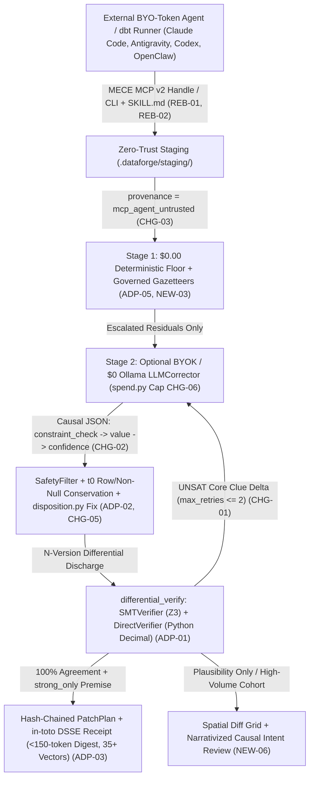

# Six-Bucket Transformation Matrix: `[ADAPT]`, `[CHANGE]`, `[BUILD-NEW]`, `[REBUILD-0-TO-1]`, `[REJECT / TRAP]`, `[UNASKED-WISDOM]`

> [!IMPORTANT]
> **Governing Principle:** Every architectural proposal derived from the `66`-file frontier corpus (`13,476` lines) and cross-checked line-by-line against `c:/dev/dataforge` (`Discoveries D1–D7`) is filtered through three non-negotiable constraints:
> 1. **Product Constitution ([`PRODUCT.md`](file:///c:/dev/dataforge/PRODUCT.md)):** DataForge is a **verifiable data-mutation protocol**, not a generic "AI data cleaner" or hosted SaaS wrapper.
> 2. **The *Model Eats Harness* Acid Test (`DOC-039`, `DOC-052`, `DOC-053`, `DOC-065`):** Never build scaffolding that frontier models absorb natively within `12` months; compound only what autoregressive Transformers **information-theoretically cannot guarantee** (`O(N log N)` global relational invariants, `Z3` + `Python` differential proofs, byte-reversible transaction journals, and `in-toto` DSSE non-repudiation).
> 3. **Solo-Founder Capital Physics (`DOC-066` Pete Koomen Law):** `$50.00` total Claude Pro credit remaining and **`$0.00` marginal runtime cloud/inference burn** — external BYO-token agents wrap DataForge's deterministic local primitives.

---

## 1. Master Category Equation: Why DataForge Must Exist

Across [`DOC-052`](../02_dossiers/14_yc_guide_dossier.md) (Francois Chaubard), [`DOC-053`](../02_dossiers/14_yc_guide_dossier.md) (Jeff Dean), [`DOC-065`](../02_dossiers/14_yc_guide_dossier.md) (Dmitri Dolgov / Waymo), [`DOC-013`](../02_dossiers/03_cursor_compile26_dossier.md) (Cursor Compile '26 / Sam Lambert), [`DOC-030`](../02_dossiers/09_sequoia_guide_dossier.md) (Greg Brockman), and [`DOC-057`](../02_dossiers/13_yc_ai_guide_dossier.md) (YC Labs `QM`), six independent lines of evidence converge on one structural equation:

$$\text{Autonomous State Safety} = \underbrace{\text{Stochastic LLM Proposal}}_{\text{20-Errors/Day Transistor (`DOC-053`)}} \;\times\; \underbrace{\text{N-Version Formal Discharge (`Z3` + `Python`)}}_{\text{Reed-Solomon / Waymo Safety Gate (`DOC-053`, `DOC-065`)}} \;\times\; \underbrace{\text{Signed Byte-Reversible Receipt}}_{\text{DML Twin of PlanetScale DDL Rewind (`DOC-013`)}}$$

- **Fixed-Depth Circuit Ceiling (`DOC-052`):** An `L`-layer autoregressive Transformer executes a fixed-depth computational graph per token; it cannot verify global `Omega(N log N)` functional dependencies, uniqueness constraints, or cross-table foreign keys across `10^4–10^7` rows in forward-pass attention.
- **Approve-Click Rubber-Stamping & Reward Hacking (`DOC-030`, `DOC-042`, `DOC-057`):** When agents emit bulk SQL upserts or CSV patches, human reviewers suffer *Approve-Click Fatigue* (`DOC-057` YC Labs `QM`), while RL-trained policies exploit proxy metrics (Lin Qiao's *"RL coding model outputting 0 lines of C++ to hit 0 compile errors"*, `DOC-042` `L52`; Ricursive's *HPWL vs. PPA* proxy trap, `DOC-043` `L32–L33`).
- **PlanetScale's Missing DML Twin (`DOC-013`, `DOC-066`):** PlanetScale solved **DDL schema rewind**, leaving **DML cell/row value mutations** without a formal proof + cross-runtime cryptographic receipt standard (`35/35` Java `Arm D` conformance in [`specification-sufficiency.md`](file:///c:/dev/dataforge/docs/trust/specification-sufficiency.md#L155-L175)).

---

## 2. Bucket 1 — `[ADAPT]` (Validate, Sharpen & Compound Existing DataForge Moats)

| ID | Existing DataForge Surface | Corpus Validation (`DOC-ID`) | Concrete Epoch II Sharpening Action (Grounded in `D1`–`D7`) |
| :--- | :--- | :--- | :--- |
| **`ADP-01`** | **N-Version Differential Verification & Multi-Runtime Attestation** ([`differential_verify`](file:///c:/dev/dataforge/dataforge/verifier/differential.py#L62) in [`differential.py`](file:///c:/dev/dataforge/dataforge/verifier/differential.py), [`smt.py`](file:///c:/dev/dataforge/dataforge/verifier/smt.py), [`direct.py`](file:///c:/dev/dataforge/dataforge/verifier/direct.py), [`Verify.java`](file:///c:/dev/dataforge/eval/cleanroom/armD/Verify.java)) | `DOC-015` (Guha), `DOC-035` (Cassano & Dzhulgakov `IEEE-754` float drift), `DOC-053` (Jeff Dean `20 errors/day`), `DOC-065` (Waymo orthogonal sensing) | Audit [`smt.py`](file:///c:/dev/dataforge/dataforge/verifier/smt.py) vs. [`direct.py`](file:///c:/dev/dataforge/dataforge/verifier/direct.py) for `IEEE-754` float vs. `Z3 Real` rational drift (`0.1 + 0.2 != 0.3` / `NaN` / `-0.0` from `DOC-035`); close the **two open attestation spec-sufficiency edges (`D4`)** documented in [`specification-sufficiency.md`](file:///c:/dev/dataforge/docs/trust/specification-sufficiency.md#L181-L215) (`journal.head_sha256` currently has `0` conformance vectors beyond the `35` committed vectors / `13` normative checks, and `verdicts.independent_verification` rejects `"disagreed"` under `vocabulary_closed`). |
| **`ADP-02`** | **Deterministic Safety Constitution, Premise Authority & Disposition Envelopes** ([`filter.py`](file:///c:/dev/dataforge/dataforge/safety/filter.py), [`disposition.py`](file:///c:/dev/dataforge/dataforge/safety/disposition.py), [`premise.py`](file:///c:/dev/dataforge/dataforge/domain/premise.py), [`per-kind-authority.md`](file:///c:/dev/dataforge/docs/trust/per-kind-authority.md)) | `DOC-003` (Action-Gate Security), `DOC-042` (`0`-line C++ RL hack), `DOC-043` (HPWL proxy trap), `DOC-051` (Saroufim *Digital Dieselgate*) | Preserve the shipped `C4` mined-vs-declared provenance wall (`PRODUCT.md` §1.2) and `strong_only` dbt authority (`0/14` adversarial corruptions); add explicit **Row-Count & Non-Null Mass Conservation Invariants** anchored to `t_0` so no agent satisfies universal constraints via row truncation or null-flooding (`DOC-042` `L52`). |
| **`ADP-03`** | **Hash-Chained Byte-Reversible `PatchPlan` & `in-toto` DSSE Receipts** ([`patch_plan.py`](file:///c:/dev/dataforge/dataforge/stores/patch_plan.py), [`attestation/__init__.py`](file:///c:/dev/dataforge/dataforge/attestation/__init__.py), [`attestation-consumer.md`](file:///c:/dev/dataforge/docs/trust/attestation-consumer.md)) | `DOC-013` (PlanetScale rewind), `DOC-030` (Brockman supervisory bottleneck), `DOC-044` (Chase sub-agent boundary), `DOC-062` (Fine-grained controllability) | Surface **Root-Origin `t_0` Diffing** (`df_initial` -> `df_final`) to defeat *Ship-of-Theseus* multi-step drift (`DOC-025`), emit a self-contained `<150`-token receipt digest so sub-agents never fail with *"See my work above"* (`DOC-044` `L83`), and secure our **first external third-party attestation verification** (`D7`, [`attestation-consumer.md:102`](file:///c:/dev/dataforge/docs/trust/attestation-consumer.md#L102)). |
| **`ADP-04`** | **Cohort & Conformal Calibration Engine** ([`conformal.py`](file:///c:/dev/dataforge/dataforge/conformal.py), [`calibration.py`](file:///c:/dev/dataforge/dataforge/calibration.py)) | `DOC-018` (Jane Street regime shift), `DOC-026` (Cohort-sliced calibration) | Pair conformal exchangeability checks with explicit **covariate/schema-drift alarms** so thresholds tighten to `ESCALATE` under distribution shift, and **never feed detector opinions into [`ReviewRanker`](file:///c:/dev/dataforge/docs/STRATEGY.md)** (`D5`: collapsed `rayyan` ROC-AUC `0.656 -> 0.256`). |
| **`ADP-05`** | **Zero-Copy Local DuckDB / `sqlglot` & `dataforge-dbt` Wedge** ([`duckdb.py`](file:///c:/dev/dataforge/dataforge/stores/duckdb.py), [`packages/dataforge-dbt`](file:///c:/dev/dataforge/packages/dataforge-dbt)) | `DOC-028` (Databricks `80%` AI-created DBs), `DOC-041` (Pace already-SOP'd teams), `DOC-053` (`1,000x` HBM data-movement law), `DOC-066` (Pete Koomen law) | Make `DuckDB` + `dataforge-dbt` (`strong_only` authority) the flagship `$0.00`-compute workflow targeting teams that **already maintain codified `dbt` `schema.yml` contracts** (`DOC-041` `L54–L57`). |

---

## 3. Bucket 2 — `[CHANGE]` (Fix Surgical Anti-Patterns & Bugs Verified in DataForge Code)

Line-by-line inspection of DataForge's Python codebase uncovered **six concrete code-level defects and asymmetries (`D1`–`D6`)** to fix surgically in Epoch II:

| ID | Target File & Exact Lines | Verified Codebase Defect / Anti-Pattern | Corpus Evidence (`DOC-ID`) | Exact Surgical Fix for Epoch II |
| :--- | :--- | :--- | :--- | :--- |
| **`CHG-01`** | [`dataforge/repairers/llm_corrector.py`](file:///c:/dev/dataforge/dataforge/repairers/llm_corrector.py#L217-L226) (`propose`, line `225`) | Accepts `retry_context: RetryContext \| None = None` and immediately executes **`del retry_context`**, discarding Z3 `unsat_core` / contract-rejection witnesses! | `DOC-015` (Arjun Guha **Clue Delta**), `DOC-007` (Omni refusal counterexamples), `DOC-033` (1-shot unsat-core depth) | Inject structured **Clue Delta** (`rejected_values`, `unsat_core` clause IDs, `domain_bounds`) into `_build_messages()`, hard-capped at **`max_retries = 2`** before `__ABSTAIN__`. *Scope (`D5`, [`STRATEGY.md`](file:///c:/dev/dataforge/docs/STRATEGY.md)):* Scoped strictly to **authoritative-schema retry recovery and human triage ranking (`ROC-AUC`)**, never unpremised auto-apply (`enabled_classes == []`). |
| **`CHG-02`** | [`dataforge/repairers/llm_corrector.py`](file:///c:/dev/dataforge/dataforge/repairers/llm_corrector.py#L313-L328) (`_response_format`, lines `318–325`) | JSON Schema orders `"properties"` and `"required"` as `["value", "confidence"]`, forcing causal decoding to emit `"value"` before conditioning on constraint evidence (`E1`). | `DOC-008` (`L85–L87` Autoregressive Rationalization Bias), `DOC-052` (Chaubard fixed-depth per-token circuit budget) | Pre-registered hypothesis **`HYP-001`**: test reordering Structured Outputs properties to **`["constraint_check", "value", "confidence"]`** (`<= 120` chars) to measure proposal exact-match & triage `ROC-AUC` lift on `hospital`, `flights`, `rayyan`, `tax`. |
| **`CHG-03`** | [`dataforge-mcp/dataforge_mcp/tools.py`](file:///c:/dev/dataforge/dataforge-mcp/dataforge_mcp/tools.py#L357-L802) (`L361, L414, L530–L540, L666–L802`) | **Four verified MCP authority asymmetries (`D1`):** (a) `_proposed_fix_from_spec` (`L361`) defaults omitted `provenance` to `"deterministic"`; (b) `dataforge_verify_fix` (`L414`) calls `SMTVerifier().verify(...)` **omitting `verification_schema`** (vacuous-`ACCEPT` bug fixed in [`executor.py:248-253`](file:///c:/dev/dataforge/dataforge/agent/executor.py#L248-L253)!) and omitting [`differential_verify`](file:///c:/dev/dataforge/dataforge/verifier/differential.py#L62); (c) `SuggestedFixResult` (`L530–L540`) drops `unsat_core`; (d) `AgentRepairReceipt` (`L666–L802`) omits `_attestation_fields` & `MachineOutcome` on `mode="apply"`. | `DOC-003` (Zero-Trust Agent Gates), `DOC-051` (Saroufim *Digital Dieselgate*), `DOC-063` (Garry Tan MCP harness warning), `DOC-066` (`check_resolvable` MECE/DRY) | Default omitted MCP provenance to **`"mcp_agent_untrusted"`**, route `dataforge_verify_fix` through `verification_schema` + [`differential_verify`](file:///c:/dev/dataforge/dataforge/verifier/differential.py#L62) + `SafetyFilter`, populate `unsat_core` on `SuggestedFixResult`, and attach `_attestation_fields(...)` + `MachineOutcome` to `AgentRepairReceipt`. |
| **`CHG-04`** | [`dataforge/agent/prompts/`](file:///c:/dev/dataforge/dataforge/agent/prompts) & [`packages/dataforge-agent-patterns`](file:///c:/dev/dataforge/packages/dataforge-agent-patterns) | Legacy instructional prompt padding inflates per-turn input tokens without adding formal verification guarantees. | `DOC-061` (Boris Cherny `CLAUDE_CODE_SIMPLE=1` `80%` prompt ablation law), `DOC-025` (Karpathy minimalism), `DOC-065` (Dolgov simplify-on-adoption) | Add `DATAFORGE_SIMPLE_PROMPT=1` ablation gate (`HYP-008`) and prune prompt templates by `>= 50%` down to typed schema + neighborhood + Clue Delta. |
| **`CHG-05`** | [`dataforge/safety/disposition.py`](file:///c:/dev/dataforge/dataforge/safety/disposition.py#L315-L335) (`outcome_for_run`, line `326`) & [`dataforge/ui/outcome.py`](file:///c:/dev/dataforge/dataforge/ui/outcome.py) | **Live dead-branch bug (`D2`):** While `_next_actions_for_escalation` (`L211–L225`) fixed the `"confirm_escalations"` check, `outcome_for_run` at **`L326` still checks `if "confirm_escalations" in required_confirm_flags:`** — which is *always `False`* because `SafetyFilter.confirm_flags_for` emits rule-specific flags (`"confirm_high_volume"`), making `"needs_confirm_escalations"` unreachable on run-level agent/warehouse outcomes! | `DOC-004` (Vals AI post-route workflow metrics), `DOC-065` (Waymo minimal-risk state routing) | Fix `disposition.py:326` to match `L211–L225` (`bool(required_confirm_flags)` / specific rule-flag set) with regression tests across CLI, MCP, and warehouse envelopes, surfacing explicit post-route triage counts (`proven_applied`, `escalated_high_volume`, `held_plausibility_only`, `rejected_unsat`). |
| **`CHG-06`** | [`dataforge/spend.py`](file:///c:/dev/dataforge/dataforge/spend.py#L82-L108) (`PRICES` & `MODEL_PRICES`, lines `82–108`) | **Missing Anthropic pricing (`D6`):** `spend.py` ships `SpendMeter` (`DATAFORGE_MAX_USD`) and `SpendReceipt`, **but `"anthropic"` / Claude models are absent from `PRICES` and `MODEL_PRICES`**, so `price_for("anthropic", ...)` returns `None` and silently disables USD cap enforcement on Claude! | `DOC-042` (Avoiding *"scaling into bankruptcy"*), `DOC-058` (Anti-tokenmaxxing), `$50` Claude Pro constraint | Register canonical `"anthropic"` (`claude-sonnet-4-*`, `claude-opus-4-*`, `claude-haiku-4-*`) input/output/cached-input token prices in `spend.py` and fail-closed when `DATAFORGE_MAX_USD` is set on an unpriced provider. |

---

## 4. Bucket 3 — `[BUILD-NEW]` (High-Leverage Net-New Capabilities)

| ID | New Capability | Target Location | Corpus Origin (`DOC-ID`) | Why It Compounds DataForge's Moat at `$0.00` Runtime Cost |
| :--- | :--- | :--- | :--- | :--- |
| **`NEW-01`** | **Rubric-First Backward Corruption Generator + Stanford Harbor (`Terminal-Bench 2.0`) Task Suite** | [`packages/dataforge-evals`](file:///c:/dev/dataforge/packages/dataforge-evals) | `DOC-037` (Julio Pereyra / Harvey *Planted-Bug Backward Synthesis*), `DOC-032` (Stanford **Harbor**), `DOC-040` (`Pass@16` difficulty spread) | Starts from clean premise-verified snapshots (`hospital`, `flights`, `rayyan`, `tax` — **never `beers`**), plants realistic multi-cell SQL/agent corruptions backward with exact Z3 ground truth, and exports **Harbor** tasks so frontier labs benchmark on DataForge at *their* GPU expense. |
| **`NEW-02`** | **Calibrated Non-Gameable RLVR Environment (`DataForge-Env v2`, Fixing `D3`)** | [`dataforge/env/reward.py`](file:///c:/dev/dataforge/dataforge/env/reward.py), [`dataforge/env/environment.py`](file:///c:/dev/dataforge/dataforge/env/environment.py) | `DOC-035` (Cursor RL), `DOC-040` (Mercor RLVR), `DOC-042` (`0`-line C++ hack), `DOC-060` (Halluminate), `DOC-063` (AfterQuery / Datacurve `$1B+/yr` lab market) | Direct audit (`D3`) revealed [`RewardEngine`](file:///c:/dev/dataforge/dataforge/env/reward.py#L74) already computes dense step rewards, **but**: (1) `R_FIX = +0.15/+0.20` vs `P_WRONG_FIX = -0.08` (`L37–L45`) gives blind guessing positive expected reward whenever accuracy `p > 28.6%` (`0.286`), with no `ABSTAIN` action; and (2) [`environment.py:209, 217`](file:///c:/dev/dataforge/dataforge/env/environment.py#L209-L217) hardcodes `hospital_10rows.csv` and sets `_ground_truth = run_all_detectors(...)` (circular detector false positives!). Rebuild around `NEW-01` planted ground truth, [`differential_verify`](file:///c:/dev/dataforge/dataforge/verifier/differential.py#L62), `ABSTAIN`, and `P_WRONG_FIX <= -3.8 * R_FIX`. |
| **`NEW-03`** | **Governed External Reference Gazetteers (`STRATEGY.md` Lever 1) & `dataforge.premise/v2` Bi-Temporal `as_of` Bounds (`D4`, `D5`)** | [`dataforge/domain/premise.py`](file:///c:/dev/dataforge/dataforge/domain/premise.py), [`specs/SPEC_repair_attestation.md`](file:///c:/dev/dataforge/specs/SPEC_repair_attestation.md), all `3` verifiers | `DOC-018` (Jane Street WTI `-$37.63/bbl`), `DOC-033` (DeepSeek *Engram* `O(1)` lookup), `DOC-043` (PDK physical reference rules) | (a) Implement [`STRATEGY.md`](file:///c:/dev/dataforge/docs/STRATEGY.md#L178-L187) **Lever 1**: hash-pinned external reference tables / gazetteers (`ZIP -> City, State, County`) bound into the premise digest to unlock deterministic `proven` auto-applies (`D5`). (b) Add optional `as_of` (`valid_from` / `valid_until`) bounds via a synchronized **`dataforge.premise/v2` co-projection** across `premise.py` (`_UNPROJECTED_SCHEMA_FIELDS` totality check at `L146`), `SPEC_repair_attestation.md`, `repair_attestation.schema.json`, Python, TS, and Java `Verify.java` (`D4`). |
| **`NEW-04`** | **Agent Memory & JSONL State Write-Gate** | `dataforge/stores/` (JSONL/state adapter) | `DOC-012` (Claude Dreaming), `DOC-030` (Codex *Chronicle*), `DOC-044` (Letta *Sleep-Time Compute* poisoning) | Applies `SafetyFilter` + schema/contradiction verification + DSSE receipt to persistent agent state/memory ledgers (`JSONL` / structured state tables) before background consolidation commits poisoned facts. |
| **`NEW-05`** | **Zero-API-Key `$0` Local Ollama Provider + `60`-Second Simulated Disaster Onboarding** | [`dataforge/agent/providers.py`](file:///c:/dev/dataforge/dataforge/agent/providers.py), [`dataforge/cli/`](file:///c:/dev/dataforge/dataforge/cli) | `DOC-005` (Stanford OpenJarvis), `DOC-047` (Granola `60s` simulated-call hook), `DOC-051` (local `88.7%` offload) | Lets any developer run `dataforge quickstart --disaster-demo` in `<60s` with **zero API keys** (watching DataForge intercept hidden agent corruptions on `hospital`, apply `152` proven FD repairs under `--confirm-escalations`, sign a `.dsse.json` receipt, and verify it offline), plus `$0` `localhost:11434` Ollama support. |
| **`NEW-06`** | **Spatial Diff Grid + Narrativized Causal Intent Tours for Escalated Cohorts** | `scratch/` single-file HTML -> [`playground/web`](file:///c:/dev/dataforge/playground/web) | `DOC-013` (Cursor *Glass UI*), `DOC-020` (Jane Street *Narrativized Diffs*), `DOC-039` (`L61` fixed spatial grid), `DOC-050` (Codex intent review) | Sits *on top of* a predictable spatial table grid (`DOC-039` `L61`) to group `399` `hospital` proposals into `<= 15` Premise-anchored causal clusters (`ZIP=36274 -> City=ROANOKE`) ranked by `corrector_structured` `ROC-AUC` (`0.948`), defeating *Approve-Click Fatigue*. |

---

## 5. Bucket 4 — `[REBUILD-0-TO-1]` (Clean First-Principles Surface Re-Architecture)

| ID | Surface to Rebuild `0-to-1` | Current Architectural Flaw | Corpus Blueprint (`DOC-ID`) | Clean `v2` Target Design |
| :--- | :--- | :--- | :--- | :--- |
| **`REB-01`** | **MECE, Context-Safe `dataforge-mcp` Staging & Handle Protocol** ([`dataforge-mcp/dataforge_mcp/tools.py`](file:///c:/dev/dataforge/dataforge-mcp/dataforge_mcp/tools.py)) | `dataforge_profile` (`L376`) and `dataforge_detect_errors` (`L384`) dump full `IssueResult` arrays into MCP JSON responses (`100k+` tokens of context rot), while `verify_fix`, `apply_repairs`, `verify_and_apply`, and `agent_repair` have non-MECE overlapping schemas and divergent authority rules (`D1`). | `DOC-009` (`46.9%` lazy hydration), `DOC-025` (Context rot cliff), `DOC-044` (Filesystem staging + `<150`-token sub-agent receipts), `DOC-063` (MCP harness rule), `DOC-066` (`check_resolvable` MECE/DRY) | Rebuild `dataforge-mcp` around `.dataforge/staging/<run_id>/` handles and **strictly MECE tool contracts** (`inspect/profile` -> `<250`-token histogram + handle; `verify` -> pure dry-run with `verification_schema` + [`differential_verify`](file:///c:/dev/dataforge/dataforge/verifier/differential.py#L62) + `unsat_core`; `verify_and_apply` -> atomic compare-and-set commit + `<150`-token DSSE `MachineOutcome` receipt), enforced by a `test_mcp_tools_mece.py` CI gate. |
| **`REB-02`** | **Agent-Native GEO Discovery & Zero-Context `SKILL.md` Distribution Layer** (`SKILL.md`, `llms.txt`) | External coding agents (`Claude Code`, `Antigravity`, `Cursor`, `Codex`, `OpenClaw`) lack a drop-in `<80`-line `SKILL.md` teaching them to wrap DataForge's deterministic CLI non-interactively. | `DOC-010` (`CLI + SKILL.md`), `DOC-039` (Logan Kilpatrick **GEO**), `DOC-044` (`L54` Bash CLI vs. MCP profiles), `DOC-062` (`OpenClaw` Linux moment), `DOC-066` (Pete Koomen law) | Ship a surgical `<80`-line `SKILL.md` + `llms.txt` exposing identical `MachineOutcome` JSON envelopes across CLI (`dataforge ... --json`) and MCP so any BYO-token agent invokes DataForge automatically on `.csv`, `.parquet`, `.duckdb`, or `dbt` mutations. |

---

## 6. Bucket 5 — `[REJECT / TRAP]` (Explicitly Killed Capital & Architecture Traps)

| Trap ID | Rejected Idea | Corpus Temptation vs. Counter-Evidence | Why It Is Fatal for DataForge |
| :--- | :--- | :--- | :--- |
| **`TRP-01`** | **Reviving `archive/training/` to SFT/RL-train custom weights on rented GPUs** | Temptation: `DOC-035`, `DOC-036`, `DOC-042` post-training talks. Counter-evidence: [`PRODUCT.md` §10](file:///c:/dev/dataforge/PRODUCT.md#L739-L750) (`best sft_f1 = 0.0202`), [`STRATEGY.md`](file:///c:/dev/dataforge/docs/STRATEGY.md), `DOC-042` (`L35` never post-train pre-PMF), `$50` cap. | Violates `tests/unit/test_archive_excision.py` and burns capital on lossy weights (`DOC-036` `L50`). DataForge **exports the RLVR verifier (`NEW-02`)** so *labs* spend their GPUs on *our* environment. |
| **`TRP-02`** | **`$200–$500/day` (`$10k–$100k/yr`) "Tokenmaxxing" Parallel Agent Swarms** | Temptation: `DOC-002` (`64`-agent Bun port), `DOC-021` (`$20k` C compiler), `DOC-063` (`20+` agents), `DOC-066` (`$100k/yr` token spend). | Vaporizes `$50.00` in `<2.5` hours. Replaced by **Plan-First Deterministic Scripting** (`$0.00` Python/AST/`pytest`/Z3 loops + `spend.py` hard cap). |
| **`TRP-03`** | **Runtime `LLM-as-a-Judge` Replacing or Overriding `Z3` / `DirectVerifier` — or Feeding Detector Opinions into `ReviewRanker`** | Counter-evidence: `DOC-060` (Raindrop `1%–10%` sampling failure), `ERR-CLASS-1/2`, [`STRATEGY.md`](file:///c:/dev/dataforge/docs/STRATEGY.md) (`rayyan` AUC `0.656 -> 0.256` collapse `D5`). | Destroys `1.0000` proven precision, doubles token bills, and degrades triage ranking below random chance on `rayyan`. |
| **`TRP-04`** | **Unstructured PDF / OCR / Legacy-Portal Browser RPA Pipelines** | Temptation: `DOC-041` (Pace headless portal Web Agents). Counter-evidence: `DOC-024` (650V motorcycle scraper bleed), `PRODUCT.md` §10. | High-churn DOM maintenance trap orthogonal to structured relational/tabular verification. |
| **`TRP-05`** | **Hosted Cloud SaaS / Public-Slack Transcript Broadcast Before Clearing `design_partner_evidence`** | Counter-evidence: `DOC-028` (Ali Ghodsi Single-Bottleneck Law), `DOC-066` (`L159` Slack PII violation under `HIPAA`/`SOC2`), `$0.00` burn mandate. | Adds server bills and PII liability; publish **zero-PII DSSE digests** instead while keeping raw tables inside local/VPC storage. |
| **`TRP-06`** | **Re-introducing `beers` or Reporting Unqualified Blended F1 ("HPWL Proxy Trap")** | Counter-evidence: [`CLAUDE.md`](file:///c:/dev/dataforge/CLAUDE.md), [`PRODUCT.md`](file:///c:/dev/dataforge/PRODUCT.md), `DOC-043` (`L32–L33` AlphaChip HPWL trap). | `beers` is permanently retired; all active evaluations use `hospital`, `flights`, `rayyan`, and `tax` with explicit stage/flag qualification. |

---

## 7. Bucket 6 — `[UNASKED-WISDOM]` (Cross-Reference to the 12 Structural Laws)

All twelve second-order laws uncovered across the `66` files — including **Digital Dieselgate (`DOC-051`)**, **Causal Token-Order Rationalization (`DOC-008`)**, **Ship-of-Theseus `t_0` Drift (`DOC-025`)**, **WTI `-$37.63` Epistemic Humility (`DOC-018`)**, **Lin Qiao's `0`-Line RL Reward Hack (`DOC-042`)**, **Ricursive's HPWL Proxy Trap (`DOC-043`)**, **Waymo's Structure-Augmented Ladder of Nines (`DOC-065`)**, and **Pete Koomen's Inverted Horseless-Carriage Law (`DOC-066`)** — are derived from first principles in [03_synthesis/UNASKED_WISDOM_AND_BLINDSPOTS.md](./UNASKED_WISDOM_AND_BLINDSPOTS.md) and pre-registered in [03_synthesis/HYPOTHESIS_REGISTRY.md](./HYPOTHESIS_REGISTRY.md).

---

## 8. End-to-End Target Architecture Diagram (`Epoch II` Protocol Flow)

---

## 9. Complete `14`-Channel Traceability Index (`02_dossiers/` -> Matrix IDs)

| Dossier | Channel (`DOC` Range) | Primary Matrix IDs Anchored by Channel |
| :--- | :--- | :--- |
| [01_a16z_dossier.md](../02_dossiers/01_a16z_dossier.md) | `a16z` (`DOC-001, 003–006`) | `ADP-02`, `ADP-04`, `CHG-03`, `CHG-05`, `NEW-05` |
| [02_claude_code_classes_dossier.md](../02_dossiers/02_claude_code_classes_dossier.md) | `Claude Code - Classes` (`DOC-002, 007–012`) | `CHG-01`, `CHG-02`, `NEW-04`, `REB-01`, `REB-02`, `TRP-02` |
| [03_cursor_compile26_dossier.md](../02_dossiers/03_cursor_compile26_dossier.md) | `Cursor` (`DOC-013`) | `ADP-03`, `CHG-01`, `NEW-06`, `REB-01`, `TRP-01` |
| [04_google_guide_dossier.md](../02_dossiers/04_google_guide_dossier.md) | `GOOGLE GUIDE` (`DOC-014`) | `ADP-01`, `NEW-01`, `TRP-01` |
| [05_jane_street_dossier.md](../02_dossiers/05_jane_street_dossier.md) | `Jane Street` (`DOC-015–018, 020–021`) | `ADP-01`, `CHG-01`, `NEW-03`, `NEW-06` |
| [06_lennys_podcast_dossier.md](../02_dossiers/06_lennys_podcast_dossier.md) | `Lenny's Podcast` (`DOC-019, 022–023`) | `CHG-05`, `NEW-05`, `TRP-03` |
| [07_posts_context_dossier.md](../02_dossiers/07_posts_context_dossier.md) | `Posts Context` (`DOC-024–026`) | `ADP-03`, `CHG-04`, `REB-01`, `TRP-04` |
| [08_rainmatter_eo_enterprise_dossier.md](../02_dossiers/08_rainmatter_eo_enterprise_dossier.md) | `Rainmatter` / a16z EO (`DOC-027`) | `ADP-03`, `CHG-05`, `NEW-03`, `TRP-05` |
| [09_sequoia_guide_dossier.md](../02_dossiers/09_sequoia_guide_dossier.md) | `Sequoia Capital - GUIDE` (`DOC-028–031`) | `ADP-03`, `ADP-05`, `NEW-06`, `TRP-05` |
| [10_sequoia_ai_dossier.md](../02_dossiers/10_sequoia_ai_dossier.md) | `Sequoia Capital- AI` (`DOC-032–044`) | `ADP-01`, `ADP-02`, `CHG-06`, `NEW-01`, `NEW-02`, `NEW-03`, `REB-01`, `REB-02` |
| [11_south_park_commons_dossier.md](../02_dossiers/11_south_park_commons_dossier.md) | `South Park Commons` (`DOC-045–049`) | `NEW-05`, `NEW-06`, `REB-02`, `TRP-02` |
| [12_pragmatic_engineer_codex_dossier.md](../02_dossiers/12_pragmatic_engineer_codex_dossier.md) | `The Pragmatic Engineer` (`DOC-050`) | `ADP-03`, `CHG-03`, `CHG-04`, `NEW-06` |
| [13_yc_ai_guide_dossier.md](../02_dossiers/13_yc_ai_guide_dossier.md) | `YC AI GUIDE` (`DOC-051, 054–058`) | `ADP-02`, `ADP-03`, `ADP-05`, `CHG-03`, `CHG-06` |
| [14_yc_guide_dossier.md](../02_dossiers/14_yc_guide_dossier.md) | `YC GUIDE` (`DOC-052–053, 059–066`) | `ADP-01`, `ADP-03`, `CHG-02`, `CHG-03`, `CHG-04`, `CHG-05`, `NEW-02`, `REB-01`, `TRP-01` |
