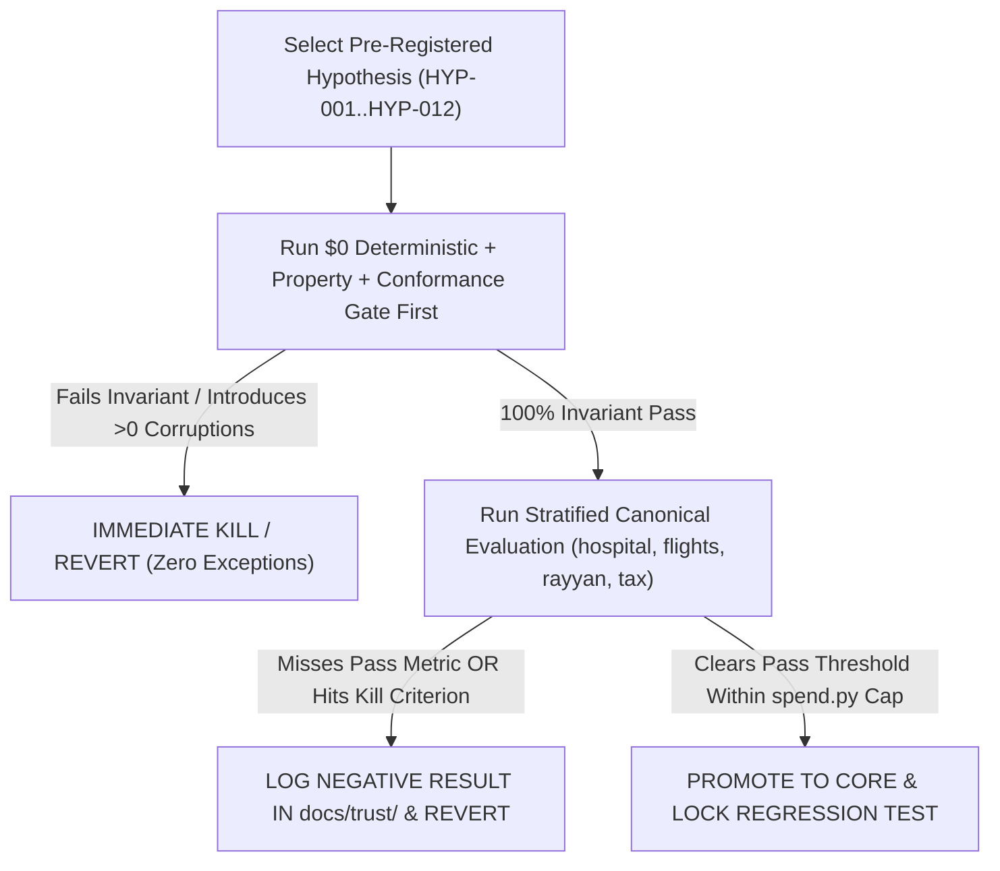

# Pre-Registered Epoch II Hypothesis Registry (`HYP-001`..`HYP-012`)

> [!IMPORTANT]
> **Epistemic Discipline ([`PRODUCT.md` Section 5](file:///c:/dev/dataforge/PRODUCT.md) & [`STRATEGY.md`](file:///c:/dev/dataforge/docs/STRATEGY.md)):** Every technical, UX, and distribution bet extracted from the `66`-file corpus (`DOC-001`..`DOC-066`) and grounded in `c:/dev/dataforge` (`Discoveries D1–D7`) is registered **before** Epoch II implementation with:
> 1. **Exact Baseline Measurement** (citing repo source lines, evaluation arm, and flags — e.g., `hospital` `1,000` rows, `20` columns, `8,223` declared-premise FD violations, `399` candidate repairs, `152/509` proven writes under `--confirm-escalations` in [`declared-premise-capability.md`](file:///c:/dev/dataforge/docs/trust/declared-premise-capability.md) & [`fd-repair-scalability.md`](file:///c:/dev/dataforge/docs/trust/fd-repair-scalability.md)).
> 2. **Falsifiable Prediction & Quantitative Pass Threshold.**
> 3. **Explicit Kill Criterion** — if an intervention fails its gate on `hospital`, `flights`, `rayyan`, or `tax` (**`beers` is permanently excluded**), it is reverted and logged as a negative result in `docs/trust/`.

---

## 1. Master Hypothesis Summary Table

| `HYP-ID` | Domain | Linked Matrix ID & `DOC-ID` | Target Code Surface | Token Cost | Primary Pass Metric | Kill Criterion |
| :--- | :--- | :--- | :--- | :---: | :--- | :--- |
| **`HYP-001`** | Causal JSON Ordering (Triage & Premised Proposal) | `CHG-02` (`DOC-008` `L85–L87`, `DOC-052`) | [`llm_corrector.py`](file:///c:/dev/dataforge/dataforge/repairers/llm_corrector.py#L313-L328) | `<$2.50` (`$0` Ollama dev) | Measurable lift (`95%` CI `> 0`) in proposal exact-match or review-queue `ROC-AUC` (vs. `0.948` `hospital` baseline, `D5`) at `0` corruption increase (`enabled_classes == []` unpremised preserved) | `95%` CI negative or `< +0.5` pp lift with `> +25%` token overhead |
| **`HYP-002`** | Z3 Clue-Delta Retry Recovery | `CHG-01` (`DOC-015`, `DOC-007`, `DOC-033`) | [`llm_corrector.py`](file:///c:/dev/dataforge/dataforge/repairers/llm_corrector.py#L217-L226) (`del retry_context` at `L225`) | `<$3.00` (`max_retries=2`) | `>= 30%` of Round-1 Z3/contract-rejected proposals under authoritative schemas converted to valid witness or clean `__ABSTAIN__` within `<= 2` retries (`0` corruptions) | Any false-positive write under authoritative schema (`precision < 1.0000`) or `> 1.8x` tokens per accepted cell |
| **`HYP-003`** | MECE MCP Staging & Context Diet | `REB-01` (`DOC-009`, `DOC-044`, `DOC-066`) | [`dataforge-mcp/dataforge_mcp/tools.py`](file:///c:/dev/dataforge/dataforge-mcp/dataforge_mcp/tools.py) | `$0.00` (deterministic) | `>= 85%` reduction in MCP response tokens on `hospital` (`1,000` rows, `8,223` FD violations) + `<150`-token sub-agent receipt digest + `100%` `check_resolvable` MECE pass | Any stale-handle race, loss of drill-down recall, or MCP regression |
| **`HYP-004`** | Zero-Trust MCP `4`-Asymmetry Closure (`D1`) | `CHG-03` (`DOC-003`, `DOC-051`, `DOC-063`) | [`tools.py`](file:///c:/dev/dataforge/dataforge-mcp/dataforge_mcp/tools.py#L361-L802) (`L361, L414, L530, L666`) | `$0.00` (deterministic) | `100%` closure of all `4` `tools.py` asymmetries: `mcp_agent_untrusted` default, `verification_schema` + [`differential_verify`](file:///c:/dev/dataforge/dataforge/verifier/differential.py#L62) in `verify_fix`, `unsat_core` exposed, and DSSE fields on `AgentRepairReceipt` | `> 0` vacuous `ACCEPT`s or spoofed-provenance writes (`0` tolerance) |
| **`HYP-005`** | Exact Rational / Decimal Parity & Spec Vectors (`D4`) | `ADP-01` (`DOC-035`, `DOC-042`, `DOC-065`) | [`smt.py`](file:///c:/dev/dataforge/dataforge/verifier/smt.py), [`direct.py`](file:///c:/dev/dataforge/dataforge/verifier/direct.py), [`Verify.java`](file:///c:/dev/dataforge/eval/cleanroom/armD/Verify.java) | `$0.00` (prop + conformance) | `0` disagreements across `10,000` `Decimal`/`IEEE-754` boundary vectors AND `100%` (`1.0000`) parity across Python, TS, & Java `Arm D` on `35+` vectors including `journal.head_sha256` & `"disagreed"` (`D4`) | Any cross-verifier divergence or `> 15%` median latency regression |
| **`HYP-006`** | `t_0` Conservation, `disposition.py:326` & `spend.py` Guards (`D2`, `D6`) | `ADP-02`, `CHG-05`, `CHG-06` (`DOC-042`, `DOC-058`) | [`disposition.py`](file:///c:/dev/dataforge/dataforge/safety/disposition.py#L326), [`cumulative.py`](file:///c:/dev/dataforge/dataforge/safety/cumulative.py), [`spend.py`](file:///c:/dev/dataforge/dataforge/spend.py#L82-L108) | `$0.00` (deterministic) | `100%` block on `t_0` row/null-truncation hacks; `"needs_confirm_escalations"` reachable in `outcome_for_run` (`L326`); `price_for("anthropic", ...)` enforces `DATAFORGE_MAX_USD` | Any false block of declared dedup rules or unpriced-provider cap bypass |
| **`HYP-007`** | Governed Reference Gazetteers (`Lever 1`) & `premise/v2` `as_of` (`D4`, `D5`) | `NEW-03` (`DOC-018`, `DOC-033`, `DOC-043`) | [`premise.py`](file:///c:/dev/dataforge/dataforge/domain/premise.py#L146), [`schema.py`](file:///c:/dev/dataforge/dataforge/verifier/schema.py) | `$0.00` (deterministic) | Hash-pinned `ZIP -> City, State, County` gazetteer unlocks new `1.0000`-precision `proven` auto-applies on `hospital`/`tax` (`$0` LLM); `as_of` regime fixtures pass `_UNPROJECTED_SCHEMA_FIELDS == frozenset()` | Any `1` false-positive corruption or break in `spec_correspondence.py` |
| **`HYP-008`** | `DATAFORGE_SIMPLE_PROMPT=1` Ablation (`50%+` Diet) | `CHG-04` (`DOC-061`, `DOC-025`, `DOC-065`) | [`dataforge/agent/prompts/`](file:///c:/dev/dataforge/dataforge/agent/prompts) | `<$2.00` | `>= 50%` reduction in input prompt tokens per step with `>=` baseline verified repair yield and `ROC-AUC` on `hospital` and `flights` | Verified repair F1 drops `> 0.01` or `ROC-AUC` drops `> 0.015` |
| **`HYP-009`** | Rubric-First Planted-Bug + Harbor Export (`Pass@16` Calibrated) | `NEW-01` (`DOC-037`, `DOC-032`, `DOC-040`) | [`packages/dataforge-evals`](file:///c:/dev/dataforge/packages/dataforge-evals) | `$0.00` (local generator) | `20` deterministic planted-bug Harbor tasks (`hospital`, `flights`, `rayyan`, `tax`) with Z3-verified ground truth, `0` contamination, and calibrated `Pass@16` spread (`0 < Pass@16 < 16`, `DOC-040`) | Any task lacks unique formal ground truth or saturates `16/16` trivially |
| **`HYP-010`** | Anti-Reward-Hacking `DataForgeEnv` (`p > 28.6%` Fix, `D3`) | `NEW-02` (`DOC-035`, `DOC-040`, `DOC-042`, `DOC-060`, `DOC-063`) | [`reward.py`](file:///c:/dev/dataforge/dataforge/env/reward.py#L37-L45), [`environment.py`](file:///c:/dev/dataforge/dataforge/env/environment.py#L209-L217) | `$0.00` (deterministic) | Replaces `hospital_10rows.csv` & circular `run_all_detectors` ground truth with planted manifests; `P_WRONG_FIX <= -3.8 * R_FIX` + `ABSTAIN` ensures blind guessing (`p < 0.80`) & `5` exploit policies score `< 0` | Any synthetic exploit (`blind_guesser`, `null_flooder`, `row_truncator`) beats calibrated `ABSTAIN` |
| **`HYP-011`** | Spatial Grid + Narrativized Causal Intent Diffs | `NEW-06` (`DOC-013`, `DOC-020`, `DOC-039` `L61`, `DOC-045`) | `scratch/` single-file HTML -> [`playground/web`](file:///c:/dev/dataforge/playground/web) | `<$4.00` | Groups `hospital`'s `399` declared-premise proposals (`152` proven under `--confirm-escalations`) atop a fixed spatial grid into `<= 15` causal clusters reviewable in `<90s` | Hides cell-level `old -> new` witnesses, feeds detector opinions into `ReviewRanker`, or breaks `verify.ts` |
| **`HYP-012`** | `60s` Zero-Key Disaster Demo & Third-Party Verified Rescue PRs (`D7`) | `NEW-05` (`DOC-037`, `DOC-041`, `DOC-047`, `DOC-065`) | [`quickstart.py`](file:///c:/dev/dataforge/dataforge/cli/quickstart.py) + `10` `dbt` PRs | `<$6.00` | `<60s` offline cold-start (`0` API keys) AND `>= 3` external `dbt`/data maintainers verify a `.dsse.json` receipt they did not produce ([`attestation-consumer.md:102`](file:///c:/dev/dataforge/docs/trust/attestation-consumer.md#L102), `design_partner_evidence: MET`) | `< 2` positive maintainer responses across `10` `strong_only` `dbt` PRs -> pivot target segment immediately |

---

## 2. Detailed Experimental Protocols for Top Priority Epoch II Cycles

### Protocol A — `HYP-001` + `HYP-002`: Causal Schema Ordering & Z3 Clue-Delta (`llm_corrector.py`, Scoped by `D5`)
1. **Constitutional Scope (`STRATEGY.md:123–420`):** Per DataForge's `5` pre-registered experiments, neural proposals on unpremised columns remain strictly `enabled_classes == []` (propose/rank-only, never auto-applied), and detector opinions are **never** fed into `ReviewRanker`.
2. **Stratified Canonical Slices:** `50`-issue slices across `hospital` (declared premise), `flights` (schedule conflict abstention), `rayyan` (bibliographic triage `ROC-AUC`), and `tax` (FD + rate constraints) — **strictly excluding `beers`**.
3. **Arms:**
   - **Control (`A0`):** Current [`LLMCorrector`](file:///c:/dev/dataforge/dataforge/repairers/llm_corrector.py) (`del retry_context` at `L225`; `["value", "confidence"]` at `L318–L325`).
   - **Treatment 1 (`A1`):** `_response_format` properties ordered `["constraint_check", "value", "confidence"]`.
   - **Treatment 2 (`A2`):** `A1` + injecting `RetryContext` (`unsat_core`, `rejected_values`, `domain_bounds`) on Z3/schema rejection (`max_retries=2`).
4. **Metrics Recorded (Stage & Flag Qualified):** Proposal exact match, human triage `ROC-AUC` (95% bootstrap CI), post-[`differential_verify`](file:///c:/dev/dataforge/dataforge/verifier/differential.py#L62) + `SafetyFilter` applied precision (`must equal 1.0000` under `strong_only` schema), calibrated `__ABSTAIN__` rate, tokens, and `spend.py` USD receipt.

### Protocol B — `HYP-003` + `HYP-004`: MECE, Context-Safe, Zero-Trust `dataforge-mcp` (`tools.py`, `D1`)
1. **Workload:** Invoke `dataforge_profile`, `dataforge_detect_errors`, `dataforge_verify_fix`, and `dataforge_agent_repair` on full `hospital` (`1,000` rows, `8,223` declared-premise FD violations) and `tax`.
2. **Red-Team & MECE Checks (`25` Deterministic Test Vectors):**
   - Omitted `provenance` (`L361`), spoofed `provenance="deterministic"`, vacuous-schema `verify_fix` (`L414`), `IEEE-754` vs. `Z3` rational mismatch, missing `unsat_core` (`L530`), and `mode="apply"` receipt verification (`L666`).
   - Automated `test_mcp_tools_mece.py` verifying non-overlapping tool schemas (`DOC-066` `check_resolvable`) and `<250`-token summary / `<150`-token receipt budgets (`DOC-044`).

### Protocol C — `HYP-009` + `HYP-010`: Planted-Bug Harbor Suite & Calibrated RLVR (`DataForgeEnv`, `D3`)
1. **Backward Corruption Construction (`DOC-037`):** Start from clean premise-verified snapshots of `hospital`, `flights`, `rayyan`, and `tax`. Apply deterministic multi-cell bug operators (off-by-one join shift, `UPDATE` missing `WHERE`, `100x` decimal slip, timezone/date swap, `5%` row truncation).
2. **Eliminating `D3` Circularity & Guessing Loopholes:**
   - Replace [`environment.py:209, 217`](file:///c:/dev/dataforge/dataforge/env/environment.py#L209-L217) (`hospital_10rows.csv` + `run_all_detectors`) with planted ground-truth manifests discharged by [`differential_verify`](file:///c:/dev/dataforge/dataforge/verifier/differential.py#L62).
   - Recalibrate [`reward.py:37-45`](file:///c:/dev/dataforge/dataforge/env/reward.py#L37-L45) from `(R_FIX=+0.15/+0.20, P_WRONG_FIX=-0.08)` (where blind guessing wins above `28.6%` accuracy!) to `P_WRONG_FIX <= -3.8 * R_FIX` with an explicit small-positive/zero calibrated `ABSTAIN` action on under-determined cells.
   - Stress-test against `5` adversarial policies (`blind_guesser` at `p = 0.50`, `null_flooder`, `row_truncator`, `abstain_everything`, `schema_mutator`).

---

## 3. Recursive Re-Planning Cadence ("Plan and Redo Again and Again")

Per [`00_CHARTER_AND_METHODOLOGY.md`](../00_CHARTER_AND_METHODOLOGY.md), Epoch II executes in **five falsification loops**:
- **Loop 1 (`$0.00` spend):** `HYP-006` (`spend.py` Anthropic prices `D6` + `disposition.py:326` fix `D2` + `t_0` conservation), `HYP-005` (`Decimal`/Z3 parity + `35+` cross-runtime spec vectors closing `journal.head_sha256` & `"disagreed"` `D4`), `HYP-003` & `HYP-004` (`tools.py` `4` asymmetries `D1` + `.dataforge/staging/` handles), and `HYP-007` (governed reference gazetteers `D5` + `dataforge.premise/v2` `as_of`).
- **Loop 2 (`<$5.50` spend):** `HYP-001`, `HYP-002`, `HYP-008` (`llm_corrector.py` causal JSON order, Z3 Clue Delta, and `DATAFORGE_SIMPLE_PROMPT=1` — prototyped on `$0` mocks/Ollama first under `spend.py` cap).
- **Loop 3 (`$0.00` spend):** `HYP-009`, `HYP-010` (Planted-bug Harbor export + `DataForgeEnv` `p > 28.6%` & ground-truth rebuild `D3`).
- **Loop 4 (`<$4.00` spend):** `HYP-011`, `REB-02` (Single-file HTML Spatial Grid + Intent Diffs -> `playground/web`, plus `<80`-line `SKILL.md` & `llms.txt` GEO surface).
- **Loop 5 (`<$6.00` spend):** `HYP-012` (`60`-second `--disaster-demo` + `10` `strong_only` `dbt` rescue PRs securing `>= 3` external third-party receipt verifications to flip `design_partner_evidence: MET` `D7`).

---

## 4. Canonical Dataset Baseline & Qualification Table (`beers` Permanently Excluded)

| Dataset | Primary Error & Constraint Topology | Verified Baseline Behavior (`PRODUCT.md` & `docs/trust/`) | Target Epoch II Hypotheses Tested |
| :--- | :--- | :--- | :--- |
| **`hospital`** (`1,000` rows, `20` cols) | Functional dependencies (`ZIP -> City, State, County`, `ProviderNumber -> HospitalName, Phone, Address`), domain rules (`8,223` declared-premise FD violations; `509` real errors) | Proposal-stage `F1 0.8352` (`399` declared-premise proposals); default `dataforge repair --schema` writes `0` (`NO_HIGH_VOLUME_AUTO_APPLY`); **`--confirm-escalations` writes `152/509` at `1.0000` precision, `0` corruptions (`F1 0.4599`)**; `corrector_structured` lifts triage `ROC-AUC` `0.554 -> 0.948` (`top-10` precision `0.800`) | `HYP-001`, `HYP-002`, `HYP-003`, `HYP-007` (gazetteer lift), `HYP-008`, `HYP-009`, `HYP-011` |
| **`flights`** | Multi-source schedule conflict (`flight-number -> arrival/departure time` genuine real-world ambiguity; entity consensus) | `0.0000` deterministic; `F1 0.4467` with `allow_entity_consensus` (vs. Cocoon `0.57` at `0.91` precision, non-protocol-comparable per `PRODUCT.md` `L684–L693`) | `HYP-001`, `HYP-002` (calibrated `__ABSTAIN__`), `HYP-009`, `HYP-010` |
| **`rayyan`** | Messy bibliographic / systematic-review metadata, high false-positive risk under naive rules | Flooded queue precision lifted `~5% -> ~41%` by `ReviewRanker` (`tools.py:429–430`), whereas feeding detector opinions collapsed `ROC-AUC` `0.656 -> 0.256` (`STRATEGY.md` `D5`) | `HYP-001`, `HYP-004`, `HYP-006`, `HYP-009`, `HYP-011` |
| **`tax`** | Relational FDs (`ZIP/State -> TaxRate`, marital/exemption rules, exact `Decimal` precision & historical rate shifts) | `1.0000` deterministic precision under authoritative FDs; canonical testbed for `Decimal` vs. `Z3` parity, reference gazetteers, and `as_of` tax-year bounds | `HYP-005`, `HYP-006`, `HYP-007`, `HYP-009`, `HYP-010` |

---

## 5. Pre-Registered Falsification Decision Flow

### Non-Negotiable Statistical & Reporting Rules for Epoch II

1. **Zero Silent Corruptions Under Authoritative Schema:** Any hypothesis (`HYP-001`..`HYP-012`) causing even `1` constraint-violating cell write (`precision < 1.0000` on `proven` auto-applied mutations under `strong_only` schema) is **automatically rejected**.
2. **Four-Column Stage & Flag Transparency:** Every benchmark table must report side-by-side: *(1) Proposal-Stage Yield / Triage `ROC-AUC`*, *(2) Default Auto-Applied Yield (`no flags`)*, *(3) Confirmed Cohort Yield (`--confirm-escalations`)*, and *(4) Held / Abstained Count (`held_fixes`)*.
3. **Negative Results Are First-Class Citizens:** Falsified hypotheses remain documented with exact measured CIs in `docs/trust/`.

---

## 6. Reproducible Verification Command Mapping (`Epoch II` CI Gates)

1. **Core Invariant, Correspondence, Multi-Runtime Conformance & Property Gates (`HYP-004`, `HYP-005`, `HYP-006`, `HYP-007`):**
   - `pytest tests/property/test_no_corruption_invariant.py -q`
   - `python scripts/ci/attestation_conformance.py` & `Verify.java` (`Arm D` across all `35+` committed conformance vectors and `13` normative checks)
   - `python scripts/ci/spec_correspondence.py` & `python scripts/ci/claim_coverage.py`
   - `pytest tests/unit/test_archive_excision.py tests/regression/test_env.py -q`
2. **MECE MCP Context-Diet & `4`-Asymmetry Red-Team Gate (`HYP-003`, `HYP-004`):**
   - `pytest dataforge-mcp/tests/ -q` (`<= 250` summary tokens, `<150` receipt tokens, `MECE` check, and `25` spoofed-provenance / vacuous-schema vectors)
3. **Causal JSON, Clue-Delta & Prompt-Diet Gate (`HYP-001`, `HYP-002`, `HYP-008`):**
   - Prototyped at `$0.00` on deterministic mocks + local Ollama, then validated under [`dataforge/spend.py`](file:///c:/dev/dataforge/dataforge/spend.py) (`DATAFORGE_MAX_USD=1.50` with `"anthropic"` rates registered) across `hospital`, `flights`, `rayyan`, `tax`.
4. **Planted-Bug Harbor Export & Calibrated RLVR Gate (`HYP-009`, `HYP-010`):**
   - `pytest packages/dataforge-evals/ tests/unit/ -k "env or planted or reward" -q`
5. **Cold-Start Disaster Onboarding & External Consumer Receipt Gate (`HYP-011`, `HYP-012`, `D7`):**
   - `dataforge quickstart --disaster-demo` (`<60s`, `0` API keys, verified `.dsse.json`) + `dataforge release full-vision` (`design_partner_evidence: MET`).
