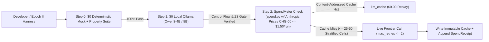

# The `$50` Solo-Founder Playbook: Zero-Marginal-Burn Engineering, Distribution & Design-Partner Rescue

> [!IMPORTANT]
> **Hard Capital & Compute Boundary:**
> - **Team Size:** `1` solo founder (`pranesh`).
> - **Remaining Paid Frontier Token Reserve:** **`$50.00` total Claude Pro credit**.
> - **Runtime Cloud / Server / Paid Inference Mandate:** **`$0.00 / month`** (`0` hosted database bills, `0` rented GPUs, `0` founder-paid LLM API keys bundled into user traffic).
> - **North-Star Ambition (`D7`):** Ship the definitive open verification standard for autonomous data mutations, clear **`design_partner_evidence: NOT MET -> MET`** ([`docs/ROADMAP_FULL_VISION.md`](file:///c:/dev/dataforge/docs/ROADMAP_FULL_VISION.md)) plus external third-party receipt verification ([`attestation-consumer.md:102`](file:///c:/dev/dataforge/docs/trust/attestation-consumer.md#L102)), and scale organically to millions of developer and agent runs worldwide.

---

## 1. Asymmetric Physics: Pete Koomen's Law & Why `$50` Beats `$50M` Here

Most AI startups in the `66`-file corpus require `$10M–$1B+` (`DOC-036`, `DOC-042`, `DOC-043`, `DOC-064`) because their unit of value is **hosted GPU training or vendor-subsidized inference**. DataForge obeys **Pete Koomen's Inverted Horseless-Carriage Law (`DOC-066` `L69, L98`)**: instead of building a hosted web app wrapping a founder-paid LLM key, DataForge ships **deterministic, local verification & cryptographic attestation primitives (`differential_verify` + `PatchPlan` + `in-toto` DSSE) wrapped BY the user's own external agent or CI runner**:

1. **Marginal Cost of `1,000,000` DataForge Verifications to Founder:** **`$0.00`**. Every `pip install`, `dataforge-dbt` gate, GitHub Action run, clean-room Java `Verify.java` (`Arm D`) check, and local `MCP` call executes on the user's CPU (`DOC-005` OpenJarvis / `DOC-053` local compute physics).
2. **BYOK / `$0` Local Inference for Optional Semantic Triage:** Whenever [`LLMCorrector`](file:///c:/dev/dataforge/dataforge/repairers/llm_corrector.py) is invoked for escalated human-review ranking, inference runs against **the user's own local Ollama / `llama.cpp` endpoint (`$0.00`)** (`DOC-005`, `DOC-051`) or the user's BYOK key — **never** DataForge's wallet.
3. **Lab Subsidization via Benchmarks (`DOC-032`, `DOC-037`, `DOC-040`, `DOC-063`):** Publishing DataForge tasks in **Stanford Harbor (`Terminal-Bench 2.0`)** and **RLVR (`DataForge-Env v2`)** induces model labs (`~$1B+/yr` external RLverifier market in `DOC-063` `L62`) and benchmark harnesses (`Vals AI` `DOC-004`) to run *their* GPUs against *our* verifier.

---

## 2. Exact `$50.00` Claude Credit Ledger (Zero-Waste Allocation)

Every `$1.00` of remaining Claude credit is guarded in code by [`dataforge/spend.py`](file:///c:/dev/dataforge/dataforge/spend.py) (**after registering `"anthropic"` pricing per `CHG-06` / `D6`**) and banned from repetitive loops (`TRP-02`):

| Tranche | Allocation | Permitted Use | Strictly Forbidden Use (`$0` Local Substitute) |
| :--- | :---: | :--- | :--- |
| **Tranche 1 — Spec & Formal Invariant Adversarial Review** | **`$12.00`** | Deep architectural critique of `SPEC_*.md` updates (`dataforge.premise/v2`, `journal.head_sha256` & `"disagreed"` vectors `D4`), Z3/Decimal parity proofs (`ADP-01`), and `in-toto` DSSE threat modeling. | Bulk file formatting, boilerplate generation, or multi-file refactors (use local Python AST / `ruff` / `pytest` for `$0.00`). |
| **Tranche 2 — Cached `LLMCorrector` Clue-Delta & Causal JSON Gate (`CHG-01`, `CHG-02`)** | **`$10.00`** | Content-addressed (`_write_cache` in [`llm_corrector.py`](file:///c:/dev/dataforge/dataforge/repairers/llm_corrector.py#L293)) stratified validation slices on `hospital`, `flights`, `rayyan`, and `tax` *after* `100%` control-flow verification on `$0` mocks and local Ollama (`Qwen3-4B`/`8B`). | Uncached multi-sample sweeps (`samples=5` x `1,000` rows), unpriced provider calls (`D6`), or retry loops beyond `max_retries = 2`. |
| **Tranche 3 — Single-File HTML Spatial Diff Prototyping (`NEW-06`, `DOC-045`)** | **`$8.00`** | One-shot standalone single-file HTML prototypes for *Spatial Grid + Narrativized Causal Intent Diffs* (`DOC-013`, `DOC-020`, `DOC-039` `L61`, `DOC-045` Thariq Shihipar workflow) before porting to [`playground/web`](file:///c:/dev/dataforge/playground/web). | Iterative multi-agent screenshot/DOM loops (`DOC-063` `20+`-agent burn trap). |
| **Tranche 4 — Design-Partner PR Rescue & Harbor Task Polish (`DOC-037`, `DOC-041`)** | **`$10.00`** | Auditing `10` active open-source repos that **already maintain `dbt` `schema.yml` contracts** (`DOC-041` `L54–L57`) to ship zero-false-positive rescue PRs (`DOC-037` `L171` Harvey `r/legaladvice` 100-question playbook). | Cold-email spam generation or generic marketing copywriting. |
| **Tranche 5 — Strategic Emergency Reserve (Untouched Floor)** | **`$10.00`** | **Hard circuit-breaker reserve (`20%`).** Untouched unless resolving a live production blocker for an active external design partner. | Any exploratory or speculative prompt. |

---

## 3. Five Zero-Burn Engineering Multipliers (`DOC-005`, `DOC-007`, `DOC-012`, `DOC-045`, `DOC-061`)

1. **Deterministic Script First, LLM Last (`DOC-007`, `DOC-012`, `DOC-032` "Codexification"):** Whenever a task touches `>3` files, computes hashes, checks links, audits MECE tool schemas (`DOC-066`), or runs evaluations, write a deterministic Python script (`$0.00` replay cost, `100%` reproducibility).
2. **Governed Reference Gazetteers Before LLM Calls (`STRATEGY.md` Lever 1, `DOC-033`):** Use `$0.00` hash-pinned reference lookup tables (`ZIP -> City, State, County`) for deterministic `proven` repairs (`D5`), invoking LLMs only on unresolved semantic ambiguities.
3. **Single-File HTML Before React (`DOC-045`):** Prototyping complex diff/escalation UIs in one zero-build `.html` file in `scratch/` costs `10x` fewer tokens than iterating across multi-file TypeScript/Vite bundles.
4. **Prompt Diet & Handle-Based Staging (`DOC-009`, `DOC-044`, `DOC-061`):** Pruning legacy prompt scaffolding via `DATAFORGE_SIMPLE_PROMPT=1` (`CHG-04`) and replacing raw MCP JSON dumps with `.dataforge/staging/` handles (`REB-01`) cuts per-session token burn by `2x–10x`.
5. **Strict Scope Excision (`DOC-028`, `DOC-042`, `PRODUCT.md` §10):** Zero work on `archive/training/`, zero cloud SaaS hosting, zero `beers` usage, and zero new sub-packages until `design_partner_evidence` flips to `MET`.

---

## 4. Zero-CAC Distribution Engine: How `1` Developer Reaches Millions

Across the corpus, four zero-ad-spend distribution mechanisms repeatedly produced category leaders (`Granola` `DOC-047`, `Harvey` `DOC-037`, `DeepMind/GEO` `DOC-039`, `Cursor` `DOC-013`, `Waymo` `DOC-065`, `YC/Koomen` `DOC-066`):

### Engine 1 — The `60`-Second Simulated Disaster Hook (`DOC-047` Granola Playbook)
- **Why Granola Won Onboarding (`DOC-047`):** Chris Pedregal shipped a built-in simulated meeting so new users hit the "aha!" moment in `<60` seconds without waiting for a live call.
- **DataForge Adaptation (`NEW-05`):** Without an authored Premise, `dataforge repair` conservatively writes `0` cells (`PRODUCT.md` `L63–L82`). `dataforge quickstart --disaster-demo` runs in `<60` seconds with **zero API keys**: an agent attempts a bulk cleanup containing hidden corruptions alongside `152` valid FD repairs on `hospital`'s declared premise; DataForge blocks every corruption via [`differential_verify`](file:///c:/dev/dataforge/dataforge/verifier/differential.py#L62), applies the `152` proven fixes (demonstrating `--confirm-escalations`), signs an `in-toto` `.dsse.json` receipt, and verifies it cross-runtime!

### Engine 2 — Zero-PII Cryptographic PR Receipts (`DOC-065`, `DOC-066`, `attestation-consumer.md`)
- Solving `DOC-066`'s (`L159`) Slack PII dilemma, every GitHub Action / `dataforge-dbt` check posts a **zero-PII verifiable receipt summary**:
  > **`DataForge Verified Mutation`** — `152` cells proven (`SMTVerifier + DirectVerifier` `100%` agreement under `strong_only` premise), `0` corruptions, `247` ambiguous cells held, byte-reversible (`sha256:8f3a... -> sha256:c19d...`). Verify offline (Python, TS, or zero-dep Java 17 `Verify.java` — `35/35` spec vectors).
- Every merged PR in an open-source repo demonstrates DataForge to contributors and auditors at **`$0.00` CAC**.

### Engine 3 — GEO (*Generative Engine Optimization*) & MECE Skills (`DOC-010`, `DOC-039`, `DOC-062`, `DOC-066`)
- Ship `llms.txt` + a `<80`-line `SKILL.md` (`REB-02`) compatible with `Claude Code`, `Antigravity`, `Cursor`, `Codex`, and `OpenClaw` (`DOC-062` `L22`). When developers ask their agent to *"clean/migrate this CSV or dbt seed safely"*, the agent discovers and wraps DataForge automatically.

### Engine 4 — Benchmark Gravity via Stanford Harbor & RLVR (`DOC-032`, `DOC-037`, `DOC-040`, `DOC-063`)
- Contribute `DataForge-Harbor-v1` (`20` planted-bug tabular tasks across `hospital`, `flights`, `rayyan`, `tax` — never `beers`) to the `Terminal-Bench / Harbor` ecosystem and expose calibrated `DataForgeEnv` (`NEW-02`) to open RLVR researchers.

---

## 5. The `14`-Day Design-Partner Rescue Sprint (`design_partner_evidence: NOT MET -> MET`)

Combining **Weinberg & Pereyra's `r/legaladvice` 100-question wedge at Harvey (`DOC-037` `L171`)**, **Jamie Cuffe's "Already-SOP'd" workflow filter at Pace (`DOC-041` `L54–L57`)**, and **Waymo's third-party safety verification (`DOC-065` `L88–L90`)**:

1. **Target Qualification (`DOC-041` Filter):** Target **active open-source & high-velocity data teams that *already* maintain `dbt` `schema.yml` (`not_null`, `unique`, `accepted_values`, `relationships`) or explicit CSV/Parquet schemas on GitHub** — avoiding unpremised tables where `enabled_classes == []`.
2. **Zero-Ask Rescue PR + Independent Verification (`D7`):**
   - Ingest their existing `dbt` `schema.yml` under `strong_only` authority (`0/14` adversarial corruptions in [`per-kind-authority.md`](file:///c:/dev/dataforge/docs/trust/per-kind-authority.md)).
   - Open a surgical PR catching real deterministic violations with a signed `.dsse.json` bundle **and** the 1-line command (`python verify_standalone.py` or `java Verify.java`) so the maintainer **independently verifies an attestation they did not produce** — directly closing [`attestation-consumer.md:102`](file:///c:/dev/dataforge/docs/trust/attestation-consumer.md#L102)!
3. **Convert `>= 3` Named Design Partners:** Wire `dataforge-dbt` / GitHub Actions into `>= 3` repositories with `48`-hour responsiveness (`DOC-046`), recording audited evidence in `docs/evidence/` for **`<$10` in tokens and `$0` cash**.

---

## 6. Operational Spend-Guard Architecture (`spend.py` Hard Cap Enforcement)

### Concrete Operational Guardrails During Epoch II

| Guardrail Rule | Mechanism in `c:/dev/dataforge` | Failure Prevented |
| :--- | :--- | :--- |
| **Rule 0 — Register Anthropic Pricing First (`CHG-06`, `D6`)** | Populate `"anthropic"` rates in [`dataforge/spend.py:82-108`](file:///c:/dev/dataforge/dataforge/spend.py#L82-L108) and fail-closed if `price_for(...) is None` when `DATAFORGE_MAX_USD` is set. | Closes the live gap where `price_for("anthropic", ...)` returns `None` and bypasses USD caps! |
| **Rule 1 — Default Offline Mode** | `allow_llm = False` in [`llm_corrector.py`](file:///c:/dev/dataforge/dataforge/repairers/llm_corrector.py#L192) and `mode = "dry_run"` in [`controller.py`](file:///c:/dev/dataforge/dataforge/agent/controller.py#L89). | Zero accidental API calls during `pytest` or CI runs. |
| **Rule 2 — Per-Run Ceiling (`$1.50` Max)** | Pre-flight `estimate_usd` + `SpendMeter` (`DATAFORGE_MAX_USD=1.50`) in [`spend.py`](file:///c:/dev/dataforge/dataforge/spend.py). | Prevents runaway `N`-row x `5`-sample loops (`TRP-02`). |
| **Rule 3 — `max_retries = 2` Clue-Delta Circuit Breaker** | After `2` Z3 rejections with Clue-Delta feedback (`CHG-01`), deterministic fallback to `__ABSTAIN__`. | Eliminates solver-LLM ping-pong on under-determined cells (`flights`). |
| **Rule 4 — Zero Paid Infra Dependencies** | Local `.csv`/`.parquet`/[`duckdb.py`](file:///c:/dev/dataforge/dataforge/stores/duckdb.py) + `z3-solver` + Python `Decimal` + local `Ed25519` DSSE + Java 17 `Verify.java`. | Preserves `$0.00/month` fixed burn from `1` to `1,000,000` users. |

---

## 7. Cycle-by-Cycle Execution Sequence After User Authorizes Epoch II

| Phase | Target Deliverables | Max Claude Credit Burn | External Proof Artifact Produced |
| :--- | :--- | :---: | :--- |
| **Cycle A — Spec Lock & Spend/Disposition Fixes** | Ship `CHG-06` (`spend.py` Anthropic prices), `CHG-05` (`disposition.py:326` fix), and `D4` spec vectors (`journal.head_sha256`, `"disagreed"`, `dataforge.premise/v2` spec). | **`$0.00`–`$4.00`** | `35+` green conformance vectors across Python, TS, and Java `Arm D`. |
| **Cycle B — Zero-Burn MCP, Parity & Gazetteer Hardening** | Ship `CHG-03` + `REB-01` (`tools.py` 4 asymmetries + MECE `.dataforge/staging/` handles), `ADP-01` (`Decimal`/Z3 parity), `ADP-02` (`t_0` conservation), `NEW-03` (reference gazetteers + `as_of`). | **`$0.00`** | `100%` green `backend_gate.py`, `spec_correspondence.py`, & `10,000`-vector property suite. |
| **Cycle C — Clue-Delta & Causal JSON Triage Calibration** | Ship `CHG-01` (`retry_context` Clue Delta), `CHG-02` (`constraint_check`-first JSON), `CHG-04` (`DATAFORGE_SIMPLE_PROMPT=1`), and `$0` Ollama adapter (`NEW-05`). | `<= $8.00` | Reproducible cached proposal/triage `ROC-AUC` table on `hospital`, `flights`, `rayyan`, `tax`. |
| **Cycle D — Harbor Benchmark, Calibrated RLVR & Spatial UI** | Ship `NEW-01` (Planted-Bug Harbor suite), `NEW-02` (`reward.py` `p > 28.6%` fix + `environment.py` planted ground truth), `REB-02` (`SKILL.md` + `llms.txt`), `NEW-06` (Spatial Grid + Intent Diffs), and `60s` `--disaster-demo`. | `<= $10.00` | Public `Harbor` task pack + anti-reward-hacking `DataForgeEnv` + `<60s` offline demo. |
| **Cycle E — `14`-Day Design-Partner Rescue Sprint (`D7`)** | Execute `10` zero-false-positive `strong_only` `dbt` rescue PRs with third-party receipt verification (`Verify.java` / `verify_standalone.py`); onboard `>= 3` named partners. | `<= $10.00` (`$18.00+` kept in reserve) | **`design_partner_evidence: NOT MET -> MET`** + external consumer verification in `docs/evidence/`. |
